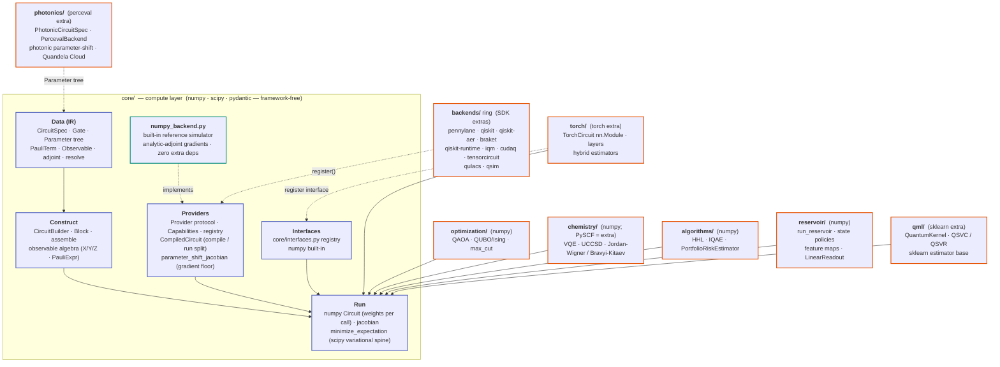
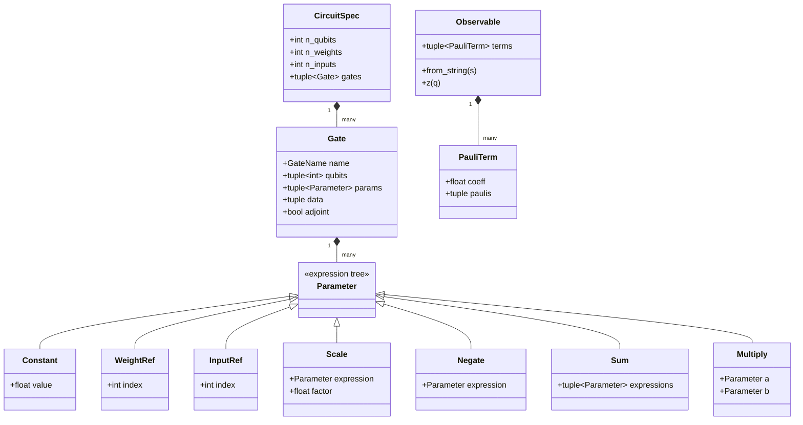
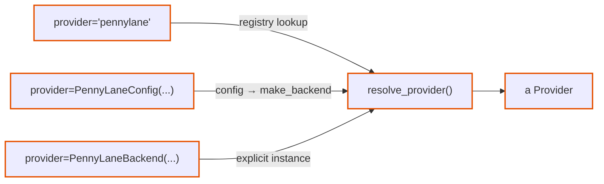
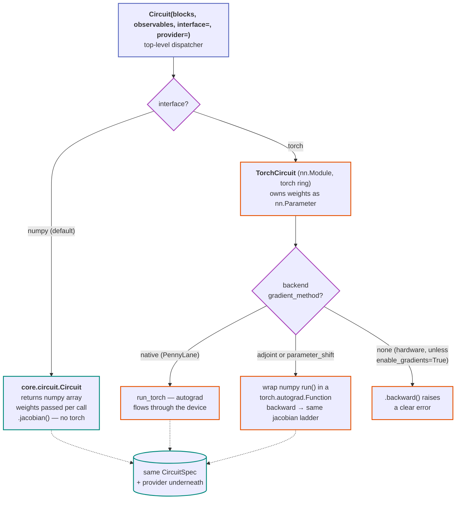
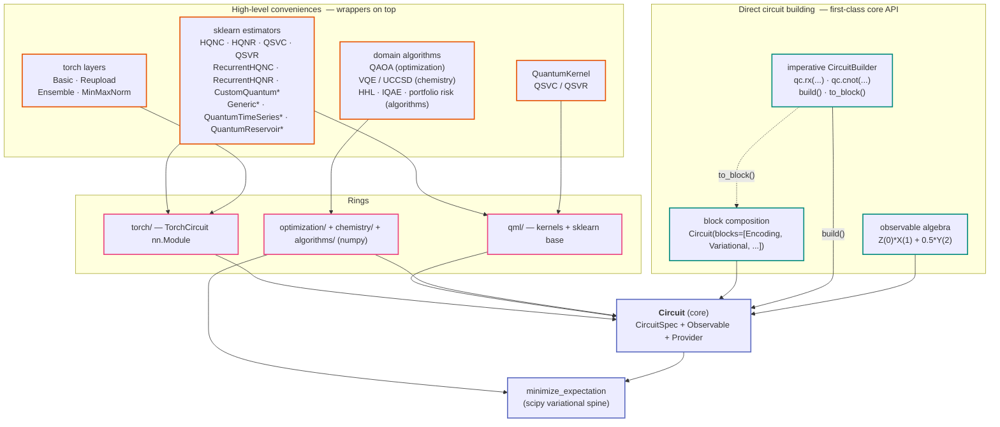

# Architecture: How eigenkit is organised

This guide provides an overview of `eigenkit`'s architecture, from its main
components to the internal representation and execution of quantum circuits.
It covers four key aspects:

1. **Library structure.** How the core library connects to optional backends,
   application modules, and framework integrations.
2. **Circuit execution.** How a circuit is processed, from its definition to
   execution on a selected backend.
3. **Circuit representation.** How `CircuitSpec` provides a common,
   provider-neutral representation of quantum circuits.
4. **Backends and interfaces.** How different execution providers and
   user-facing interfaces fit into the architecture.

At the center of `eigenkit` is a lightweight core built on NumPy and SciPy,
which represents quantum circuits independently of any execution provider
through `CircuitSpec`. Additional functionality, including external backends,
application-specific modules, and integrations with classical frameworks, is
organised into optional layers that depend on the core, while keeping the core
independent of them.

---

## 1. The library structure: Core and optional modules

`eigenkit` is built around a lightweight, framework-independent core that uses
only NumPy, SciPy, and Pydantic. This core contains the essential components for
defining, compiling, and executing quantum circuits, including a built-in
simulator.

Additional functionality is organised into optional modules that extend the
core without introducing new dependencies into it. Quantum SDK backends connect
through the provider registry, while integrations with classical frameworks use
the interface registry. Application-specific modules, such as optimization and
quantum chemistry, build on the core's variational optimization tools.

Importing `eigenkit` loads only the core components. Additional modules are
loaded when needed.

Two additional packages provide utilities for working with quantum models
without being part of the circuit execution architecture:

- **Datasets (`datasets/`).** Built-in datasets and exploratory data analysis
  (EDA) tools.
- **Benchmarking (`benchmark/`).** Multi-seed experiments and comparisons
  against classical machine-learning baselines.

These tools interact with the library through the scikit-learn estimator
interface rather than directly through the core execution layer.

The architecture follows a simple dependency rule: all optional modules depend
on the core, but the core never depends on them. This separation is enforced in
continuous integration (CI) using import-linter.

The built-in NumPy simulator is the only execution backend included directly in
the core. It serves as the reference implementation against which other
backends are validated, helping ensure consistent behavior across providers.

---

## 2. Data flow: From circuit definition to execution

The execution of a quantum circuit in `eigenkit` follows three main stages:

1. **Construction.** Define a circuit using predefined blocks, `CircuitBuilder`,
   or a combination of both. The result is a `CircuitSpec`, a provider-neutral
   representation of the circuit.
2. **Compilation.** Convert the `CircuitSpec` into the native representation
   required by the selected backend. This step prepares the circuit for
   execution and is performed only once, allowing the compiled objects to be
   reused.
3. **Execution and differentiation.** Run the compiled circuit or compute its
   gradients using `run()` and `jacobian()`. These operations can be called
   repeatedly with different parameter values without recompiling the circuit.

```mermaid
flowchart LR
    subgraph BUILD["① Construct (once)"]
        direction TB
        B["blocks=[Encoding, Variational, ...]"]
        BLD["CircuitBuilder<br/>qc.rx(...) · qc.cnot(...)"]
        ASM["assemble()<br/>relocate local WeightRef/InputRef<br/>into the global frame"]
        SPEC[("CircuitSpec<br/>+ Observable(s)")]
        B --> ASM --> SPEC
        BLD -- "build()" --> SPEC
        BLD -. "to_block()" .-> B
    end

    subgraph COMPILE["② provider.compile() (once)"]
        direction TB
        VAL["validate spec vs Capabilities<br/>(gates, max_qubits)"]
        CC[["CompiledCircuit<br/>cached native objects:<br/>matrices · qnodes · parametric QuantumCircuit · Pauli ops"]]
        VAL --> CC
    end

    subgraph CALL["③ Per call"]
        direction TB
        FWD["circuit(weights, inputs)<br/>resolve Parameter exprs<br/>→ expectation array"]
        JAC["circuit.jacobian(weights, inputs)<br/>d⟨O⟩ / d(weights)"]
    end

    SPEC --> VAL
    CC --> FWD
    CC --> JAC

    JAC --> GRADOFF{"gradient_method<br/>= none?"}
    GRADOFF -- "yes (hardware, unless<br/>enable_gradients=True)" --> REFUSE["raises: train on a simulator,<br/>or opt in"]
    GRADOFF -- "no" --> GRADPATH{"backend has<br/>its own jacobian?"}
    GRADPATH -- "yes (adjoint: numpy, Qulacs,<br/>TensorCircuit; PennyLane autodiff)" --> NATIVE["use it directly"]
    GRADPATH -- "no (Qiskit, Aer, Braket, CUDA-Q, qsim;<br/>hardware with enable_gradients=True)" --> PS["core parameter-shift<br/>f(θ+π/2) − f(θ−π/2) / 2"]
    class REFUSE stage;
    class GRADOFF branch;
    PS --> UNSAFE{"angles wrap weights<br/>in Scale/Multiply/Sum?"}
    UNSAFE -- "no" --> FASTPS["naive shift (fast path)"]
    UNSAFE -- "yes" --> CHAIN["chain-rule jacobian<br/>Σ (∂θ/∂wᵢ)·(∂⟨O⟩/∂θ)"]

    classDef stage stroke:#5c6bc0,stroke-width:2px;
    classDef data stroke:#00897b,stroke-width:2px;
    classDef branch stroke:#e65100,stroke-width:2px;
    class B,BLD,ASM,VAL,FWD,JAC,NATIVE,PS,FASTPS,CHAIN stage;
    class SPEC,CC data;
    class GRADPATH,UNSAFE branch;
```

### Why separate compilation from execution?

Creating backend-specific objects, such as a Qiskit `QuantumCircuit` or a
PennyLane device, can be significantly more expensive than evaluating an already
compiled circuit. By separating compilation from execution, `eigenkit` avoids
rebuilding these objects for every forward or backward pass, reducing overhead
during repeated evaluations and variational optimization.

For hardware backends, compilation may also include device-specific
transpilation. In Qiskit Runtime and IQM (with the default
`transpile_mode="parametric"`), this transformation is performed once, allowing
subsequent executions with different parameter values to reuse the transpiled
circuit.

---

## 3. The data model: `CircuitSpec` and symbolic parameters

All backends in `eigenkit` use the same provider-neutral representation: a
`CircuitSpec` together with a list of `Observable` objects.

One important feature of this representation is that gate angles can be
symbolic expressions rather than fixed numerical values. Instead of specifying
an angle directly, users can define expressions such as `2π·x₀` or `w₀·x₁`,
where `x` represents input data and `w` represents trainable parameters. This
allows circuits to support operations such as feature scaling without requiring
users to preprocess their data, while also enabling transformations such as
`adjoint` to operate on parameterised gates.

### Symbolic parameter expressions

The parameter tree has three types of leaf nodes:

- `Constant`: A fixed numerical value.
- `WeightRef`: A reference to a trainable parameter.
- `InputRef`: A reference to an input feature.

These nodes can be combined using four supported operators. In particular,
`Multiply` allows two symbolic expressions to be multiplied together, enabling
operations such as trainable feature scaling in
`Reuploading(trainable_scale=True)`. Because both operands can depend on
parameters, these expressions require the chain rule when computing gradients,
as illustrated in the data flow diagram in Section 2.

| Node | Meaning | Use case |
|---|---|---|
| `Constant(0.5)` | literal | `RX(0.5)` |
| `WeightRef(3)` | `weights[3]` | trainable rotations |
| `InputRef(0)` | `inputs[0]` | data encoding |
| `Scale(expression, factor)` | `factor · expression` | `RY(2π·x)` |
| `Negate(expression)` | `−expression` | adjoint of a trainable |
| `Sum(expressions)` | `e1 + e2 + …` | data reuploading |
| `Multiply(a, b)` | `a · b` (bilinear) | trainable feature scaling |

### Gate representation

Each gate contains additional information beyond its parameter expressions:

- `Gate.data` stores data that cannot be represented as a single angle, such as
  the state vector used by `AmplitudeEncoding` or the matrix defining a
  `QubitUnitary`.
- `Gate.adjoint` indicates whether a gate has been inverted by the `adjoint`
  transformation.
- `Gate.name` identifies the gate using one of the predefined names in
  `GateName`, ensuring that only supported gate types can be represented.

### Observables and Pauli terms

Measurements are represented using `Observable` objects, which are composed of
`PauliTerm` elements. Each `PauliTerm` has two main components:

- `coeff`: A real-valued coefficient, ensuring that the observable represents a
  Hermitian operator. Providing a complex coefficient raises a `TypeError` that
  identifies the invalid value.
- `paulis`: A tuple of `(Pauli operator, qubit index)` pairs, such as
  `(("Z", 0), ("X", 1))`, rather than a dictionary or mapping.

Together, these structures provide a consistent representation of circuits and
observables that can be interpreted by different execution backends.

---

## 4. The backend landscape: One protocol, many providers

All backends implement the same `Provider` protocol over `CircuitSpec +
Observable`. They differ in how they get gradients, how they represent symbolic
parameters, and whether they support async submission to cloud/QPU hardware.

```mermaid
flowchart TB
    PROTO["<b>Provider protocol</b><br/>compile(spec, observables) → CompiledCircuit<br/>Capabilities · run() · optional submit()"]

    subgraph LOCAL["Local simulators"]
        NP["<b>numpy</b> — default<br/>grads: adjoint (exact)<br/>auto-registered · no deps"]
        PL["<b>pennylane</b><br/>grads: native autodiff<br/>run_torch: autograd through the device"]
        QK["<b>qiskit</b><br/>grads: parameter-shift<br/>statevector sim"]
        BL["<b>braket (local)</b><br/>grads: parameter-shift<br/>LocalSimulator"]
        CQ["<b>cudaq</b> (opt-in)<br/>grads: parameter-shift<br/>restricted param exprs"]
        AER["<b>qiskit-aer</b> / <b>-mps</b><br/>grads: parameter-shift<br/>dense core · matrix-product-state"]
        TC["<b>tensorcircuit</b><br/>grads: jax autodiff<br/>tensor-network · jax.vmap"]
        QL["<b>qulacs</b><br/>grads: adjoint (backprop)<br/>fast C++ statevector"]
        QS["<b>qsim</b><br/>grads: parameter-shift<br/>single-precision (fp32)"]
    end

    subgraph CLOUD["Cloud / QPU &nbsp;(async submit() · CostWarning · dry_run_info)"]
        BC["<b>braket (cloud/QPU)</b><br/>config switch via device_arn<br/>QPU: shots&gt;0 · grads=none<br/>unless enable_gradients=True"]
        QR["<b>qiskit-runtime</b> (opt-in)<br/>IBM Eagle/Heron + FakeBackends<br/>grads=none unless enable_gradients=True<br/>transpile + EstimatorV2/SamplerV2"]
        IQ["<b>iqm</b><br/>IQM Resonance + local noise-modelled devices<br/>grads=none unless enable_gradients=True<br/>counts-only, shots&gt;0"]
    end

    PROTO --> NP & PL & QK & BL & CQ
    PROTO --> AER & TC & QL & QS
    PROTO --> BC & QR & IQ

    classDef proto stroke:#5c6bc0,stroke-width:2px;
    classDef sim stroke:#00897b,stroke-width:2px;
    classDef cloud stroke:#ec407a,stroke-width:2px;
    class PROTO proto;
    class NP,PL,QK,BL,CQ,AER,TC,QL,QS sim;
    class BC,QR,IQ cloud;
```

The `provider=` argument is **polymorphic** — the same slot accepts three
shapes, each obvious at the call site:

---

## 5. Interface dispatch: NumPy and PyTorch

The **interface** decides what the top-level `Circuit(...)` returns. The default
is numpy (framework-free, weights passed per call). `interface="torch"` returns
a `TorchCircuit` nn.Module that *owns* its weights — but it's the same
`CircuitSpec` and the same provider underneath. The torch machinery lives in
the torch ring and registers into the core interface registry lazily, so a
numpy-only environment never imports torch.

---

## 6. The user-facing stack: Two ways to work with eigenkit

`eigenkit` provides two complementary ways to develop quantum applications:
building circuits directly or using high-level components. Both rely on the same
underlying architecture, allowing users to choose the level of abstraction that
best suits their needs.

### Direct circuit construction

The circuit-building API provides full control over circuit design and
execution. Users can define circuits in different ways:

- **Predefined blocks.** Compose reusable `Block` objects to construct circuits
  declaratively, such as `Circuit(blocks=[Encoding, Variational, ...])`.
- **Gate-by-gate construction.** Use `CircuitBuilder` to define custom gate
  sequences with methods such as `qc.rx(...)` and `qc.cnot(...)`. The `build()`
  method creates a complete circuit, while `to_block()` converts a sequence into
  a reusable block.
- **Observable algebra.** Define Hamiltonians and measurement operators using
  expressions such as `Z(0)*X(1) + 0.5*Y(2)`.

This API is a central part of `eigenkit`, not just an internal implementation
detail. It provides the flexibility to develop custom quantum algorithms and
serves as the foundation for the library's higher-level functionality.

### High-level components

For common applications, `eigenkit` provides ready-to-use components that
simplify development without requiring users to construct every circuit
manually:

- **Machine-learning estimators.** Scikit-learn-compatible models with familiar
  `fit()` and `predict()` methods.
- **Quantum layers.** PyTorch-compatible layers that can be integrated directly
  into `nn.Sequential` and hybrid neural networks.
- **Domain-specific algorithms.** Implementations of QAOA for optimization, VQE
  for quantum chemistry, HHL for linear systems, IQAE for amplitude estimation,
  and portfolio risk estimation.

These components are built on the same circuit representation, reusable
blocks, and variational optimization framework available through the direct
API. This makes it possible to start with ready-made models and move to custom
circuit implementations when greater flexibility is needed.

**The iceberg analogy.** High-level components such as estimators, layers, and
algorithms are the visible part of `eigenkit`, providing convenient interfaces
for common applications. Beneath them lies the more flexible circuit-building
API, including reusable blocks, `CircuitBuilder`, and the observable algebra.
These are all publicly accessible, allowing users to move from ready-made
components to fully customised quantum circuits whenever they need more
control.
