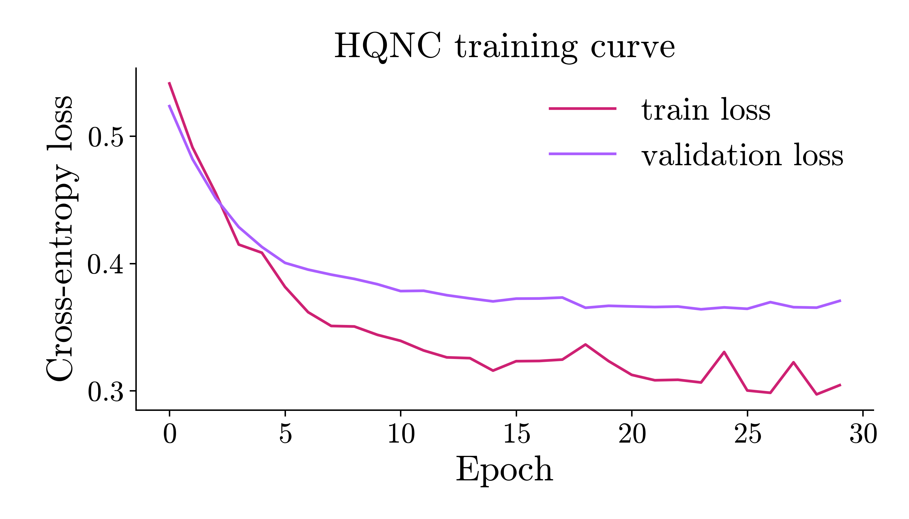

# Quantum Classification

This page shows complete classification runs on the moons dataset, with `HQNC` and `QSVC`.

## Data

```python
from eigenkit.datasets import load_dataset
from sklearn.model_selection import train_test_split

data = load_dataset("moons")
X_train, y_train = data["X_train"], data["y_train"]
X_test, y_test = data["X_test"], data["y_test"]

X_fit, X_val, y_fit, y_val = train_test_split(
    X_train,
    y_train,
    test_size=0.2,
    stratify=y_train,
    random_state=42,
)
```

## HQNC

Train `HQNC`, the hybrid quantum neural network classifier, from start to end with
the cross-entropy loss:

```python
from eigenkit import HQNC

model = HQNC(
    in_features=2,
    depth=2,
    n_classes=2,
    layer_type="Basic",
    variational_type="strong",
    basis="Y",
    epochs=30,
    lr=0.01,
    batch_size=16,
)
model.fit(X_fit, y_fit, X_val=X_val, y_val=y_val)
print(model.score(X_test, y_test))  # accuracy
```

```text
HQNC training | Epoch 1/30 | loss=0.541357 | val_loss=0.523535 | elapsed=0.1s | eta=1.9s
HQNC training | Epoch 2/30 | loss=0.491087 | val_loss=0.481886 | elapsed=0.1s | eta=1.6s
HQNC training | Epoch 3/30 | loss=0.455297 | val_loss=0.451289 | elapsed=0.2s | eta=1.5s
...
HQNC training | Epoch 29/30 | loss=0.297142 | val_loss=0.365255 | elapsed=1.6s | eta=0.1s
HQNC training | Epoch 30/30 | loss=0.304369 | val_loss=0.370603 | elapsed=1.7s | eta=0.0s
0.875
```

Inspect the training curve. The plot is drawn twice, once for each theme, so that
the site can show the one that matches the theme of the reader. `rc_params("dark")`
makes the backgrounds of the figure, the axes and the legend transparent, and turns
the text white. Everything else is the same in the two figures:

```python
import matplotlib
import matplotlib.pyplot as plt
from eigenkit.datasets import STYLE_COLORS, rc_params

for theme in ("light", "dark"):
    with matplotlib.rc_context(rc_params(theme=theme)):
        fig, ax = plt.subplots(figsize=(7, 4))
        ax.plot(model.train_losses_, color=STYLE_COLORS[0], label="train loss")
        ax.plot(model.validation_losses_, color=STYLE_COLORS[1], label="validation loss")
        ax.set_xlabel("Epoch")
        ax.set_ylabel("Cross-entropy loss")
        ax.set_title("HQNC training curve")
        ax.legend()
        fig.tight_layout()
        fig.savefig(f"hqnc_training_curve_{theme}.png")
        if theme == "light":
            plt.show()
        else:
            plt.close(fig)
```

{ .theme-image-light }
{ .theme-image-dark }

## QSVC

`QSVC` computes a quantum kernel, and passes it to the support vector classifier `SVC` of sklearn:

```python
from eigenkit import QSVC

model = QSVC(feature_map="AngleCNOT", reps=1, C=1.0)
model.fit(X_train, y_train)
print(model.score(X_test, y_test))
```

```text
0.9
```

## Comparing classifiers

```python
from sklearn.model_selection import cross_val_score

hqnc = HQNC(in_features=2, depth=2, epochs=20)
qsvc = QSVC(feature_map="Angle", reps=1)

for name, clf in [("HQNC", hqnc), ("QSVC", qsvc)]:
    scores = cross_val_score(clf, X_train, y_train, cv=3, scoring="accuracy")
    print(f"{name}: {scores.mean():.3f} +/- {scores.std():.3f}")
```

```text
HQNC training | Epoch 1/20 | loss=0.582853 | elapsed=0.0s | eta=0.4s
...
HQNC training | Epoch 20/20 | loss=0.436515 | elapsed=0.5s | eta=0.0s
HQNC: 0.818 +/- 0.059
QSVC: 0.831 +/- 0.054
```

Three folds train three `HQNC` models, so the log above appears three times
before the two summary lines.

## sklearn-compatible cloning

```python
from sklearn.base import clone

cloned = clone(hqnc)  # unfitted copy with the same hyperparameters
cloned.fit(X_train, y_train)
```

```text
HQNC training | Epoch 1/20 | loss=0.543862 | elapsed=0.0s | eta=0.5s
...
HQNC training | Epoch 20/20 | loss=0.338438 | elapsed=0.6s | eta=0.0s
HQNC(epochs=20, in_features=2, in_quantum=2)
```

## Switching backends

The `provider=` argument of every estimator accepts the same forms as
`Circuit(provider=...)`:

```python
from eigenkit import PennyLaneConfig

# Faster local simulator.
HQNC(
    in_features=2,
    depth=2,
    variational_type="strong",
    basis="Y",
    epochs=20,
    provider=PennyLaneConfig(device_name="lightning.qubit"),
)
```

See the [Providers guide](../user-guide/providers.md) for the full list of the
supported backends.
