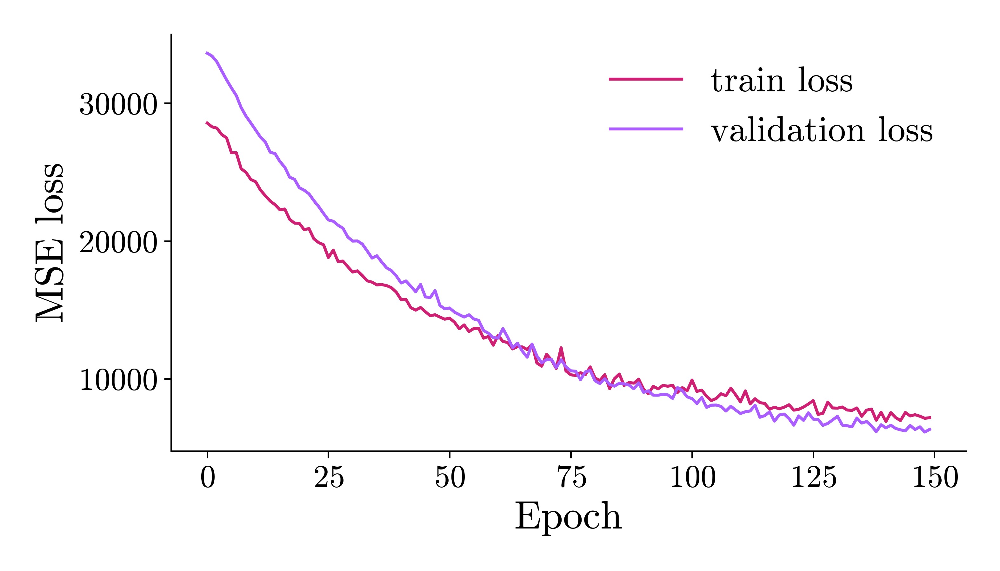
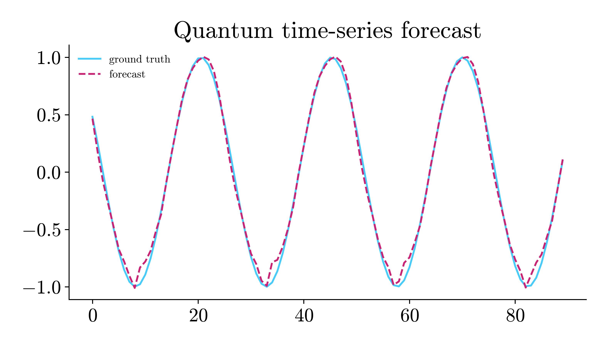
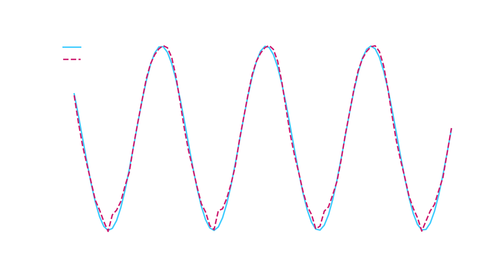

# Quantum Regression and Time Series

This page shows complete regression runs with `HQNR` and `QSVR`, and time-series
forecasting with `QuantumTimeSeriesRegressor`.

## Data

```python
from eigenkit.datasets import load_dataset
from sklearn.model_selection import train_test_split

data = load_dataset("diabetes")
X_train, y_train = data["X_train"], data["y_train"]
X_test, y_test = data["X_test"], data["y_test"]

X_fit, X_val, y_fit, y_val = train_test_split(
    X_train,
    y_train,
    test_size=0.2,
    random_state=42,
)
```

## HQNR

`HQNR` is the hybrid quantum neural network regressor. It uses the same pipeline as
`HQNC`, with a single linear output:

```python
from eigenkit import HQNR

model = HQNR(
    in_features=X_train.shape[1],
    depth=3,
    layer_type="Basic",
    variational_type="strong",
    basis="Y",
    epochs=150,
    lr=0.02,
    batch_size=16,
)
model.fit(X_fit, y_fit, X_val=X_val, y_val=y_val)
print(model.score(X_test, y_test))  # R^2
```

```text
HQNR training | Epoch 1/150 | loss=28556.850369 | val_loss=33623.300781 | elapsed=2.9s | eta=433.1s
HQNR training | Epoch 2/150 | loss=28281.023980 | val_loss=33419.722656 | elapsed=5.6s | eta=411.2s
HQNR training | Epoch 3/150 | loss=28189.342122 | val_loss=32996.566406 | elapsed=8.3s | eta=408.6s
...
HQNR training | Epoch 149/150 | loss=7139.822401 | val_loss=6145.080078 | elapsed=399.1s | eta=2.7s
HQNR training | Epoch 150/150 | loss=7184.452705 | val_loss=6334.184277 | elapsed=401.1s | eta=0.0s
-0.44105827808380127
```

`variational_type` and `basis` are passed explicitly, and not left to their
defaults. All four arguments of the ansatz default to `None`, which means "use the
value of the layer that you named". `Basic` uses the `"basic"` variational block,
measured in the `Z` basis. This problem needs the stronger block. `"strong"` applies
the three rotations `RZ`, `RY` and `RZ` to each qubit in each layer, so it has three
times as many weights at the same `depth`, and it is what brings the loss down over
`150` epochs. Without these two arguments, the same run ends near `13600` instead of
`7180`.

!!! warning "This example shows how to use the library, not a competitive model"

    The score above is negative. This means that the regressor does worse on the
    held-out split than a prediction of the training mean would. A `Ridge`
    baseline on the same split reaches about `0.42`. The curve below does go down,
    and that is what the example is for, but it stops far short of a useful model.
    After `150` epochs, the loss has not reached the variance of the target. The
    target ranges from `25` to `346`, and this whole range comes from the linear
    head alone, on top of a quantum layer whose outputs are in `[-1, 1]`. Scale the
    target before you draw any conclusion from the score.

Inspect the training curve. The plot is drawn twice, once for each theme, so that
the site can show the one that matches the theme of the reader. `rc_params("dark")`
makes the backgrounds of the figure, the axes and the legend transparent, and turns
the text white. Everything else is the same in the two figures:

```python
import matplotlib
import matplotlib.pyplot as plt
from eigenkit.datasets import STYLE_COLORS, rc_params

for theme in ("light", "dark"):
    with matplotlib.rc_context(rc_params(theme=theme)):
        fig, ax = plt.subplots(figsize=(7, 4))
        ax.plot(model.train_losses_, color=STYLE_COLORS[0], label="train loss")
        ax.plot(model.validation_losses_, color=STYLE_COLORS[1], label="validation loss")
        ax.set_xlabel("Epoch")
        ax.set_ylabel("MSE loss")
        ax.legend()
        fig.tight_layout()
        fig.savefig(f"hqnr_training_curve_{theme}.png")
        if theme == "light":
            plt.show()
        else:
            plt.close(fig)
```

{ .theme-image-light }
{ .theme-image-dark }

You can choose the loss with `loss_func` (`"mse"`, `"mae"` or `"huber"`).

## QSVR

`QSVR` is the quantum support vector regressor. It works like `QSVC`, but for
regression:

```python
from eigenkit import QSVR

model = QSVR(feature_map="Angle", reps=1, C=1.0, epsilon=0.1)
model.fit(X_train, y_train)
print(model.score(X_test, y_test))
```

```text
0.008799388796009833
```

## Time-series forecasting

`QuantumTimeSeriesRegressor` wraps an inner estimator with a sliding window. Here
the inner model is `RecurrentHQNR`, so each window is read as a sequence, and it is
not flattened first.

```python
import numpy as np
from eigenkit import (
    RecurrentHQNR,
    QuantumTimeSeriesRegressor,
)

# Toy sine wave with a 1-D feature axis.
t = np.linspace(0, 8 * np.pi, 100).astype(np.float32)
series = np.sin(t).reshape(-1, 1)  # (100, 1)
target = np.sin(t + 0.1).astype(np.float32)

inner = RecurrentHQNR(
    seq_feature_dim=1,
    rnn_type="gru",
    rnn_hidden_dim=4,
    depth=1,
    variational_type="strong",
    basis="Y",
    epochs=50,
)

model = QuantumTimeSeriesRegressor(
    estimator=inner,
    in_size=10,
    shift=1,
)
model.fit(series, target)
predictions = model.predict(series)

# The wrapper carries the inner estimator's loss history.
history = model.train_losses_
print(f"epochs: {len(history)}   first: {history[0]:.6f}   last: {history[-1]:.6f}")

# score() windows and aligns the targets the same way predict does.
for name, value in model.score(series, target, return_dict=True).items():
    print(f"{name:5s} {value: .6f}")
```

```text
RecurrentHQNR training | Epoch 1/50 | loss=0.561485 | elapsed=0.1s | eta=2.5s
RecurrentHQNR training | Epoch 2/50 | loss=0.533511 | elapsed=0.1s | eta=2.3s
RecurrentHQNR training | Epoch 3/50 | loss=0.497451 | elapsed=0.1s | eta=2.3s
...
RecurrentHQNR training | Epoch 49/50 | loss=0.002330 | elapsed=2.4s | eta=0.0s
RecurrentHQNR training | Epoch 50/50 | loss=0.003000 | elapsed=2.4s | eta=0.0s
epochs: 50   first: 0.561485   last: 0.003000
r2     0.993713
mse    0.003008
mae    0.040461
rmse   0.054849
mape   0.293061
```

`variational_type` and `basis` are set here for the same reason as for `HQNR`
above. The arguments of the ansatz default to those of the layer, and this problem
needs the `"strong"` block. Without these two arguments, the same run ends at an
`R²` of `0.9087` and an `rmse` of `0.209`, instead of the `0.9937` and `0.055` above.
That forecast overshoots `1.0` and lags on every descent.

By default, `score()` returns only the `R²`, which is what `cross_val_score` and
`GridSearchCV` expect. `return_dict=True` gives the five figures above. Read `mape`
(the mean absolute percentage error) with care on this target. A sine crosses zero,
so a percentage error is large wherever the true value is near zero. So `0.29` says
less about the fit than the `rmse` (the root mean squared error) of `0.055` does, for
a signal of amplitude `1`. `model.train_losses_` holds the loss of every epoch, if
you want to plot it next to the forecast.

## Visualising the forecast

```python
import matplotlib
import matplotlib.pyplot as plt
from eigenkit.datasets import STYLE_COLORS, rc_params

# QuantumTimeSeriesRegressor predicts targets at indices
# `i + in_size - 1 + shift`, so we align ground truth with that range.
aligned = target[10:]  # in_size=10, shift=1

for theme in ("light", "dark"):
    with matplotlib.rc_context(rc_params(theme=theme)):
        fig, ax = plt.subplots(figsize=(7, 4))
        ax.plot(aligned, color=STYLE_COLORS[3], label="ground truth")
        ax.plot(predictions, color=STYLE_COLORS[0], label="forecast", linestyle="--")
        ax.legend(fontsize=9, loc="upper left")
        ax.set_title("Quantum time-series forecast")
        fig.tight_layout()
        fig.savefig(f"quantum_timeseries_forecast_{theme}.png")
        if theme == "light":
            plt.show()
        else:
            plt.close(fig)
```

{ .theme-image-light }
{ .theme-image-dark }

## Swapping the inner estimator

Any compatible regressor can be the inner estimator. For tabular estimators (such
as `HQNR` and `QSVR`), the wrapper flattens each window before `fit` and
`predict`:

```python
from eigenkit import HQNR, QuantumTimeSeriesRegressor

# in_size * n_features = 10 * 1 = 10 features per flattened window.
inner = HQNR(in_features=10, depth=2, epochs=20)
model = QuantumTimeSeriesRegressor(estimator=inner, in_size=10, shift=1)
model.fit(series, target)
predictions = model.predict(series)
```

```text
HQNR training | Epoch 1/20 | loss=0.609575 | elapsed=0.2s | eta=3.1s
HQNR training | Epoch 2/20 | loss=0.578486 | elapsed=0.3s | eta=2.8s
...
HQNR training | Epoch 19/20 | loss=0.114036 | elapsed=2.8s | eta=0.1s
HQNR training | Epoch 20/20 | loss=0.098465 | elapsed=3.0s | eta=0.0s
```
