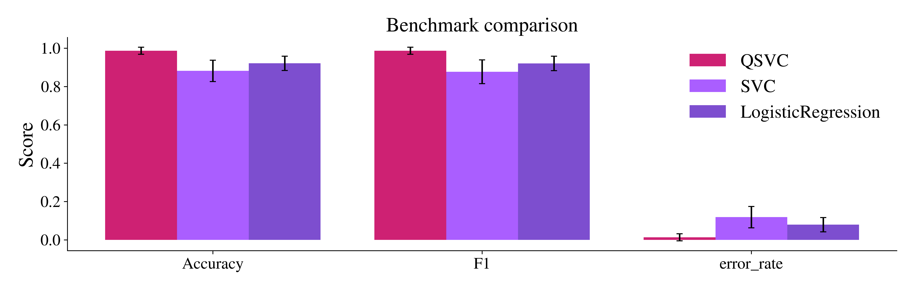

# Benchmark comparison on Iris

This example runs a small benchmark with `eigenkit`. It compares a quantum estimator with scikit-learn baselines, adds a custom metric, inspects the raw rows, reuses the selected model and saves the numeric results.


## Imports

The benchmark module works with eigenkit estimators and with built-in scikit-learn estimators. A custom metric must state whether higher or lower values are better.


```python
from pathlib import Path
from tempfile import TemporaryDirectory

import numpy as np
from sklearn.linear_model import LogisticRegression
from sklearn.svm import SVC

from eigenkit import QSVC
from eigenkit.benchmark import BenchmarkResult, compare, custom_metric
from eigenkit.datasets import load_dataset
```

## Load a small preview split

`compare()` can load the dataset by its name. Here we also load one split directly, so that we have a few samples for the prediction example at the end.


```python
data = load_dataset("iris", split=True, test_size=0.25, random_state=42)

X_preview = np.asarray(data["X_test"][:5], dtype=np.float32)

print(f"Dataset: {data['metadata'].name}")
print(f"Train shape: {data['X_train'].shape}, test shape: {data['X_test'].shape}")
print("Preview shape:", X_preview.shape)
```

```text
Dataset: iris
Train shape: (112, 4), test shape: (38, 4)
Preview shape: (5, 4)
```


## Configure models and metrics

The classical baselines are simple on purpose. This keeps the run fast, and it makes the benchmark table easy to read.


```python
def error_rate(y_true, y_pred):
    return float(np.mean(y_true != y_pred))


models = [
    QSVC(feature_map="Angle", reps=1, C=1.0, random_state=42),
    SVC(kernel="linear", C=0.01),
    LogisticRegression(max_iter=500, C=0.1),
]

metrics = [
    "accuracy",
    "f1",
    custom_metric(error_rate, direction="lower", name="error_rate"),
]

print("Models:", [type(model).__name__ for model in models])
print(
    "Metrics:", [metric if isinstance(metric, str) else metric.name for metric in metrics]
)
```

```text
Models: ['QSVC', 'SVC', 'LogisticRegression']
Metrics: ['accuracy', 'f1', 'error_rate']
```


## Run the benchmark

`store_predictions=True` keeps the predictions of the last seed. With them, you can build confusion matrices and make quick checks after the summary table.


```python
result = compare(
    models=models,
    dataset="iris",
    validation_size=0.0,
    test_size=0.25,
    n_seeds=2,
    metrics=metrics,
    store_predictions=True,
    save_dir="models",  # to save models after training
)

print(result.table())
```

```text
┌────────────────────┬───────────────┬───────────────┬───────────────┐
│ Model              │ Accuracy      │ F1            │ error_rate    │
├────────────────────┼───────────────┼───────────────┼───────────────┤
│ QSVC               │ 0.987 ± 0.019 │ 0.987 ± 0.019 │ 0.013 ± 0.019 │
│ SVC                │ 0.882 ± 0.056 │ 0.877 ± 0.062 │ 0.118 ± 0.056 │
│ LogisticRegression │ 0.921 ± 0.037 │ 0.921 ± 0.038 │ 0.079 ± 0.037 │
└────────────────────┴───────────────┴───────────────┴───────────────┘
```


## Inspect raw rows

`to_dataframe()` returns one row for each model, seed and metric. Use this form when you want to make your own charts or run further analysis.


```python
raw = result.to_dataframe()
print(raw.head(9).to_string(index=False))
```

```text
             model  seed     metric    value
              QSVC     0   accuracy 1.000000
              QSVC     0         f1 1.000000
              QSVC     0 error_rate 0.000000
               SVC     0   accuracy 0.921053
               SVC     0         f1 0.920798
               SVC     0 error_rate 0.078947
LogisticRegression     0   accuracy 0.947368
LogisticRegression     0         f1 0.947200
LogisticRegression     0 error_rate 0.052632
```


## Plot the results

`.plot()` draws a grouped bar chart of the summary table. `theme=` chooses the
colours, and `save_path=` writes the figure to a file instead of showing it. One
loop therefore produces the two files that this page shows below. The site shows
the one that matches the reader's theme, and `"dark"` leaves the background
transparent:

```python
for theme in ("light", "dark"):
    result.plot(save_path=f"{theme}_theme.png", theme=theme)

# Without `save_path` the same call shows the light figure inline.
result.plot()
```

{ .theme-image-light }
{ .theme-image-dark }

## Reuse the fitted result

`best_model()` returns the fitted estimator with the best mean score on the chosen metric. `predict()` is a shortcut that uses this selected model. Because the predictions were stored, the result can also build a confusion matrix without fitting again.


```python
best = result.best_model(metric="accuracy")
preview_predictions = result.predict(X_preview, metric="accuracy")

print("Best model by accuracy:", type(best).__name__)
print("Predictions for five preview samples:", preview_predictions.tolist())
print("QSVC confusion matrix:")
print(result.confusion_matrix("QSVC"))
```

```text
Best model by accuracy: QSVC
Predictions for five preview samples: [0, 1, 1, 1, 0]
QSVC confusion matrix:
[[12  0  0]
 [ 0 13  0]
 [ 0  1 12]]
```


## Save numeric results

`BenchmarkResult.save()` writes the benchmark rows, the summary, the predictions, the paths of the saved models, the loss curves and the metric directions to a JSON file. It does not save the fitted estimators.


```python
with TemporaryDirectory() as tmp_dir:
    saved_path = result.save(Path(tmp_dir) / "iris_benchmark.json")
    loaded = BenchmarkResult.load(saved_path)

print("Saved file:", saved_path.name)
print("Loaded rows:", len(loaded.raw))
print("Loaded prediction keys:", sorted(loaded.predictions))
```

```text
Saved file: iris_benchmark.json
Loaded rows: 18
Loaded prediction keys: ['LogisticRegression', 'QSVC', 'SVC']
```
