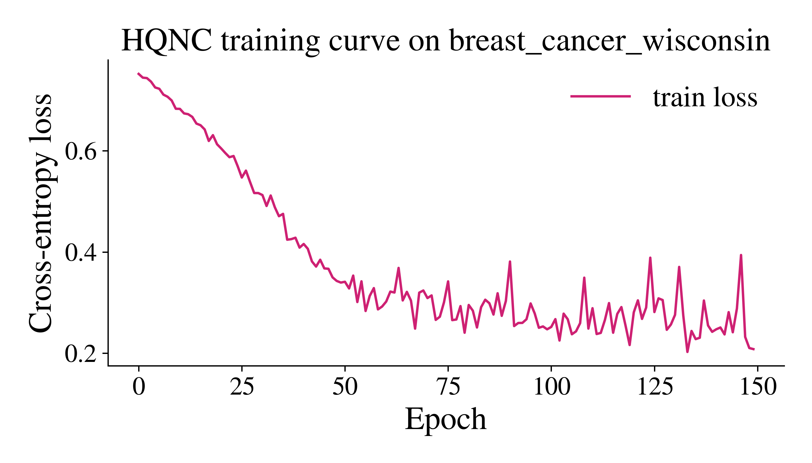

# Healthcare: Breast cancer classification using eigenkit

## Why this problem matters
Breast cancer is one of the most common cancers in the world. Reliable tools that
support classification help clinicians to detect high-risk cases earlier, to decide
which diagnostic tests come first, and to improve the outcomes of treatment.

!!! warning "A research demonstration, not a medical tool"

    This example shows how to use the library on a public dataset. It is not a
    medical device and has not been validated for any clinical use. Do not use
    it, or a model trained the same way, to diagnose or treat anyone.

## Dataset
This example uses the Wisconsin Breast Cancer dataset, which is available in
`eigenkit.datasets` under the name `breast_cancer_wisconsin`.

## Our approach: Hybrid Quantum-Classical Classification (HQNC)
In this example, we train the **hybrid quantum neural network classifier (HQNC)**
of **eigenkit** to separate two classes (benign and malignant tumours), and we
measure the quality of its predictions.

## Import libraries


```python
import numpy as np
import matplotlib
import matplotlib.pyplot as plt

from sklearn.decomposition import PCA
from sklearn.metrics import accuracy_score, classification_report, f1_score

from eigenkit.datasets import STYLE_COLORS, load_dataset, rc_params
from eigenkit import HQNC
```

## Loading the selected dataset


```python
# Load and split dataset into train/test subsets
data = load_dataset("breast_cancer_wisconsin", split=True, test_size=0.2, random_state=42)
X_train, y_train = data["X_train"], data["y_train"]
X_test, y_test = data["X_test"], data["y_test"]

# Convert to NumPy arrays for stable downstream processing
X_train = np.asarray(X_train, dtype=np.float32)
X_test = np.asarray(X_test, dtype=np.float32)
y_train = np.asarray(y_train)
y_test = np.asarray(y_test)

print("Train shape:", X_train.shape, y_train.shape)
print("Test shape:", X_test.shape, y_test.shape)
print("Class counts (train):", dict(zip(*np.unique(y_train, return_counts=True))))

# Reduce dimensionality to keep quantum circuit width practical
n_components = 8
pca = PCA(n_components=n_components, random_state=42)
X_train_pca = pca.fit_transform(X_train).astype(np.float32)
X_test_pca = pca.transform(X_test).astype(np.float32)

print("Train shape after PCA:", X_train_pca.shape)
print("Test shape after PCA:", X_test_pca.shape)
print("Explained variance ratio:", round(float(pca.explained_variance_ratio_.sum()), 4))
```

```text
Train shape: (455, 30) (455,)
Test shape: (114, 30) (114,)
Class counts (train): {np.int64(0): np.int64(170), np.int64(1): np.int64(285)}
Train shape after PCA: (455, 8)
Test shape after PCA: (114, 8)
Explained variance ratio: 1.0
```


## Model creation and training


```python
# Configure HQNC classifier
model = HQNC(
    in_features=n_components,
    n_qubits=n_components,
    depth=2,
    n_classes=len(np.unique(y_train)),
    layer_type="Basic",
    variational_type="strong",
    basis="Y",
    lr=0.001,
    optimizer="adam",
    epochs=150,
    batch_size=32,
    random_state=42,
)

# Fit model on transformed training features
model.fit(X_train_pca, y_train)
print("Training complete. Last epoch loss:", round(float(model.train_losses_[-1]), 6))
```

```text
HQNC training | Epoch 1/150 | loss=0.751814 | elapsed=0.6s | eta=95.4s
HQNC training | Epoch 2/150 | loss=0.744411 | elapsed=1.3s | eta=94.6s
HQNC training | Epoch 3/150 | loss=0.743520 | elapsed=1.9s | eta=94.2s
...
HQNC training | Epoch 149/150 | loss=0.210164 | elapsed=96.0s | eta=0.6s
HQNC training | Epoch 150/150 | loss=0.208010 | elapsed=96.6s | eta=0.0s
Training complete. Last epoch loss: 0.20801
```


## Evaluation


```python
# Predict on the held-out test split
y_pred = model.predict(X_test_pca)

# Report core classification quality metrics
acc = accuracy_score(y_test, y_pred)
macro_f1 = f1_score(y_test, y_pred, average="macro")
weighted_f1 = f1_score(y_test, y_pred, average="weighted")

print(f"Accuracy:    {acc:.4f}")
print(f"Macro F1:    {macro_f1:.4f}")
print(f"Weighted F1: {weighted_f1:.4f}")
print("Classification report:")
print(classification_report(y_test, y_pred, digits=4, zero_division=0))
```

```text
Accuracy:    0.9298
Macro F1:    0.9221
Weighted F1: 0.9285
Classification report:
              precision    recall  f1-score   support

           0     0.9722    0.8333    0.8974        42
           1     0.9103    0.9861    0.9467        72

    accuracy                         0.9298       114
   macro avg     0.9412    0.9097    0.9221       114
weighted avg     0.9331    0.9298    0.9285       114
```


## Plotting results


```python
# Visualize training dynamics across epochs
with matplotlib.rc_context(rc_params(theme="light")):
    plt.figure(figsize=(7, 4))
    plt.plot(model.train_losses_, color=STYLE_COLORS[0], label="train loss")
    plt.xlabel("Epoch")
    plt.ylabel("Cross-entropy loss")
    plt.title("HQNC training curve on breast_cancer_wisconsin")
    plt.legend()
    plt.tight_layout()
    plt.show()
```


{ .theme-image-light }
{ .theme-image-dark }

## Takeaway

An HQNC with `8` qubits and `depth=2` receives `8` components from a principal
component analysis (PCA) of the original `30` features. After `150` epochs, it
reaches an accuracy of `0.9298` and a macro F1 score of `0.9221` on the test split
of `114` samples. The PCA step is what keeps the circuit narrow: with one qubit for
each input feature, the circuit would need `30` qubits. The width of the circuit
and the number of components are the two settings to change first. They balance
the cost of the simulation against how much of the variance of the data reaches
the model.
