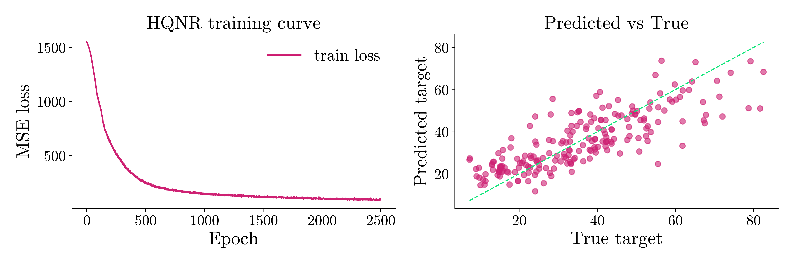
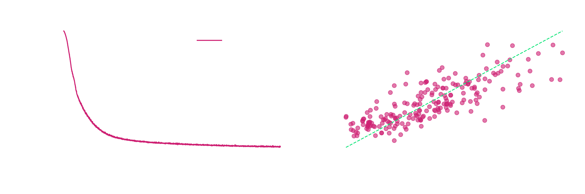

# Civil Engineering: Concrete compressive strength prediction using eigenkit

## Why this problem matters
Concrete is the most used human-made material on Earth. More than 30 billion metric tons are used every year, and concrete is the main structural material of over 90% of infrastructure projects worldwide. The global concrete market was valued at **$ 1.82 trillion in 2024**, and it is expected to reach **$ 2.28 trillion** by 2030.

The most important quality parameter of a concrete mix is its **compressive strength**: its ability to carry loads without failing. Getting this number wrong has severe consequences, from costly rework and project delays to structural collapses that cost human lives.

Compressive strength is traditionally measured by a **destructive 28-day test**. Concrete cylinders are cast, cured under controlled conditions for 28 days, and then crushed. This standard procedure causes several serious problems:

**Time cost**: construction cannot continue until the strength is confirmed, which delays the schedule by weeks.
**Late discovery**: if the concrete fails the test, the structure has already been poured, which leads to expensive demolition and rework.
**No optimisation during the work:** the mix design cannot be adjusted as the work goes on, because the results arrive a month later.
**Destructive nature**: the test specimens are destroyed, so they cannot be examined again.

There is also an important **environmental side**, beyond safety and cost. Cement production alone causes about **8% of global CO₂ emissions** (about 2.8 billion tonnes every year), which makes it one of the largest industrial sources of greenhouse gases. An accurate prediction of the strength before pouring makes **mix optimisation** possible: the cement content can be reduced while the required strength is kept, which directly reduces the CO₂ emissions. As regulations become stricter (for example the €43 billion Green Deal Industrial Plan of the European Union for low-carbon cement), mix design based on data is no longer optional. The industry needs it.

## Dataset
This guide uses the Concrete Compressive Strength dataset by I-Cheng Yeh (1998).

- Dataset source: [UC Irvine Machine Learning Repository: Concrete Compressive Strength](https://archive.ics.uci.edu/dataset/165/concrete+compressive+strength)
- Licence: [CC BY 4.0](https://creativecommons.org/licenses/by/4.0/)

The dataset contains 1,030 observations. Each has 8 quantitative input features (cement, blast furnace slag, fly ash, water, superplasticiser, coarse aggregate, fine aggregate and age) and 1 continuous target: the compressive strength of the concrete, in megapascals (MPa).

## Our approach: Hybrid Quantum Neural Network Regressor (HQNR)
In this guide, we predict the compressive strength with **HQNR**, the hybrid quantum neural network regressor of **eigenkit**. It is a regression model that combines classical and quantum parts.

HQNR combines classical neural network layers with a parametrised quantum circuit, which acts as a trainable layer that processes the features.

## Import libraries


```python
from pathlib import Path
import matplotlib
import matplotlib.pyplot as plt

import numpy as np

from sklearn.metrics import mean_absolute_error, mean_squared_error, r2_score

from eigenkit import HQNR
from eigenkit.datasets import load_dataset, rc_params
```

## Loading the selected dataset


```python
# Load data and split into train/test subsets
data = load_dataset("concrete")

X_train, y_train = data["X_train"], data["y_train"]
X_test, y_test = data["X_test"], data["y_test"]
```

## Model creation and training


```python
# Use one qubit per input feature
n_features = X_train.shape[1]

# Configure HQNR regression model
model = HQNR(
    in_features=n_features,
    n_qubits=n_features,
    depth=2,
    layer_type="Basic",
    variational_type="strong",
    basis="Y",
    lr=0.001,
    optimizer="adam",
    epochs=2500,
    batch_size=64,
    loss_func="mse",
    random_state=42,
)

# Train model on training split
model.fit(X_train, y_train)
print("Training complete. Last epoch loss:", round(float(model.train_losses_[-1]), 6))
```

```text
...
HQNR training | Epoch 2498/2500 | loss=99.659904 | elapsed=3907.0s | eta=3.1s
HQNR training | Epoch 2499/2500 | loss=97.315125 | elapsed=3907.7s | eta=1.6s
HQNR training | Epoch 2500/2500 | loss=94.637728 | elapsed=3908.5s | eta=0.0s
Training complete. Last epoch loss: 94.637728
```


## Evaluation


```python
# Generate regression predictions for test data
y_pred = model.predict(X_test)

# Compute standard regression quality metrics
mae = mean_absolute_error(y_test, y_pred)
rmse = np.sqrt(mean_squared_error(y_test, y_pred))
r2 = r2_score(y_test, y_pred)

print(f"MAE:  {mae:.4f}")
print(f"RMSE: {rmse:.4f}")
print(f"R2:   {r2:.4f}")
```

```text
MAE:  7.8936
RMSE: 9.9623
R2:   0.6531
```


## Plotting results


```python
from eigenkit.datasets import STYLE_COLORS

with matplotlib.rc_context(rc_params(theme="light")):
    fig, axes = plt.subplots(1, 2, figsize=(12, 4))

    axes[0].plot(model.train_losses_, label="train loss")
    axes[0].set_xlabel("Epoch")
    axes[0].set_ylabel("MSE loss")
    axes[0].set_title("HQNR training curve")
    axes[0].legend()

    axes[1].scatter(y_test, y_pred, alpha=0.6, color=STYLE_COLORS[0])
    line_min = min(float(np.min(y_test)), float(np.min(y_pred)))
    line_max = max(float(np.max(y_test)), float(np.max(y_pred)))
    axes[1].plot(
        [line_min, line_max],
        [line_min, line_max],
        "--",
        linewidth=1.2,
        color=STYLE_COLORS[5],
    )
    axes[1].set_xlabel("True target")
    axes[1].set_ylabel("Predicted target")
    axes[1].set_title("Predicted vs True")

    plt.tight_layout()
    plt.show()
```


{ .theme-image-light }
{ .theme-image-dark }

## Takeaway

An HQNR with 8 qubits and `depth=2` explains 65% of the variance of the compressive
strength on the held-out test set (its coefficient of determination R² is `0.6531`).
Its mean absolute error (MAE) is `7.89` MPa, and its root mean squared error (RMSE)
is `9.96` MPa, on test values that range from `7.3` to `82.6` MPa. The average error
is roughly a tenth of that range. The model uses only the composition of the mix and
the age of the concrete, with no cylinder cast and no 28-day wait. This is enough to
rank candidate mixes, and to decide which of them are worth the destructive test.
