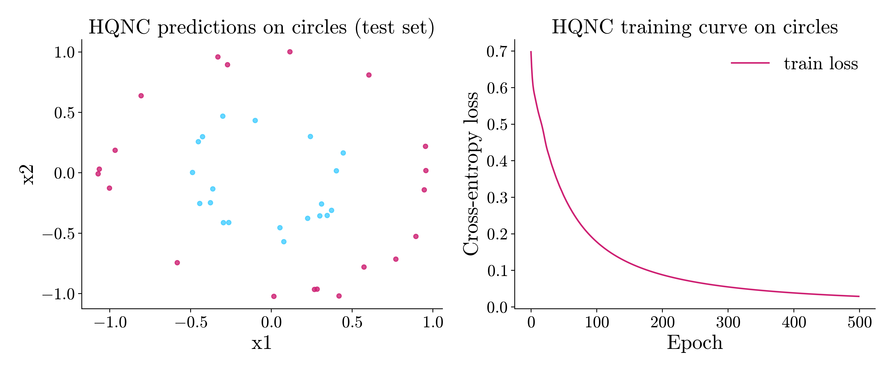

# Classification benchmark: Circles dataset using eigenkit

## Why this problem matters
The circles dataset is a standard benchmark for non-linear classification. It
checks whether a model can separate classes with a curved boundary, where simple
linear classifiers usually fail.

## Dataset
This example uses the synthetic `circles` dataset from `eigenkit.datasets`: two
concentric circles, a large one and a small one.

## Our approach: Hybrid Quantum-Classical Classification (HQNC)
In this example, we train the **hybrid quantum neural network classifier (HQNC)**
of **eigenkit**, and we measure the quality of its predictions on a test split that
is kept out of training.

## Import libraries


```python
import numpy as np
import matplotlib
import matplotlib.pyplot as plt

from sklearn.metrics import accuracy_score, classification_report, f1_score

from eigenkit.datasets import STYLE_COLORS, load_dataset, rc_params
from eigenkit import HQNC
```

## Loading the selected dataset


```python
# Load and split synthetic circles dataset
data = load_dataset("circles", split=True, test_size=0.2, random_state=42)
X_train, y_train = data["X_train"], data["y_train"]
X_test, y_test = data["X_test"], data["y_test"]

# Convert to NumPy arrays used by model API.
X_train = np.asarray(X_train, dtype=np.float32)
X_test = np.asarray(X_test, dtype=np.float32)
y_train = np.asarray(y_train)
y_test = np.asarray(y_test)

print("Train shape:", X_train.shape, y_train.shape)
print("Test shape:", X_test.shape, y_test.shape)
print("Classes:", np.unique(y_train))
```

```text
Train shape: (160, 2) (160,)
Test shape: (40, 2) (40,)
Classes: [0 1]
```


## Model creation and training


```python
# Configure HQNC classifier for binary classes
model = HQNC(
    in_features=X_train.shape[1],
    n_qubits=X_train.shape[1],
    depth=5,
    n_classes=len(np.unique(y_train)),
    layer_type="Basic",
    variational_type="strong",
    basis="Y",
    lr=0.02,
    optimizer="adam",
    epochs=500,
    batch_size=len(X_train),
    random_state=42,
)

# Train model parameters
model.fit(X_train, y_train)
print("Training complete. Last epoch loss:", round(float(model.train_losses_[-1]), 6))
```

```text
HQNC training | Epoch 1/500 | loss=0.697751 | elapsed=0.1s | eta=27.4s
HQNC training | Epoch 2/500 | loss=0.656395 | elapsed=0.1s | eta=18.8s
HQNC training | Epoch 3/500 | loss=0.626758 | elapsed=0.1s | eta=16.2s
...
HQNC training | Epoch 499/500 | loss=0.028733 | elapsed=22.2s | eta=0.0s
HQNC training | Epoch 500/500 | loss=0.028657 | elapsed=22.2s | eta=0.0s
Training complete. Last epoch loss: 0.028657
```


## Evaluation


```python
# Predict labels for the test subset
y_pred = model.predict(X_test)

# Compute summary classification metrics
acc = accuracy_score(y_test, y_pred)
macro_f1 = f1_score(y_test, y_pred, average="macro")

print(f"Accuracy: {acc:.4f}")
print(f"Macro F1: {macro_f1:.4f}")
print("Classification report:")
print(classification_report(y_test, y_pred, digits=4, zero_division=0))
```

```text
Accuracy: 1.0000
Macro F1: 1.0000
Classification report:
              precision    recall  f1-score   support

           0     1.0000    1.0000    1.0000        20
           1     1.0000    1.0000    1.0000        20

    accuracy                         1.0000        40
   macro avg     1.0000    1.0000    1.0000        40
weighted avg     1.0000    1.0000    1.0000        40
```


## Plotting results


```python
# Plot test predictions and training loss in one figure
from matplotlib.colors import ListedColormap

with matplotlib.rc_context(rc_params(theme="light")):
    fig, axes = plt.subplots(1, 2, figsize=(12, 5))

    class_cmap = ListedColormap([STYLE_COLORS[0], STYLE_COLORS[3]])
    axes[0].scatter(
        X_test[:, 0], X_test[:, 1], c=y_pred, cmap=class_cmap, s=18, alpha=0.8
    )
    axes[0].set_title("HQNC predictions on circles (test set)")
    axes[0].set_xlabel("x1")
    axes[0].set_ylabel("x2")

    axes[1].plot(model.train_losses_, color=STYLE_COLORS[0], label="train loss")
    axes[1].set_xlabel("Epoch")
    axes[1].set_ylabel("Cross-entropy loss")
    axes[1].set_title("HQNC training curve on circles")
    axes[1].legend()

    plt.tight_layout()
    plt.show()
```


{ .theme-image-light }
{ .theme-image-dark }

## Takeaway

An HQNC with `2` qubits and `depth=5` separates the two circles exactly. The
accuracy and the macro F1 score are both `1.0000` on the test split of `40`
samples, and the loss falls to `0.028657` over `500` epochs. Linear classifiers
cannot solve `circles`, so the result shows that the model can represent a curved
decision boundary. This holds on a small, clean and synthetic dataset.
[Breast cancer](breast-cancer-hqnc.md) applies the same estimator to a real
dataset.
