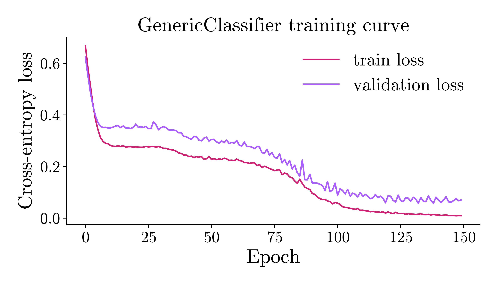
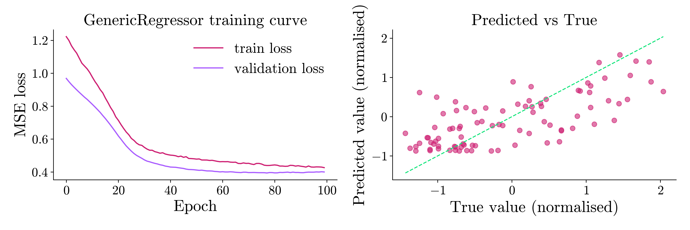

# Usage example: Generic Estimators

`GenericClassifier` and `GenericRegressor` are wrappers, compatible with sklearn, that train **any** `torch.nn.Module` through the standard `fit` and `predict` interface of the library. `HQNC` and `HQNR` build the architecture of the model for you. The generic estimators instead expect a complete network, output head included, so you have full control over the architecture.

This example has two parts:

1. **Classification**: the moons dataset, which has two classes, with a hybrid model that is part quantum and part classical.
2. **Regression**: the diabetes dataset, with a hybrid model that uses a quantum layer to extract features.

## Imports

```python
import matplotlib
import matplotlib.pyplot as plt
import numpy as np
from sklearn.model_selection import train_test_split
import torch
from torch import nn

from eigenkit import GenericClassifier, GenericRegressor
from eigenkit.datasets import STYLE_COLORS, load_dataset, rc_params
from eigenkit import Basic, Reupload
```

---

## Part 1: Classification

### Data

The moons dataset is a small benchmark with two features and two classes. Its decision boundary is small and non-linear, which makes it a good fit for hybrid models.

```python
data = load_dataset("moons")
X_train, y_train = data["X_train"], data["y_train"]
X_test, y_test = data["X_test"], data["y_test"]

X_fit, X_val, y_fit, y_val = train_test_split(
    X_train,
    y_train,
    test_size=0.2,
    stratify=y_train,
    random_state=42,
)

print(f"Train: {X_fit.shape}, Validation: {X_val.shape}, Test: {X_test.shape}")
print(f"Classes: {np.unique(y_train)}")
```

```text
Train: (128, 2), Validation: (32, 2), Test: (40, 2)
Classes: [0 1]
```

### Build a hybrid model

The model is a small `nn.Sequential`. A linear layer expands the two input
features to the number of qubits, `Basic` processes these values, and the last
linear layer maps the result to two logits, one for each class.

`Basic` takes `n_qubits` inputs and returns `n_qubits` outputs, so the sizes of the
layers on both sides must match.

```python
N_QUBITS = 5
N_CLASSES = 2

torch.manual_seed(42)
quantum_layer = Basic(n_qubits=N_QUBITS, depth=3, variational_type="strong")

clf_net = nn.Sequential(
    nn.Linear(2, N_QUBITS),  # expand features to qubit count
    nn.ReLU(),
    quantum_layer,  # (batch, N_QUBITS) -> (batch, N_QUBITS) expectation values
    nn.Linear(N_QUBITS, N_CLASSES),
)

print(clf_net)
```

```text
Sequential(
  (0): Linear(in_features=2, out_features=5, bias=True)
  (1): ReLU()
  (2): Basic(
    (circuit): TorchCircuit()
  )
  (3): Linear(in_features=5, out_features=2, bias=True)
)
```

### Train with `GenericClassifier`

`GenericClassifier` wraps the network in a standard sklearn estimator. Pass the complete `nn.Module` as `model`. Set `in_features`, so that the wrapper checks the shape of the input in `fit()`. Configure the training loop with `epochs`, `lr` and `batch_size`.

The wrapper encodes the labels automatically, so `y_train` can hold integers, strings or any other hashable labels.

!!! warning "Pre-trained weights and the behaviour of `fit()`"

    `fit()` does **not** start from the weights that the `nn.Module` holds. It
    copies the module, and then calls `reset_parameters()` on every submodule that
    has this method (such as `nn.Linear` and the quantum layers of eigenkit), seeded
    with `random_state`. So the weights of these layers are drawn again before
    training, even if the module that you pass already holds trained weights. The
    module that you pass is not changed. `clone()` copies the *hyperparameters* of
    the estimator, not the trained weights, and each later call to `fit()` (for
    example after `clone()`, or inside cross-validation) also starts again from new
    weights. To keep the trained weights, use the fitted estimator, or save it with
    `save()` and load it again with `load()`, and do not call `fit()` on it
    again.

```python
clf = GenericClassifier(
    model=clf_net,
    in_features=2,
    epochs=150,
    lr=0.01,
    batch_size=16,
    random_state=42,
)

clf.fit(X_fit, y_fit, X_val=X_val, y_val=y_val)
print(f"Test accuracy: {clf.score(X_test, y_test):.3f}")
```

```text
GenericClassifier training | Epoch 1/150 | loss=0.668630 | val_loss=0.624434 | elapsed=0.2s | eta=32.6s
GenericClassifier training | Epoch 2/150 | loss=0.583259 | val_loss=0.552643 | elapsed=0.4s | eta=33.1s
GenericClassifier training | Epoch 3/150 | loss=0.512898 | val_loss=0.487117 | elapsed=0.7s | eta=34.2s
...
GenericClassifier training | Epoch 149/150 | loss=0.009535 | val_loss=0.067237 | elapsed=56.7s | eta=0.4s
GenericClassifier training | Epoch 150/150 | loss=0.009276 | val_loss=0.070270 | elapsed=56.9s | eta=0.0s
Test accuracy: 1.000
```

### Training curve

```python
for theme in ("light", "dark"):
    with matplotlib.rc_context(rc_params(theme=theme)):
        fig, ax = plt.subplots(figsize=(7, 4))
        ax.plot(clf.train_losses_, color=STYLE_COLORS[0], label="train loss")
        ax.plot(clf.validation_losses_, color=STYLE_COLORS[1], label="validation loss")
        ax.set_xlabel("Epoch")
        ax.set_ylabel("Cross-entropy loss")
        ax.set_title("GenericClassifier training curve")
        ax.legend()
        fig.tight_layout()
        fig.savefig(f"generic_classifier_training_curve_{theme}.png")
        if theme == "light":
            plt.show()
        else:
            plt.close(fig)
```

{ .theme-image-light }
{ .theme-image-dark }

### Predict and inspect outputs

```python
labels = clf.predict(X_test)
probs = clf.predict_proba(X_test)

print("Predicted labels (first 8):", labels[:8].tolist())
print("Class probabilities (first 3):")
print(probs[:3])
```

```text
Predicted labels (first 8): [0, 1, 1, 1, 0, 1, 0, 1]
Class probabilities (first 3):
[[9.9979252e-01 2.0752900e-04]
 [1.8817510e-02 9.8118252e-01]
 [3.3264074e-01 6.6735923e-01]]
```

### Save and load

Call `save()` after training. The bundle stores the trained weights, the label encoder and the training metadata.

The architecture cannot be rebuilt automatically from the bundle, so you must pass a module with the **same `nn.Module` structure** to `GenericClassifier.load()`. The saved weights are loaded into a copy of this module, and the module that you pass is not changed. So the module used in training and the module passed to `load()` do not need to be the same Python object. They only need to have the same structure of layers.

```python
clf.save("clf_hybrid.eigenkit")

# Rebuild the architecture (same structure, fresh weights)
clf_net_fresh = nn.Sequential(
    nn.Linear(2, N_QUBITS),
    nn.ReLU(),
    Basic(n_qubits=N_QUBITS, depth=3, variational_type="strong"),
    nn.Linear(N_QUBITS, N_CLASSES),
)

clf_loaded = GenericClassifier.load("clf_hybrid.eigenkit", model=clf_net_fresh)

# Predictions must match the original model
assert (clf_loaded.predict(X_test) == clf.predict(X_test)).all()
print(f"Loaded model test accuracy: {clf_loaded.score(X_test, y_test):.3f}")
```

```text
Loaded model test accuracy: 1.000
```

---

## Part 2: Regression

### Data

The diabetes dataset has `10` features, and its target is a continuous measure of the progression of the disease. We normalise both the features and the target with `StandardScaler`.

```python
from sklearn.preprocessing import StandardScaler

data = load_dataset("diabetes")
X_train_r_full, y_train_r_full = data["X_train"], data["y_train"]
X_test_r, y_test_r_raw = data["X_test"], data["y_test"]

X_train_r_raw, X_val_r_raw, y_train_r_raw, y_val_r_raw = train_test_split(
    X_train_r_full,
    y_train_r_full,
    test_size=0.2,
    random_state=42,
)

x_scaler = StandardScaler()
X_train_r = x_scaler.fit_transform(X_train_r_raw).astype(np.float32)
X_val_r = x_scaler.transform(X_val_r_raw).astype(np.float32)
X_test_r = x_scaler.transform(X_test_r).astype(np.float32)

y_scaler = StandardScaler()
y_train_r = (
    y_scaler.fit_transform(y_train_r_raw.reshape(-1, 1)).ravel().astype(np.float32)
)
y_val_r = y_scaler.transform(y_val_r_raw.reshape(-1, 1)).ravel().astype(np.float32)
y_test_r = y_scaler.transform(y_test_r_raw.reshape(-1, 1)).ravel().astype(np.float32)

print(f"Train: {X_train_r.shape}, Validation: {X_val_r.shape}, Test: {X_test_r.shape}")
print(f"Target mean: {y_train_r.mean():.3f}, std: {y_train_r.std():.3f}")
```

```text
Train: (282, 10), Validation: (71, 10), Test: (89, 10)
Target mean: -0.000, std: 1.000
```

### Build a hybrid regression model

The architecture has three parts:

1. **A classical encoder**, which compresses the `10` features to the number of qubits.
2. **A `Basic` quantum layer**, which is a variational layer that extracts features.
3. **A classical regression head**, which is a linear output with a single neuron.

`GenericRegressor` expects the `forward()` method of the model to return a tensor of shape `(batch,)` or `(batch, 1)`. The last layer, `nn.Linear(N_QUBITS_R, 1)`, meets this requirement.

```python
N_QUBITS_R = 6
IN_FEATURES_R = X_train_r.shape[1]  # 10

torch.manual_seed(42)
quantum_layer_r = Basic(n_qubits=N_QUBITS_R, depth=3, variational_type="strong")

reg_net = nn.Sequential(
    nn.Linear(IN_FEATURES_R, N_QUBITS_R),
    nn.ReLU(),
    quantum_layer_r,
    nn.Linear(N_QUBITS_R, 1),
)

print(reg_net)
```

```text
Sequential(
  (0): Linear(in_features=10, out_features=6, bias=True)
  (1): ReLU()
  (2): Basic(
    (circuit): TorchCircuit()
  )
  (3): Linear(in_features=6, out_features=1, bias=True)
)
```

### Train with `GenericRegressor`

The default loss is the mean squared error (MSE). Pass `loss_func="mae"` (the mean absolute error) or `loss_func="huber"` (the Huber loss) to use another loss, or pass any callable `(output, target) -> scalar_tensor` for a custom loss.

```python
reg = GenericRegressor(
    model=reg_net,
    in_features=IN_FEATURES_R,
    loss_func="mse",
    epochs=100,
    lr=0.001,
    batch_size=32,
    random_state=42,
)

reg.fit(X_train_r, y_train_r, X_val=X_val_r, y_val=y_val_r)
print(f"Test R²: {reg.score(X_test_r, y_test_r):.3f}")
```

```text
GenericRegressor training | Epoch 1/100 | loss=1.222554 | val_loss=0.968641 | elapsed=0.2s | eta=23.3s
GenericRegressor training | Epoch 2/100 | loss=1.199555 | val_loss=0.949176 | elapsed=0.5s | eta=22.2s
GenericRegressor training | Epoch 3/100 | loss=1.166938 | val_loss=0.930964 | elapsed=0.7s | eta=21.9s
...
GenericRegressor training | Epoch 99/100 | loss=0.429658 | val_loss=0.401382 | elapsed=27.2s | eta=0.3s
GenericRegressor training | Epoch 100/100 | loss=0.426311 | val_loss=0.400020 | elapsed=27.4s | eta=0.0s
Test R²: 0.489
```

### Training curve and predictions

```python
preds = reg.predict(X_test_r)

for theme in ("light", "dark"):
    with matplotlib.rc_context(rc_params(theme=theme)):
        fig, axes = plt.subplots(1, 2, figsize=(12, 4))

        axes[0].plot(reg.train_losses_, color=STYLE_COLORS[0], label="train loss")
        axes[0].plot(
            reg.validation_losses_, color=STYLE_COLORS[1], label="validation loss"
        )
        axes[0].set_xlabel("Epoch")
        axes[0].set_ylabel("MSE loss")
        axes[0].set_title("GenericRegressor training curve")
        axes[0].legend()

        lims = [min(y_test_r.min(), preds.min()), max(y_test_r.max(), preds.max())]
        axes[1].scatter(y_test_r, preds, alpha=0.6, color=STYLE_COLORS[0])
        axes[1].plot(lims, lims, "--", linewidth=1.2, color=STYLE_COLORS[5])
        axes[1].set_xlabel("True value (normalised)")
        axes[1].set_ylabel("Predicted value (normalised)")
        axes[1].set_title("Predicted vs True")

        plt.tight_layout()
        fig.savefig(f"generic_regressor_training_curve_{theme}.png")
        if theme == "light":
            plt.show()
        else:
            plt.close(fig)
```

{ .theme-image-light }
{ .theme-image-dark }

### Save and load

Saving and loading work as for the classifier. Call `save()` after training, and pass the architecture again when you load. The bundle stores the weights and the training metadata, but not the architecture.

```python
reg.save("reg_hybrid.eigenkit")

# Rebuild the architecture (same structure, fresh weights)
reg_net_fresh = nn.Sequential(
    nn.Linear(IN_FEATURES_R, N_QUBITS_R),
    nn.ReLU(),
    Basic(n_qubits=N_QUBITS_R, depth=3, variational_type="strong"),
    nn.Linear(N_QUBITS_R, 1),
)

reg_loaded = GenericRegressor.load("reg_hybrid.eigenkit", model=reg_net_fresh)

np.testing.assert_allclose(
    reg_loaded.predict(X_test_r),
    reg.predict(X_test_r),
    atol=1e-5,
)
print(f"Loaded model R²: {reg_loaded.score(X_test_r, y_test_r):.3f}")
```
```text
Loaded model R²: 0.489
```

### Custom loss function

Any callable `(output, target) -> scalar_tensor` can be used directly as the loss. Note that a model trained with a callable loss cannot be saved: `save()` raises a `SerializationError`. Use a loss given by its name (`"mse"`, `"mae"` or `"huber"`) when you need to save the model.

The log-cosh loss is a smooth approximation of the MAE, and it is less sensitive to outliers than the MSE. The direct formula `torch.log(torch.cosh(x))` overflows for `|x| > 88` in float32, so we use the identity `log(cosh(x)) = |x| + log(1 + exp(-2|x|)) - log(2)`, which stays finite for any input.

```python
def log_cosh_loss(output, target):
    """Numerically stable log-cosh loss.

    Uses the identity log(cosh(x)) = |x| + log(1 + exp(-2|x|)) - log(2).
    """
    diff = output.squeeze(-1) - target
    abs_diff = torch.abs(diff)
    return (
        abs_diff + torch.log1p(torch.exp(-2.0 * abs_diff)) - torch.log(torch.tensor(2.0))
    ).mean()


torch.manual_seed(42)
reg_custom = GenericRegressor(
    model=nn.Sequential(
        nn.Linear(IN_FEATURES_R, N_QUBITS_R),
        nn.ReLU(),
        Basic(n_qubits=N_QUBITS_R, depth=3, variational_type="strong"),
        nn.Linear(N_QUBITS_R, 1),
    ),
    in_features=IN_FEATURES_R,
    loss_func=log_cosh_loss,
    epochs=30,
    lr=0.01,
)

reg_custom.fit(X_train_r, y_train_r, X_val=X_val_r, y_val=y_val_r)
print(f"Log-cosh model R²: {reg_custom.score(X_test_r, y_test_r):.3f}")
```

```text
GenericRegressor training | Epoch 1/30 | loss=0.407534 | val_loss=0.307214 | elapsed=0.2s | eta=7.2s
GenericRegressor training | Epoch 2/30 | loss=0.317115 | val_loss=0.247753 | elapsed=0.5s | eta=6.6s
GenericRegressor training | Epoch 3/30 | loss=0.252423 | val_loss=0.213302 | elapsed=0.7s | eta=6.3s
...
GenericRegressor training | Epoch 29/30 | loss=0.158274 | val_loss=0.195311 | elapsed=6.0s | eta=0.2s
GenericRegressor training | Epoch 30/30 | loss=0.157571 | val_loss=0.191838 | elapsed=6.2s | eta=0.0s
Log-cosh model R²: 0.492
```
