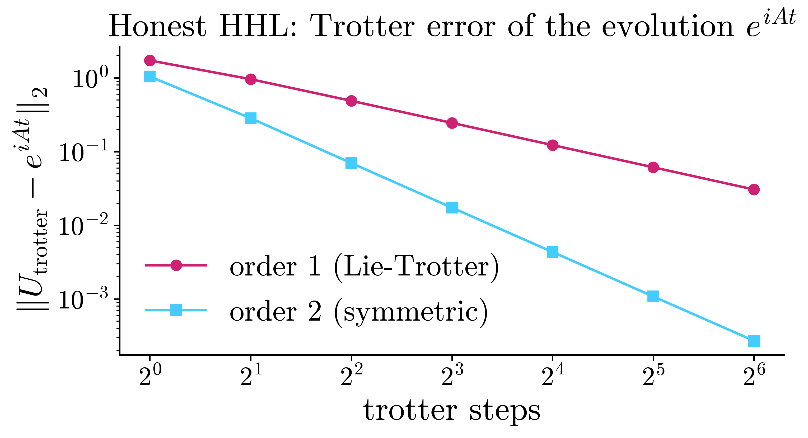
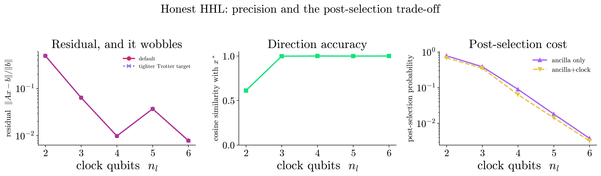
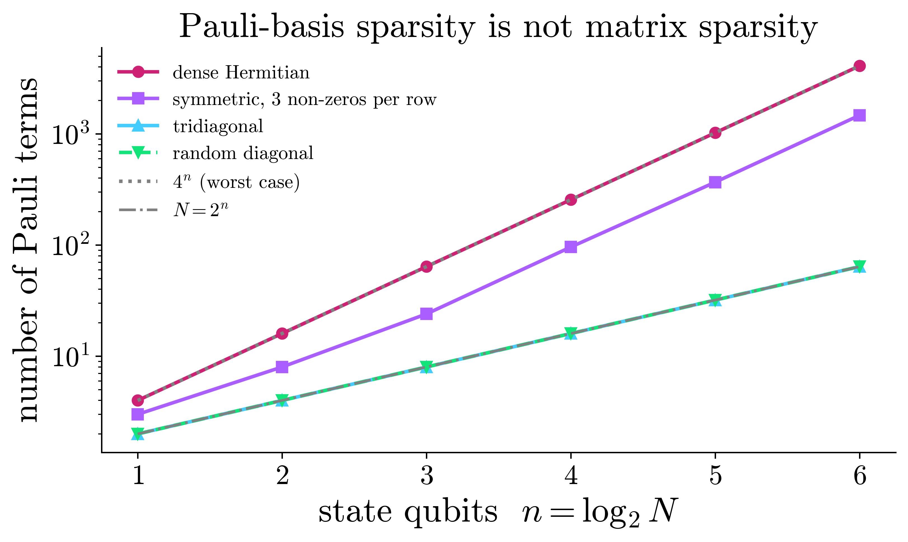
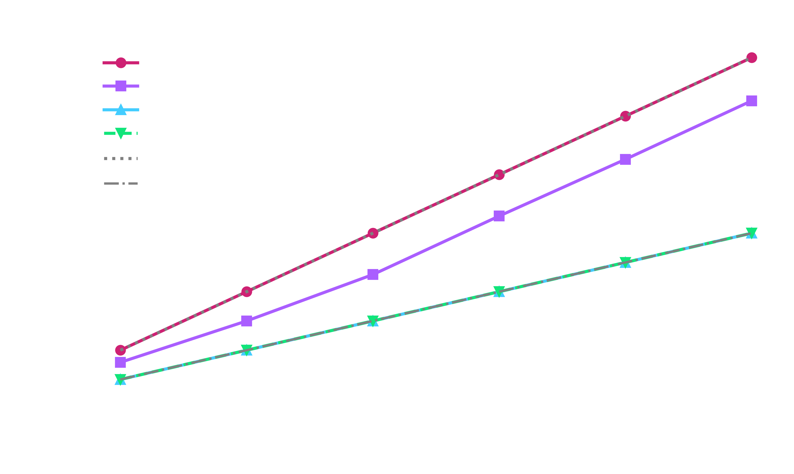

# Linear Systems with HHL

The **Harrow-Hassidim-Lloyd (HHL)** algorithm solves a linear system `Ax = b` on a
quantum computer. The `eigenkit` implementation has **two modes**:

| `mode` | How the circuit is built | Runs on hardware? |
|--------|--------------------------|-------------------|
| `"reference"` (default) | The eigenvalues are found classically (`eigvalsh`), `e^{iAt}` is applied as a dense matrix from `expm`, and the evolution time is tuned to the known spectrum. | ❌ No, it runs on a simulator only. |
| `"honest"` | There is **no** eigendecomposition, `e^{iAt}` is **Trotterised into elementary gates**, and the time is fixed from a Gershgorin bound that is cheap to compute. | ✅ Yes, the circuit can be built from elementary gates. |

`"reference"` mode is fast and exact. However, it does `O(N³)` classical work, and it
applies a `2ⁿ × 2ⁿ` unitary that is given only as a matrix, so it gives **no** quantum
speedup. `"honest"` mode removes all three shortcuts, so its circuit is one that you
could, *in principle*, run on real hardware.

This example runs on `provider="numpy"`, which is the default of `HHL`, so it needs no
optional extra. The figures need `matplotlib`. The whole page runs in about ten
seconds. See the [HHL chapter](../algorithms/hhl.md) for the construction, and the
[Algorithms guide](../user-guide/algorithms.md) for the interface.

```python
import warnings

import matplotlib
import matplotlib.pyplot as plt
import numpy as np

from eigenkit import HHL
from eigenkit.datasets import STYLE_COLORS, rc_params

# Honest mode is a pure-gate simulation; the numpy backend keeps it fast. Each
# figure below is drawn twice, so the site can serve whichever theme matches the
# reader's.
PROVIDER = "numpy"
```

## Solving small systems in honest mode

We solve a few textbook systems with `mode="honest"`, and compare each answer with the
classical one. `"honest"` mode requires `n_eigenvalue_qubits >= 2`, because the clock
register must be two-sided to represent negative eigenvalues.

From here on, every number comes from the circuit of `"honest"` mode. `"reference"`
mode appears only once more, in the section on how `"honest"` mode works below. There,
its gate counts are the baseline that `"honest"` mode is defined against. It is not
shown as an alternative to run.

None of the examples below chooses `n_eigenvalue_qubits` by hand. In the printed rows,
`n_l` is the number of clock qubits. `P_readout` is the rate at which a device
post-selects, and it falls by about four times for each added clock qubit. The helper
below therefore chooses the register: it grows the register until the solver stops
warning and the residual is good enough, and then it stops. The section on precision
below is the sweep that shows why it should stop there.

```python
def cosine(u, v):
    u, v = np.asarray(u).ravel(), np.asarray(v).ravel()
    return abs(np.vdot(u, v)) / (np.linalg.norm(u) * np.linalg.norm(v) + 1e-15)


def solve_at_chosen_clock(A, b, target=0.03, n_l_max=7, **kwargs):
    """Solve in honest mode, letting the answer choose the clock register.

    `n_eigenvalue_qubits` is the one knob honest mode cannot derive for itself.
    The resolution floor `C` has to clear the smallest eigenvalue of `A`, and
    the smallest eigenvalue is precisely what the honest path refuses to
    compute. Two things it may read instead: the warnings the solver raises for
    itself, and the residual the result already carries: `‖Ax − b‖/‖b‖` is an
    `O(N²)` check on the answer, not an `O(N³)` look at the spectrum.

    So grow the register from 2 and stop at the first size that raises no
    warning and lands inside `target`. Stopping matters as much as starting:
    each extra clock qubit costs about fourfold in post-selection rate, and
    the precision section shows the residual does not fall monotonically to pay
    for it. The smallest register that is good enough is the right one, not the
    largest that fits.
    """
    A, b = np.asarray(A, float), np.asarray(b, float)
    x_true = np.linalg.solve(A, b)

    for n_l in range(2, n_l_max + 1):
        # A warning here is the solver telling us this register is too coarse,
        # which is the answer to the question being asked, not a problem to
        # report, so it is caught rather than printed.
        with warnings.catch_warnings(record=True) as caught:
            warnings.simplefilter("always")
            result = HHL(
                n_eigenvalue_qubits=n_l, provider=PROVIDER, mode="honest", **kwargs
            ).solve(A, b)

        good = not caught and result.residual <= target
        note = f"{len(caught)} warning(s)" if caught else ""
        line = (
            f"   n_l={n_l}:  resid={result.residual:.4f}  "
            f"cos={cosine(result.solution, x_true):.4f}  "
            f"P_readout={result.readout_probability:.2e}  "
            f"1 in {round(1 / max(result.readout_probability, 1e-12)):<4d} {note}"
            + ("  <- chosen" if good else "")
        )
        # Rstrip, because `trim trailing whitespace` in pre-commit strips the
        # page and cannot strip the cell, and the two then never match again.
        print(line.rstrip())
        if good:
            if x_true.size <= 8:  # a wider vector wraps and reads as noise
                print(f"   classical x = {np.round(x_true, 4)}")
                print(f"   honest    x = {np.round(result.solution, 4)}")
            return n_l, result

    raise RuntimeError(
        f"no register up to n_l={n_l_max} met target={target}; the system is "
        "worse conditioned than this notebook's examples"
    )
```

### A 2×2 diagonal system

```text
A = [[2, 0],
     [0, 1]]  =  (3/2)·I + (1/2)·Z,    b = [1, 1]    ⇒    x* = [0.5, 1]
```

A diagonal `A` decomposes into `Z` strings only, and these commute with each other, so
its Trotterisation is **exact**: even `trotter_steps=1` gives a clean answer. The
residual that is left comes from the resolution of the clock, not from Trotter error.
This is why the selector below can trade it against the post-selection rate at all.

```python
_ = solve_at_chosen_clock(np.diag([2.0, 1.0]), np.array([1.0, 1.0]), trotter_steps=1)
```

```text
   n_l=2:  resid=0.5586  cos=0.7417  P_readout=5.76e-01  1 in 2    1 warning(s)
   n_l=3:  resid=0.0508  cos=0.9991  P_readout=2.37e-01  1 in 4
   n_l=4:  resid=0.0125  cos=0.9999  P_readout=4.90e-02  1 in 20     <- chosen
   classical x = [0.5 1. ]
   honest    x = [0.5062 0.9874]
```

### A system whose Trotterisation is only approximate

```text
A = [[2, 1],
     [1, 0]]  =  I + X + Z,    b = [1, 0]    ⇒    x* = [0, 1]
```

The eigenvalues are `1 ± √2`, so the condition number is `κ(A) ≈ 5.83`, and the
spectrum is indefinite (it has eigenvalues of both signs). What matters here is that
`X` and `Z` **anticommute**: the Trotter product `e^{iXτ} e^{iZτ}` is not
`e^{i(X+Z)τ}`. This is therefore the first example on this page where
`trotter_steps` changes the answer at all.

The more obvious choice, `[[2, 1], [1, 2]]`, would *not* work as an example. It equals
`2I + X`, which has exactly one Pauli term that is not the identity. With a single
term, the Trotter product is the exact exponential for any number of steps, so
`trotter_steps` has no effect there. The cell below prints both decompositions, so that
you can see the difference. An off-diagonal entry is not the same thing as Pauli terms
that do not commute.

We then let the selector choose a register at the default `trotter_steps="auto"`, and
solve again on that same register with a single Trotter step, so that the Trotter grid
is the only thing that changes.

```python
from eigenkit.algorithms._hamiltonian_sim import pauli_decompose


A_1b = np.array([[2.0, 1.0], [1.0, 0.0]])
b_1b = np.array([1.0, 0.0])

# The two-term decomposition that disqualifies [[2,1],[1,2]] as an example here,
# and the three-term one that makes [[2,1],[1,0]] a real test of trotter_steps.
for M in (np.array([[2.0, 1.0], [1.0, 2.0]]), A_1b):
    print(
        f"{M.tolist()}  =  "
        + "  +  ".join(f"{c.real:+.3g}*{s}" for c, s in pauli_decompose(M))
    )

# The register is chosen at the default trotter_steps="auto" ...
print('\ntrotter_steps="auto"  (the default)')
n_l_1b, auto_1b = solve_at_chosen_clock(A_1b, b_1b)

# ... and then held fixed, so the only thing that changes below is the grid.
print("\ntrotter_steps=1  (one step for the whole evolution), same register")
one_step = HHL(
    n_eigenvalue_qubits=n_l_1b, provider=PROVIDER, mode="honest", trotter_steps=1
).solve(A_1b, b_1b)
print(
    f"   n_l={n_l_1b}:  resid={one_step.residual:.4f}  "
    f"cos={cosine(one_step.solution, np.linalg.solve(A_1b, b_1b)):.4f}  "
    f"P_readout={one_step.readout_probability:.2e}"
)
print(f"   honest    x = {np.round(one_step.solution, 4)}")
```

```text
[[2.0, 1.0], [1.0, 2.0]]  =  +2*I  +  +1*X
[[2.0, 1.0], [1.0, 0.0]]  =  +1*I  +  +1*X  +  +1*Z

trotter_steps="auto"  (the default)
   n_l=2:  resid=0.3827  cos=0.3825  P_readout=6.64e-01  1 in 2    2 warning(s)
   n_l=3:  resid=0.3457  cos=0.5810  P_readout=1.48e-01  1 in 7    2 warning(s)
   n_l=4:  resid=0.0003  cos=1.0000  P_readout=1.67e-01  1 in 6      <- chosen
   classical x = [0. 1.]
   honest    x = [-3.0000e-04  1.0006e+00]

trotter_steps=1  (one step for the whole evolution), same register
RuntimeWarning: HHL(mode='honest'): the Trotter drift bound ‖A_eff − A‖ ≲ 0.42 exceeds C/2 = 0.214 at trotter_steps=1, trotter_order=2. The circuit is then exact HHL for a perturbed A_eff: an extremal eigenvalue can be captured by the sign-ambiguous Nyquist bucket, and the eigenvectors rotate, corrupting the direction of the solution without changing its spectrum. Use trotter_steps=6 or 'auto'.
   n_l=4:  resid=0.2412  cos=0.8964  P_readout=7.07e-02
   honest    x = [0.2341 0.4736]
```

At `trotter_steps=1`, the residual is `0.2412`, and the cosine with `x*` drops to
`0.8964`. `trotter_steps="auto"` picks 6 steps, and reaches a residual of `0.0003`
with a cosine of `1.0000`. The single-step run also raises a `RuntimeWarning`. The
drift bound `‖A_eff − A‖ ≲ 0.42`, where `A_eff` is the Hamiltonian that the Trotter
circuit actually simulates, exceeds `C/2 = 0.214`, where `C` is the rotation constant.
Quantum phase estimation (QPE) then measures a perturbed Hamiltonian, and not `A`. This
warning is the reason for `"auto"`. The selector solves the same bound for the smallest
number of steps that stays below `trotter_tolerance · C` (the default tolerance is
`0.25`). When you set the number of steps by hand, the warning gives the number that
the selector would need (6).

### An indefinite system, with a negative eigenvalue

```text
A = [[0, 1],
     [1, 0]],    b = [1, 1]    ⇒    x* = [1, 1]
```

The eigenvalues are `±1`. The two-sided clock register resolves the sign of each
eigenvalue, and the controlled `RY` inversion gives `1/λ` the correct sign. Both
eigenvalues have modulus `1`, so two clock qubits already place them exactly on the
grid of buckets. This is the best case on the whole page, and it is worth seeing
once.

```python
_ = solve_at_chosen_clock(
    np.array([[0.0, 1.0], [1.0, 0.0]]), np.array([1.0, 1.0]), trotter_steps=1
)
```

```text
   n_l=2:  resid=0.0000  cos=1.0000  P_readout=1.00e+00  1 in 1      <- chosen
   classical x = [1. 1.]
   honest    x = [1. 1.]
```

### Beyond 2×2: a 4×4 and an 8×8

Nothing so far requires the system to be small. The three cases above are `2 × 2` only
so that their Pauli decompositions fit in a line of text. Here is the
finite-difference matrix at `N = 4` and `N = 8`, solved from start to finish in
`"honest"` mode, with the register chosen in the same way.

```python
def tridiagonal_system(dim):
    """The finite-difference matrix, with b a unit load on the first node."""
    A = 2.0 * np.eye(dim) - np.eye(dim, k=1) - np.eye(dim, k=-1)
    b = np.zeros(dim)
    b[0] = 1.0
    return A, b


for dim in (4, 8):
    A_n, b_n = tridiagonal_system(dim)
    print(
        f"{dim}x{dim} tridiagonal:  kappa={np.linalg.cond(A_n):.1f}, "
        f"{len(pauli_decompose(A_n))} Pauli terms, "
        f"{dim.bit_length() - 1} state qubits"
    )
    solve_at_chosen_clock(A_n, b_n)
```

```text
4x4 tridiagonal:  kappa=9.5, 4 Pauli terms, 2 state qubits
   n_l=2:  resid=0.7017  cos=0.2905  P_readout=2.98e-01  1 in 3    2 warning(s)
   n_l=3:  resid=0.3643  cos=0.5031  P_readout=4.66e-01  1 in 2    2 warning(s)
   n_l=4:  resid=0.1959  cos=0.9339  P_readout=1.45e-01  1 in 7
   n_l=5:  resid=0.0319  cos=0.9996  P_readout=7.89e-02  1 in 13
   n_l=6:  resid=0.0086  cos=1.0000  P_readout=1.94e-02  1 in 51     <- chosen
   classical x = [0.8 0.6 0.4 0.2]
   honest    x = [0.7965 0.593  0.3972 0.2006]
8x8 tridiagonal:  kappa=32.2, 8 Pauli terms, 3 state qubits
   n_l=2:  resid=0.7026  cos=0.2008  P_readout=2.97e-01  1 in 3    2 warning(s)
   n_l=3:  resid=0.3671  cos=0.3729  P_readout=3.73e-01  1 in 3    2 warning(s)
   n_l=4:  resid=0.1829  cos=0.5478  P_readout=1.62e-01  1 in 6    1 warning(s)
   n_l=5:  resid=0.1450  cos=0.7137  P_readout=4.64e-02  1 in 22   1 warning(s)
   n_l=6:  resid=0.0190  cos=0.9997  P_readout=3.67e-02  1 in 27     <- chosen
   classical x = [0.8889 0.7778 0.6667 0.5556 0.4444 0.3333 0.2222 0.1111]
   honest    x = [0.8694 0.7391 0.6207 0.515  0.4105 0.3047 0.2055 0.1027]
```

Both systems stop at six clock qubits, with a cosine of `1.0000` for the `4 × 4` and
`0.9997` for the `8 × 8`. The `8 × 8` has `κ = 32`, which is five times the condition
number of any of the `2 × 2` examples, and it reaches a residual of `0.019` with one
usable preparation in 27. The `8 × 8` system is then a circuit of 10 qubits (3 state
qubits, 6 clock qubits and 1 ancilla), and the whole search takes seconds of
simulation.

Read the rejected rows, because they show why the warning check is needed. The `8 × 8`
at `n_l = 5` has a residual of `0.145`, which is bad but not obviously fatal, while its
cosine is `0.71`. This means that the *direction* of the answer is wrong, and not only
its scale, which is exactly what a residual cannot tell you. The solver flags this row
itself: the smallest eigenvalue, `0.121`, is below half the resolution of the clock.
These rows are also *cheaper* (1 in 22 against 1 in 27), so a selector based on the
post-selection rate alone would have taken one of them. The warning is what rules them
out.

## Under the hood: what makes honest mode different

Three things distinguish `"honest"` mode from `"reference"` mode. We inspect each of
them on the following matrix:

```text
A = [[2, 1],
     [1, 3]]
```

```python
from eigenkit.algorithms._hamiltonian_sim import pauli_decompose


A = np.array([[2.0, 1.0], [1.0, 3.0]])

# (i) A is written as a sum of Pauli strings, the building block of gate-level
#     Hamiltonian simulation. No eigendecomposition involved.
terms = pauli_decompose(A)
print("Pauli decomposition of A:")
for coeff, pstring in terms:
    print(f"   {coeff.real:+.3f} · {pstring}")
```

```text
Pauli decomposition of A:
   +2.500 · I
   +1.000 · X
   -0.500 · Z
```

**(i) Parameters without the spectrum.** The `"honest"` path never calls `eigvalsh`.
The evolution time comes from a Gershgorin upper bound on `‖A‖`, which is the largest
sum of absolute values over the rows. It costs `O(nnz)`, where `nnz` is the number of
non-zero entries of `A`. The rotation constant `C` comes from the resolution of the
clock register. No eigenvalues are needed.

```python
from eigenkit.algorithms.hhl import (
    _gershgorin_spectral_radius,
    _honest_qpe_params,
)


n_l = 5
lam_max_bound = _gershgorin_spectral_radius(A)
t, C, _ = _honest_qpe_params(A, n_l)

print(
    f"Gershgorin bound on |λ|_max : {lam_max_bound:.4f}   "
    f"(true = {abs(np.linalg.eigvalsh(A)).max():.4f})"
)
print(
    f"evolution time  t           : {t:.4f}   (fixed; t·bound = {t * lam_max_bound:.4f} < π)"
)
print(
    f"rotation constant C         : {C:.4f}   (= register resolution, no spectrum used)"
)
```

```text
Gershgorin bound on |λ|_max : 4.0000   (true = 3.6180)
evolution time  t           : 0.7363   (fixed; t·bound = 2.9452 < π)
rotation constant C         : 0.2667   (= register resolution, no spectrum used)
```

**(ii) Elementary gates throughout.** In `"reference"` mode, `e^{iAt}` enters QPE as a
dense `ControlledQubitUnitary` that carries the full `2ⁿ × 2ⁿ` matrix. It is a black
box with no decomposition into hardware gates. `"honest"` mode replaces it with a
`HamiltonianQPEBlock` built from `H`, `RZ`, controlled-NOT (`CNOT`), `CPHASE`,
`PhaseShift` and `SWAP` gates (plus `RX` when the decomposition contains `Y` terms,
which this `A` does not). In both modes, the eigenvalue inversion is a uniformly
controlled rotation: `2^n_l` `RY` gates and `2^n_l` `CNOT` gates, with no ancillas and
no multi-controlled gate.

The cell below counts the gates twice: first in the QPE sub-block on its own, and then
in the **assembled** HHL circuit. The second count describes the circuit that you would
send to a device. The reason to check it separately is that a clean sub-block says
nothing about the whole circuit.

```python
from collections import Counter

import scipy.linalg

from eigenkit.algorithms.hhl import _compute_rotation_angles
from eigenkit.core.blocks import (
    HamiltonianQPEBlock,
    QPEBlock,
    QubitUnitary,
    assemble,
)


# (a) the QPE sub-block on its own
# Reference QPE: dense oracle e^{iAt} raised to powers.
U = scipy.linalg.expm(1j * A * t)
ref_oracle = assemble([QubitUnitary(U, wires=(0,))])
ref_gates = QPEBlock(ref_oracle, n_clock=n_l).build(n_l + 1).gates

# Honest QPE: Trotterised into elementary gates.
hon_gates = HamiltonianQPEBlock(terms, n_clock=n_l, time=t, steps=6).build(n_l + 1).gates

print("reference QPE gate counts:", dict(Counter(g.name for g in ref_gates)))
print("honest    QPE gate counts:", dict(Counter(g.name for g in hon_gates)))

dense = [g for g in ref_gates if g.name == "ControlledQubitUnitary"][0]
print(
    f"\nreference evolution oracle is a dense {len(dense.data[0])}×{len(dense.data[0])} "
    f"controlled unitary (a hardware black box)"
)
print(
    "honest QPE *block* contains ControlledQubitUnitary:",
    any(g.name == "ControlledQubitUnitary" for g in hon_gates),
)

# (b) the assembled HHL circuit
# The block above is only the evolution stage. The inversion is the other half, and
# a sub-block being free of dense gates says nothing about the whole circuit, so
# assemble both modes and count what actually ships.
n_b = 1
b_unit = np.array([1.0, 0.0])
angles = _compute_rotation_angles(2**n_l, t, C, lam_max_bound, 0.01)

specs = {}
for mode, kwargs in (("reference", {}), ("honest", {"trotter_steps": 6})):
    solver = HHL(n_eigenvalue_qubits=n_l, provider=PROVIDER, mode=mode, **kwargs)
    specs[mode] = solver._build_circuit_spec(A, b_unit, n_b, n_l, t, angles)
    counts = dict(Counter(g.name for g in specs[mode].gates))
    print(f"\nassembled {mode:9s} HHL circuit: {counts}")

dense_names = {"QubitUnitary", "ControlledQubitUnitary"}
for mode, spec in specs.items():
    n_dense = sum(1 for g in spec.gates if g.name in dense_names)
    print(f"{mode:>9s}: {n_dense} dense unitary-matrix gates")

n_ry = sum(1 for g in specs["honest"].gates if g.name == "RY")
print(
    f"\nhonest inversion: {n_ry} RY gates = 2^n_l = {2**n_l}, each elementary, "
    f"paired with {n_ry} CNOTs"
)
```

```text
reference QPE gate counts: {'H': 10, 'ControlledQubitUnitary': 5, 'SWAP': 2, 'CPHASE': 10}
honest    QPE gate counts: {'H': 382, 'PhaseShift': 186, 'RZ': 744, 'CNOT': 744, 'SWAP': 2, 'CPHASE': 10}

reference evolution oracle is a dense 2×2 controlled unitary (a hardware black box)
honest QPE *block* contains ControlledQubitUnitary: False

assembled reference HHL circuit: {'AmplitudeEncoding': 1, 'H': 20, 'ControlledQubitUnitary': 10, 'SWAP': 4, 'CPHASE': 20, 'RY': 32, 'CNOT': 32}

assembled honest    HHL circuit: {'AmplitudeEncoding': 1, 'H': 1508, 'PhaseShift': 744, 'RZ': 2976, 'CNOT': 3008, 'SWAP': 4, 'CPHASE': 20, 'RY': 32}
reference: 10 dense unitary-matrix gates
   honest: 0 dense unitary-matrix gates

honest inversion: 32 RY gates = 2^n_l = 32, each elementary, paired with 32 CNOTs
```

The two counts show that both stages are elementary. The assembled circuit is the claim
that matters: it has **no `ControlledQubitUnitary` and no `QubitUnitary` at all**,
against 10 in the `"reference"` circuit. These 10 gates are exactly the oracle powers
`e^{iAt·2ᵏ}`. The inversion is shared between the two modes, so it is elementary in
both, and the dense evolution is the only thing that still separates them.

The evolution is the larger part. The QPE block of `"honest"` mode adds only `H`, `RZ`,
`CNOT`, `PhaseShift`, `CPHASE` and `SWAP` gates, against the five `2 × 2` oracle powers
of the `"reference"` block, each of which is a black box with no decomposition into
hardware gates. The inversion then adds `2^n_l = 32` `RY` gates and 32 `CNOT` gates.
This is the uniformly controlled decomposition of
[Möttönen et al.](https://arxiv.org/abs/quant-ph/0407010), which applies a different
`RY(θ_j)` exactly for each of the 32 clock buckets, with one `RY` and one `CNOT` for
each step of a Gray-code walk. Written out literally, as one rotation controlled by
`n_l` qubits for each bucket, the same stage would be 31 multi-controlled gates.

Two claims about this are easy to confuse:

* The **circuit** can be built from elementary gates. Every gate above is one that a
  device implements directly, and the count is `Θ(2^n_l)`. The ladder of controlled
  evolutions in QPE already costs this much, and by the no-fast-forwarding theorem, no
  HHL based on QPE avoids it.
* The **description** is not compact. The `2^n_l` angles `θ_j = 2 arcsin(C/λ̃_j)` are
  listed bucket by bucket instead of computed, so the classical description of the
  circuit has size `Θ(2^n_l)`, and this is not a uniform family of circuits of
  polynomial size. Making it uniform means evaluating `arcsin(1/λ)` with quantum
  arithmetic on the clock register. Circuits for the functions that this needs,
  including the arcsine, are given by Häner et al. 2018
  ([arXiv:1805.12445](https://arxiv.org/abs/1805.12445)).

## Trotter accuracy: `trotter_steps` and `trotter_order`

For an `A` whose Pauli terms do not commute, the Trotter product approximates
`e^{iAt}` with an error that shrinks as `trotter_steps` grows, and that shrinks
*faster* for the symmetric second order. With the default `trotter_steps="auto"`, the
number of steps is chosen so that this error stays below the limit set by the finite
resolution of the clock. This is why the anticommuting example above needed
`trotter_steps=1` to show the effect of this setting at all. To see how the two orders
scale, we measure the Trotter error of the evolution `e^{iAt}` **directly**, because it
is the quantity that ultimately governs the accuracy of `"honest"` mode. We use a
2-qubit `A` whose terms are strongly non-commuting.

```python
import scipy.linalg

from eigenkit import Circuit
from eigenkit.algorithms._hamiltonian_sim import pauli_decompose
from eigenkit.core.blocks import TrotterBlock
from eigenkit.core.ir import CircuitSpec


def block_unitary(gates, n):
    """Dense unitary of a gate list via the statevector backend (qubit-0-MSB)."""
    spec = CircuitSpec(n_qubits=n, n_weights=0, n_inputs=0, gates=tuple(gates))
    circ = Circuit(spec, provider=PROVIDER)
    dim = 2**n
    cols = [
        circ.statevector(np.zeros(0), initial_state=np.eye(dim)[j].astype(complex))
        for j in range(dim)
    ]
    return np.column_stack(cols)


A_t = np.array(
    [
        [1.0, 0.7, 0.0, 0.3],
        [0.7, -0.5, 0.4, 0.0],
        [0.0, 0.4, 0.8, 0.6],
        [0.3, 0.0, 0.6, -1.0],
    ]
)
n_state, t_t = 2, 2.0
terms_t = pauli_decompose(A_t)
# TrotterBlock skips the identity term (an unobservable global phase), so we
# compare against the traceless part of A.
A_traceless = A_t - np.trace(A_t) / A_t.shape[0] * np.eye(A_t.shape[0])
exact = scipy.linalg.expm(1j * A_traceless * t_t)

step_grid = [1, 2, 4, 8, 16, 32, 64]
err = {1: [], 2: []}
for order in (1, 2):
    for s in step_grid:
        U = block_unitary(
            TrotterBlock(terms_t, time=t_t, steps=s, order=order).build(n_state).gates,
            n_state,
        )
        err[order].append(float(np.linalg.norm(U - exact, 2)))
    print(
        f"order {order}: "
        + "  ".join(f"{s}:{v:.1e}" for s, v in zip(step_grid, err[order]))
    )
```

```text
order 1: 1:1.7e+00  2:9.6e-01  4:4.9e-01  8:2.5e-01  16:1.2e-01  32:6.1e-02  64:3.1e-02
order 2: 1:1.0e+00  2:2.8e-01  4:7.0e-02  8:1.7e-02  16:4.3e-03  32:1.1e-03  64:2.7e-04
```

The figure shows the two rates on a log-log axis, where a power law is a straight line
whose slope is its exponent:

```python
# Text inside matplotlib artists needs care here: the docs theme renders serif text
# in cmr10, TeX's OT1-encoded font.  It has no glyph at all for en dash, U+2212
# minus, or unicode sub/superscripts, and it maps ASCII "|", "_" and "^" to em
# dash, dot accent and circumflex.  So keep artist text to plain words with ASCII
# hyphens, and put every mathematical symbol inside $...$ mathtext, which uses the
# correctly encoded cm fonts.
for theme in ("light", "dark"):
    with matplotlib.rc_context(rc_params(theme=theme)):
        fig, ax = plt.subplots(figsize=(7, 4))
        ax.plot(
            step_grid,
            err[1],
            "o-",
            label="order 1 (Lie-Trotter)",
            color=STYLE_COLORS[0],
        )
        ax.plot(
            step_grid,
            err[2],
            "s-",
            label="order 2 (symmetric)",
            color=STYLE_COLORS[3],
        )
        ax.set_xscale("log", base=2)
        ax.set_yscale("log")
        ax.set_xlabel("trotter steps")
        ax.set_ylabel(r"$\| U_{\mathrm{trotter}} - e^{iAt} \|_2$")
        ax.set_title(r"Honest HHL: Trotter error of the evolution $e^{iAt}$")
        ax.legend()
        fig.tight_layout()
        fig.savefig(f"trotter_error_{theme}.png", bbox_inches="tight")
        if theme == "light":
            plt.show()
        else:
            plt.close(fig)
```

{ .theme-image-light }
{ .theme-image-dark }

The order-1 error falls as `1/steps` (each doubling halves it), while the order-2 error
falls as `1/steps²` (each doubling divides it by four). `trotter_order=2` therefore
reaches a target accuracy with far fewer steps. At `trotter_steps=64`, the two errors
are `3.1e-02` and `2.7e-04`, a factor of 115.

You do not normally set `trotter_steps` by hand. `"auto"` solves a drift bound for the
number of steps that keeps `‖A_eff − A‖` below `trotter_tolerance × C`. Lower
`trotter_tolerance` to get a more accurate and deeper circuit. At order 2, the number
of steps grows only as `1/√tolerance`.

## Precision, and what post-selection costs

`n_eigenvalue_qubits` (`n_l`) sets the resolution of the clock. In `"honest"` mode, it
also sets the rotation constant `C = 2π/(t · 2^n_l)`, which is the smallest eigenvalue
that the register can resolve. A smaller `C` handles systems with worse conditioning,
but it lowers the post-selection probability, which scales as `(C/λ)²`. This section
makes the trade-off explicit.

Two probabilities come back, and they are not the same number. `success_probability`
is the weight on `ancilla = |1⟩`, summed over **all** clock states.
`readout_probability` is the weight on the joint event `ancilla = |1⟩` **and**
`clock = |0…0⟩`. This is the slice that the solution is actually read from, and the
rate at which a device would post-select. Use the second one to plan the number of
shots; the first one overstates it.

We sweep `n_l` on `A = [[3, 1], [1, 2]]` (`κ ≈ 2.62`) with the default
`trotter_steps="auto"`. Each solve is repeated once as a control, at
`trotter_tolerance=0.01`, which is a Trotter target 25 times tighter. If the control
follows the series, the error that remains is not Trotter error, and the `off-grid`
diagnostic shows what it is instead.

```python
A_p = np.array([[3.0, 1.0], [1.0, 2.0]])
b_p = np.array([1.0, 0.0])
x_true_p = np.linalg.solve(A_p, b_p)

n_l_grid = [2, 3, 4, 5, 6]
res_p, cos_p, prob_p, read_p, res_fine = [], [], [], [], []
for n_l in n_l_grid:
    kw = dict(n_eigenvalue_qubits=n_l, provider=PROVIDER)
    # The series itself. This is the one solve left free to warn.
    r = HHL(**kw, mode="honest").solve(A_p, b_p)

    # Diagnostic only: the solver never calls eigvalsh in honest mode. How far
    # off the clock's bucket grid does each eigenvalue land? 0 = exactly on grid,
    # 0.5 = worst case.
    t_h, _, _ = _honest_qpe_params(A_p, n_l)
    grid_pos = 2**n_l * np.abs(np.linalg.eigvalsh(A_p)) * t_h / (2 * np.pi)
    off_grid = np.abs(grid_pos - np.round(grid_pos))

    # The control: the same solve against a 25x tighter Trotter target. It
    # would repeat the warnings the series has already raised, so it is
    # silenced: two copies of one warning read as two problems.
    with warnings.catch_warnings():
        warnings.simplefilter("ignore")
        r_fine = HHL(**kw, mode="honest", trotter_tolerance=0.01).solve(A_p, b_p)

    res_p.append(r.residual)
    cos_p.append(cosine(r.solution, x_true_p))
    prob_p.append(r.success_probability)
    read_p.append(r.readout_probability)
    res_fine.append(r_fine.residual)

    print(
        f"n_l={n_l}: residual={r.residual:.4f}  cos={cos_p[-1]:.4f}  "
        f"P_ancilla={r.success_probability:.2e}  P_readout={r.readout_probability:.2e}"
        f"   | off-grid: {np.round(off_grid, 2)}"
    )
    print(f"        control:  trotter_tolerance=0.01 -> {r_fine.residual:.4f}")
```

```text
RuntimeWarning: HHL(mode='honest'): σ_min ≈ 1.38 is below half the resolution floor, C/2 = 2, so it rounds into the rotation-free bucket 0, so that component of b is attenuated or dropped — and it carries the largest 1/λ weight, so it is what the direction of x depends on most. At n_eigenvalue_qubits=2: raise n_eigenvalue_qubits to ≥ 3.
RuntimeWarning: HHL: relative residual ‖Ax−b‖/‖b‖ = 0.491 — a rough answer, and with κ ≈ 3 the direction of x can be off by κ× that (a small residual bounds the backward error, not the forward one). Raise n_eigenvalue_qubits; in honest mode a finer Trotter grid is the other usual cause.
n_l=2: residual=0.4913  cos=0.6116  P_ancilla=7.87e-01  P_readout=6.91e-01   | off-grid: [0.35 0.1 ]
        control:  trotter_tolerance=0.01 -> 0.4913
n_l=3: residual=0.0640  cos=0.9982  P_ancilla=3.89e-01  P_readout=3.53e-01   | off-grid: [0.04 0.29]
        control:  trotter_tolerance=0.01 -> 0.0640
n_l=4: residual=0.0099  cos=1.0000  P_ancilla=9.01e-02  P_readout=6.40e-02   | off-grid: [0.42 0.33]
        control:  trotter_tolerance=0.01 -> 0.0099
n_l=5: residual=0.0371  cos=0.9994  P_ancilla=1.82e-02  P_readout=1.43e-02   | off-grid: [0.18 0.43]
        control:  trotter_tolerance=0.01 -> 0.0371
n_l=6: residual=0.0079  cos=1.0000  P_ancilla=3.80e-03  P_readout=3.25e-03   | off-grid: [0.29 0.04]
        control:  trotter_tolerance=0.01 -> 0.0078
```

The figure has three panels: what the answer is worth, whether its direction is right,
and what reading it costs.

```python
# Plain words plus $...$ mathtext only; see the note above the Trotter figure.
# The residual label is also set below the rc default size: at 16 pt it is
# taller than its panel and spills off the saved figure.
for theme in ("light", "dark"):
    with matplotlib.rc_context(rc_params(theme=theme)):
        fig, ax = plt.subplots(1, 3, figsize=(14, 4))
        ax[0].plot(n_l_grid, res_p, "o-", color=STYLE_COLORS[0], lw=2, label="default")
        ax[0].plot(
            n_l_grid,
            res_fine,
            "x:",
            color=STYLE_COLORS[2],
            lw=2,
            label="tighter Trotter target",
        )
        ax[0].set_xlabel(r"clock qubits  $n_l$")
        ax[0].set_ylabel(r"residual  $\|Ax - b\| / \|b\|$", fontsize=13)
        ax[0].set_title("Residual, and it wobbles")
        ax[0].set_yscale("log")
        ax[0].legend(fontsize=9)

        ax[1].plot(n_l_grid, cos_p, "s-", color=STYLE_COLORS[5], lw=2)
        ax[1].set_xlabel(r"clock qubits  $n_l$")
        ax[1].set_ylabel(r"cosine similarity with $x^*$", fontsize=13)
        ax[1].set_title("Direction accuracy")
        ax[1].set_ylim(0, 1.05)

        ax[2].plot(
            n_l_grid, prob_p, "^-", color=STYLE_COLORS[1], lw=2, label="ancilla only"
        )
        ax[2].plot(
            n_l_grid, read_p, "v--", color=STYLE_COLORS[6], lw=2, label="ancilla+clock"
        )
        ax[2].set_xlabel(r"clock qubits  $n_l$")
        ax[2].set_ylabel("post-selection probability", fontsize=13)
        ax[2].set_title("Post-selection cost")
        ax[2].set_yscale("log")
        ax[2].legend(fontsize=11)

        fig.suptitle("Honest HHL: precision and the post-selection trade-off", y=1.02)
        fig.tight_layout()
        fig.savefig(f"precision_{theme}.png", bbox_inches="tight")
        if theme == "light":
            plt.show()
        else:
            plt.close(fig)
```

{ .theme-image-light }
{ .theme-image-dark }

The residual improves overall, but not monotonically. The measured residuals across
`n_l = 2…6` are `0.4913`, `0.0640`, `0.0099`, `0.0371` and `0.0079`. Two clock qubits
are not enough to represent the spectrum at all: the residual is `0.49`, the cosine is
`0.61`, and `solve()` says so twice. The first warning reports that four clock buckets
cannot resolve this `κ`, and names the `n_eigenvalue_qubits` that can. The second
warning flags the residual itself as rough. By `n_l = 6`, the residual is 62 times
smaller. However, `n_l = 5` is **3.7 times worse than `n_l = 4`**, and the plot shows
this dip instead of a straight line.

This is not Trotter error, and the control shows it. At `trotter_tolerance=0.01`, a
Trotter target 25 times tighter, every point of the sweep comes back within `0.0001`
of the default (`n_l = 5` returns the same `0.0371`). The Trotter grid that the
selector chose was therefore never the limiting factor.

The cause is the readout projection. The solution is read from the `clock = |0…0⟩`
slice, and this slice weights each eigenvalue by how well it fits the grid of buckets.
The weight is exact on the grid, and up to about 9 % low at an offset of half a bucket
(the shortfall is largest for an eigenvalue in the lowest buckets). The pattern changes
as eigenvalues move on and off the grid when `n_l` changes, and the `off-grid` column
tracks it: `0.42`/`0.33` at `n_l = 4`, `0.18`/**`0.43`** at `n_l = 5` (close to the
worst case), and `0.29`/**`0.04`** at `n_l = 6` (almost on the grid). A small irregular
variation of the residual as `n_l` grows is therefore expected by construction. The
right way to read the trend is its envelope, not the difference from one point to the
next.

The variation comes from the evolution time. With no spectrum to look at, the
`"honest"` path takes `t` from the Gershgorin bound, which is `4.0` here against a true
`|λ|_max` of `3.618`. Where the eigenvalues fall between the centres of the buckets is
therefore not chosen: it is whatever this `t` and this `n_l` produce. The `off-grid`
column shows where they fall, and it changes with `n_l` for reasons that have nothing
to do with an improvement in accuracy. This is the one real cost of not diagonalising
`A`, and it is a cost in *the alignment of the buckets*, not in the evolution. The
`trotter_tolerance` control above has already shown that the Trotterisation is not
what limits the answer.

The post-selection panel shows the price. The ancilla weight falls from `0.79` to
`0.0038` across the sweep. The joint weight of ancilla and clock, which is the rate
that matters on hardware, falls from `0.69` to `0.0033`. At `n_l = 4`, the two differ
by a factor of `1.4` (`0.090` against `0.064`), so if you quoted `success_probability`
as the post-selection rate, you would underestimate the number of shots by that factor.

## Which matrices are actually cheap

The one classical cost that the `"honest"` path *cannot* avoid is the decomposition of
`A` into Pauli strings, and the number of terms that it finds decides whether a speedup
exists at all. The property that matters is sparsity **in the Pauli basis**. This is
not the same property as sparsity of the matrix, and confusing the two is the easiest
way to claim too much here. Below, `n` is the number of state qubits and `N = 2ⁿ` is
the dimension of `A`.

* Matrices *built* as a short Pauli sum have `O(poly n)` terms. Examples are local spin
  Hamiltonians, Ising models and `diag(1…N)`. These matrices are really cheap.
* A matrix that is sparse can be dense in the Pauli basis. A random **diagonal** matrix
  has one non-zero entry per row, and still needs `N` terms. The coefficients of its
  `Z` strings are the Walsh-Hadamard transform of the diagonal, which is dense for a
  generic diagonal.
* The tridiagonal finite-difference matrix is the standard example of a cheap system,
  and on a log axis next to `4ⁿ` it looks like one. It needs exactly `N = 2ⁿ` terms,
  which is exponential in the number of qubits. It is cheap *compared with* a dense
  matrix, not cheap in absolute terms.

Keep one thing separate. The efficiency assumption of the 2009 HHL paper uses a
**different input model**. It assumes an `A` that is `s`-sparse, whose rows can be
computed efficiently, and that is accessed through a sparse-access oracle. The cost
analysis of that model does not carry over to a decomposition into Pauli terms or into
a linear combination of unitaries. The `"honest"` path pays the Pauli cost, so that is
the cost that this section measures.

We count the Pauli terms for four families of matrices, across sizes.

```python
def tridiagonal(dim):
    return 2.0 * np.eye(dim) - np.eye(dim, k=1) - np.eye(dim, k=-1)


def random_diagonal(dim, seed):
    """One non-zero per row: as matrix-sparse as an invertible matrix can be."""
    return np.diag(np.random.default_rng(seed).standard_normal(dim))


def sparse_symmetric(dim, seed):
    """Symmetric with exactly 3 non-zeros per row: a diagonal plus one random cycle."""
    r = np.random.default_rng(seed)
    A = np.diag(r.standard_normal(dim))
    order = r.permutation(dim)
    for k in range(dim):
        i, j = order[k], order[(k + 1) % dim]
        A[i, j] = A[j, i] = r.standard_normal()
    return A


def dense_symmetric(dim, seed):
    m = np.random.default_rng(seed).standard_normal((dim, dim))
    return m + m.T


def dense_hermitian(dim, seed):
    r = np.random.default_rng(seed)
    m = r.standard_normal((dim, dim)) + 1j * r.standard_normal((dim, dim))
    return m + m.conj().T


sizes = [2, 4, 8, 16, 32, 64]
tri_terms, diag_terms, sp3_terms, dense_terms = [], [], [], []
for dim in sizes:
    n = dim.bit_length() - 1
    sp3 = sparse_symmetric(dim, seed=dim)
    tri_terms.append(len(pauli_decompose(tridiagonal(dim))))
    diag_terms.append(len(pauli_decompose(random_diagonal(dim, seed=dim))))
    sp3_terms.append(len(pauli_decompose(sp3)))
    dense_terms.append(len(pauli_decompose(dense_hermitian(dim, seed=dim))))
    print(
        f"dim={dim:3d} (n={n}):  tridiagonal={tri_terms[-1]:4d}   "
        f"rand-diagonal={diag_terms[-1]:4d}   "
        f"symmetric({int((sp3 != 0).sum(axis=1).max())} per row)={sp3_terms[-1]:5d}   "
        f"dense={dense_terms[-1]:5d}   (N={dim}, 4^n={4**n})"
    )

# Headline, compared like for like: both matrices below are real symmetric, for
# which the Y-odd Pauli strings vanish, so the ceiling is 4^n/2 + N/2 rather
# than 4^n.
dim = 128
sp3_128 = len(pauli_decompose(sparse_symmetric(dim, seed=dim)))
dense_128 = len(pauli_decompose(dense_symmetric(dim, seed=dim)))
print(
    f"\nN={dim}: symmetric with 3 non-zeros per row -> {sp3_128} Pauli terms, "
    f"against {dense_128} for fully dense real symmetric "
    f"({100 * sp3_128 / dense_128:.0f}% of dense)"
)
```

```text
dim=  2 (n=1):  tridiagonal=   2   rand-diagonal=   2   symmetric(2 per row)=    3   dense=    4   (N=2, 4^n=4)
dim=  4 (n=2):  tridiagonal=   4   rand-diagonal=   4   symmetric(3 per row)=    8   dense=   16   (N=4, 4^n=16)
dim=  8 (n=3):  tridiagonal=   8   rand-diagonal=   8   symmetric(3 per row)=   24   dense=   64   (N=8, 4^n=64)
dim= 16 (n=4):  tridiagonal=  16   rand-diagonal=  16   symmetric(3 per row)=   96   dense=  256   (N=16, 4^n=256)
dim= 32 (n=5):  tridiagonal=  32   rand-diagonal=  32   symmetric(3 per row)=  368   dense= 1024   (N=32, 4^n=1024)
dim= 64 (n=6):  tridiagonal=  64   rand-diagonal=  64   symmetric(3 per row)= 1472   dense= 4096   (N=64, 4^n=4096)

N=128: symmetric with 3 non-zeros per row -> 5440 Pauli terms, against 8256 for fully dense real symmetric (66% of dense)
```

The figure shows the four families against the two reference curves, `4ⁿ` and
`N = 2ⁿ`:

```python
ns = [d.bit_length() - 1 for d in sizes]


# Plain words plus $...$ mathtext only; see the note above the Trotter figure.
for theme in ("light", "dark"):
    with matplotlib.rc_context(rc_params(theme=theme)):
        fig, ax = plt.subplots(figsize=(7.5, 4.6))
        ax.plot(
            ns, dense_terms, "o-", color=STYLE_COLORS[0], lw=2, label="dense Hermitian"
        )
        ax.plot(
            ns,
            sp3_terms,
            "s-",
            color=STYLE_COLORS[1],
            lw=2,
            label="symmetric, 3 non-zeros per row",
        )
        ax.plot(ns, tri_terms, "^-", color=STYLE_COLORS[3], lw=2, label="tridiagonal")
        ax.plot(
            ns, diag_terms, "v--", color=STYLE_COLORS[5], lw=2, label="random diagonal"
        )
        ax.plot(
            ns, [4**n for n in ns], ":", color="0.5", lw=2, label=r"$4^n$ (worst case)"
        )
        ax.plot(ns, [2**n for n in ns], "-.", color="0.5", lw=1.5, label=r"$N = 2^n$")
        ax.set_yscale("log")
        ax.set_xlabel(r"state qubits  $n = \log_2 N$")
        ax.set_ylabel("number of Pauli terms")
        ax.set_title("Pauli-basis sparsity is not matrix sparsity")
        ax.legend(fontsize=11, loc="upper left")
        fig.tight_layout()
        fig.savefig(f"scaling_{theme}.png", bbox_inches="tight")
        if theme == "light":
            plt.show()
        else:
            plt.close(fig)
```

{ .theme-image-light }
{ .theme-image-dark }

The tridiagonal and random diagonal matrices lie exactly on the `N = 2ⁿ` line, with 2,
4, 8, 16, 32 and 64 terms across the sweep, and only the dense Hermitian matrix follows
`4ⁿ`. The plot therefore does not show a cheap family and an expensive one. It shows
one family that is exponential with base 2, and one that is exponential with base 4.
On a log axis, this gap looks like a difference in kind, and it is not.

The third curve is the main point of the section. `sparse_symmetric` is a cycle graph
with its vertices relabelled at random. It has exactly 3 non-zero entries per row,
which is the number that a tridiagonal matrix has in its interior rows. The relabelling
changes nothing about the sparsity of the matrix, and everything about the number of
terms: 1472 terms at `N = 64`, against 64 for the tridiagonal matrix. This is a factor
of 23, and 36 % of the 4096 terms that a dense Hermitian matrix of that size needs. At
`N = 128`, it reaches 5440 terms, against 8256 for a fully dense real symmetric matrix.
This is 66 % of a dense matrix, from three non-zero entries per row.

The mechanism is the following. A non-zero entry at `(i, j)` contributes to the Pauli
strings whose `X`/`Y` support is the bit pattern `i ⊕ j`. The number of terms is
therefore set by how many *distinct* offsets `i ⊕ j` the pattern contains, not by how
many non-zero entries it has. A band has only the `log₂ N` offsets `2ᵏ − 1`, which
gives 7 of them at `N = 128`. This is exactly why a real symmetric tridiagonal matrix
with variable coefficients costs `576 = 64 · 7 + 128` terms. A random pattern uses all
the offsets. For generic coefficients, the number of terms is exactly `2^(n−1)` for
each distinct non-zero offset when `A` is real symmetric, or `2ⁿ` when `A` is complex
Hermitian, plus the number of non-zero Walsh-Hadamard coefficients of the diagonal.

The `"honest"` path makes this cost *visible*: it is a number of terms that you can
print before you build a circuit, while a dense `expm` hides it. The speedup of HHL is
real for a well-conditioned `A` that is a short Pauli sum, with an efficient way to
prepare `b`. Sparsity of the matrix on its own provides none of these three
properties.

### The cheap family, solved

The first bullet above is the constructive case: a matrix *written down* as a short
Pauli sum, rather than as an array of numbers. A transverse-field Ising Hamiltonian has
`2n` terms: the identity shift, a nearest-neighbour `ZZ` term for each pair of
neighbouring sites, and a local `X` term on each site. This is linear in the number of
qubits, so the number of terms is no longer the obstacle. Once it is shifted to be
positive definite, it is a linear system like any other, and `"honest"` mode solves
it.

```python
from eigenkit.algorithms._hamiltonian_sim import pauli_string_matrix


def ising_terms(n, coupling=0.5, field=0.4, shift=3.0):
    """A transverse-field Ising Hamiltonian, shifted positive definite.

    Written down as Pauli strings rather than as a matrix, which is what makes it
    cheap: nearest-neighbour ZZ plus a local X on each site is 2n terms, linear
    in the qubit count, however large N gets.
    """
    terms = [(shift, "I" * n)]
    for k in range(n - 1):
        s = ["I"] * n
        s[k] = s[k + 1] = "Z"
        terms.append((coupling, "".join(s)))
    for k in range(n):
        s = ["I"] * n
        s[k] = "X"
        terms.append((field, "".join(s)))
    return terms


for n in (2, 3, 4):
    terms_i = ising_terms(n)
    A_i = sum(c * pauli_string_matrix(s) for c, s in terms_i).real
    b_i = np.zeros(2**n)
    b_i[0] = 1.0

    print(
        f"n={n} (N={2**n:2d}):  {len(terms_i)} terms written, "
        f"{len(pauli_decompose(A_i))} found by pauli_decompose,  "
        f"kappa={np.linalg.cond(A_i):.2f}"
    )
    solve_at_chosen_clock(A_i, b_i)
```

```text
n=2 (N= 4):  4 terms written, 4 found by pauli_decompose,  kappa=1.92
   n_l=2:  resid=0.2877  cos=0.9005  P_readout=7.80e-01  1 in 1    2 warning(s)
   n_l=3:  resid=0.0275  cos=0.9997  P_readout=1.70e-01  1 in 6      <- chosen
   classical x = [ 0.297  -0.0493 -0.0493  0.0113]
   honest    x = [ 0.2973 -0.0518 -0.0518  0.0048]
n=3 (N= 8):  6 terms written, 6 found by pauli_decompose,  kappa=3.01
   n_l=2:  resid=0.3071  cos=0.8593  P_readout=7.04e-01  1 in 1    2 warning(s)
   n_l=3:  resid=0.0436  cos=0.9981  P_readout=1.89e-01  1 in 5
   n_l=4:  resid=0.0361  cos=0.9994  P_readout=4.14e-02  1 in 24
   n_l=5:  resid=0.0048  cos=1.0000  P_readout=9.31e-03  1 in 107    <- chosen
   classical x = [ 0.2636 -0.0392 -0.0582  0.0136 -0.0392  0.0165  0.0136 -0.0044]
   honest    x = [ 0.2639 -0.0397 -0.0599  0.0146 -0.0397  0.0174  0.0146 -0.0054]
n=4 (N=16):  8 terms written, 8 found by pauli_decompose,  kappa=5.47
   n_l=2:  resid=0.3213  cos=0.8280  P_readout=6.44e-01  1 in 2    2 warning(s)
   n_l=3:  resid=0.0805  cos=0.9494  P_readout=2.19e-01  1 in 5    1 warning(s)
   n_l=4:  resid=0.0228  cos=0.9993  P_readout=4.70e-02  1 in 21     <- chosen
```

`pauli_decompose` finds exactly the terms that were written, so nothing is hidden: 8
terms for the `16 × 16` matrix, against the 256 that a dense Hermitian matrix of that
size needs, and the 16 that a random diagonal one needs. The number of terms grows by
two for each added qubit, not by a factor of four.

The three sizes stop at three different registers, with 3, 5 and 4 clock qubits, and
their cosines are `0.9997`, `1.0000` and `0.9993`. The register at which the selector
stops is therefore not a function of `N`. It depends on where the eigenvalues of that
system happen to fall on the grid of buckets, which is the subject of the precision
section. The `16 × 16` system stops at `n_l = 4`, a circuit of 9 qubits, with one
usable preparation in 21. This is the cheapest readout of any system of size `8 × 8`
or larger on this page, and it is the largest system.

This last number is the one to plan the number of shots against, and it comes from `κ`
and the resolution of the clock, not from the Pauli decomposition. Nothing about a
short Pauli sum makes post-selection cheaper. What it makes cheaper is the circuit that
has to be built in the first place.

## Summary

| | `"reference"` | `"honest"` |
|---|---|---|
| Eigenvalues | They are found classically with `eigvalsh` (`O(N³)`). | They are **not computed**. |
| Evolution `e^{iAt}` | It is a dense black box from `expm`. | It is **Trotterised into elementary gates**. |
| Evolution time `t` | It is tuned to the known spectrum. | It is fixed from a Gershgorin bound. |
| Rotation constant `C` | It is the true `λ_min`. | It is the resolution of the clock register. |
| The evolution `e^{iAt}` can be built from elementary gates | ❌ No, it is a black-box unitary. | ✅ Yes, it uses elementary gates. |
| Accuracy settings | The only one is `n_eigenvalue_qubits`. | They are `n_eigenvalue_qubits`, plus `trotter_steps`, `trotter_order` and `trotter_tolerance`. |

```python
from eigenkit import HHL

# The system from under the hood, so its Pauli decomposition is on the page.
A = np.array([[2.0, 1.0], [1.0, 3.0]])
b = np.array([1.0, 0.0])

result = HHL(
    n_eigenvalue_qubits=4,  # clock resolution; the selector above picks this
    mode="honest",  # hardware-faithful path
    trotter_steps="auto",  # default: step count from the drift bound
    trotter_order=2,  # default: symmetric splitting
    trotter_tolerance=0.25,  # default: drift bound target, as a fraction of C
    provider="numpy",
).solve(A, b)

# x ≈ A⁻¹b, read from the statevector; see the read-out caveat below.
print(f"solution            = {np.round(result.solution, 4)}")
# ‖Ax − b‖ / ‖b‖, against the original A and b.
print(f"residual            = {result.residual:.4f}")
# Weight on ancilla = |1⟩ across all clock states …
print(f"success_probability = {result.success_probability:.4f}")
# … and on ancilla = |1⟩ *and* clock = |0…0⟩, the physical rate: use this one.
print(f"readout_probability = {result.readout_probability:.4f}")
```

```text
solution            = [ 0.6018 -0.2036]
residual            = 0.0091
success_probability = 0.1772
readout_probability = 0.1294
```

The exact answer is `[0.6, -0.2]`, so four clock qubits come within one per cent of
it, at one usable preparation in eight. Four is the register that the selector from
the start of the page chooses for this system. Six clock qubits would reach a residual
of `0.0085` instead of `0.0091`, and cost one preparation in 154.

`"honest"` mode does not change one thing. In both modes, the eigenvalue inversion
still uses a table of `2^n_l − 1` angles, one for each clock bucket. It is built from
elementary gates (the uniformly controlled rotation above), so it costs nothing
asymptotically, because the ladder of controlled evolutions in QPE is already
`Θ(2^n_l)`. However, it means that the classical description of the circuit grows as
`Θ(2^n_l)`, so this is not a uniform family of circuits of polynomial size.

There is also a caveat about the readout. HHL natively produces the quantum *state*
`|x⟩`. The full `solution` vector here is read from the statevector of the simulator.
On real hardware, only expectation values `⟨x|M|x⟩` are available, and reading all `N`
components would take `O(N)` measurements. On hardware, HHL is therefore used to pass
`|x⟩` to a later quantum routine, or to estimate a single observable.

## Next

- [MaxCut with QAOA](qaoa-max-cut.md), which uses the quantum approximate optimisation
  algorithm (QAOA), is the other worked example of an algorithm that reads its answer
  from a full statevector.
- The [HHL chapter](../algorithms/hhl.md) explains the two modes, the Trotter settings,
  and where the speedup does and does not survive.
- The [Algorithms guide](../user-guide/algorithms.md) describes `HHL`, `IQAE` and
  `PortfolioRiskEstimator`, and what each result contains.
