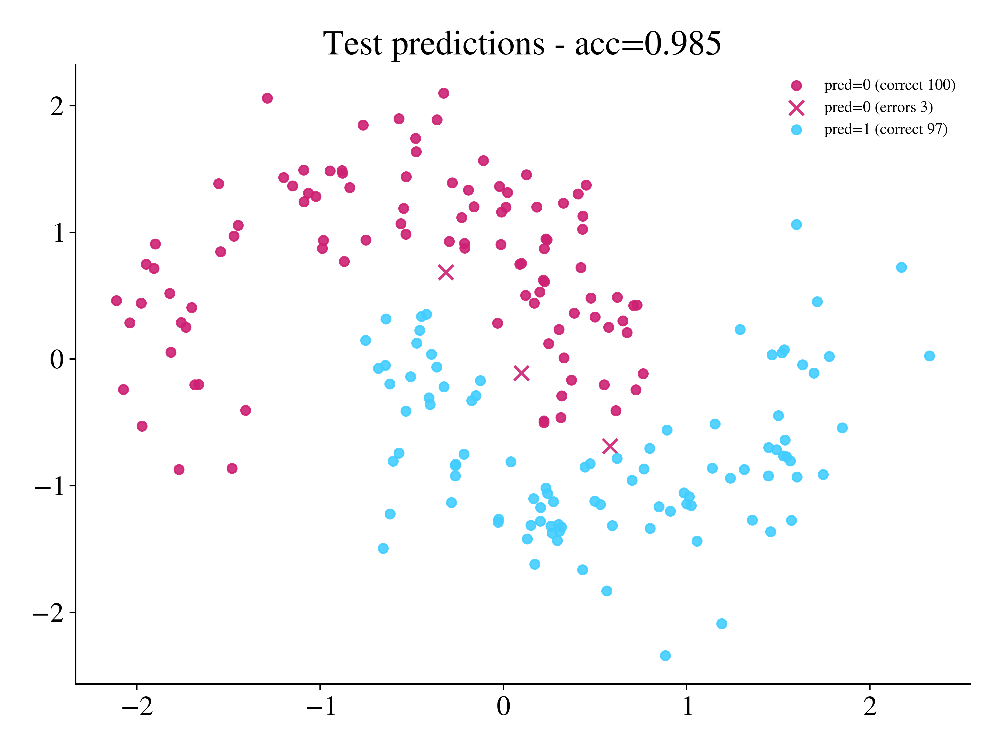
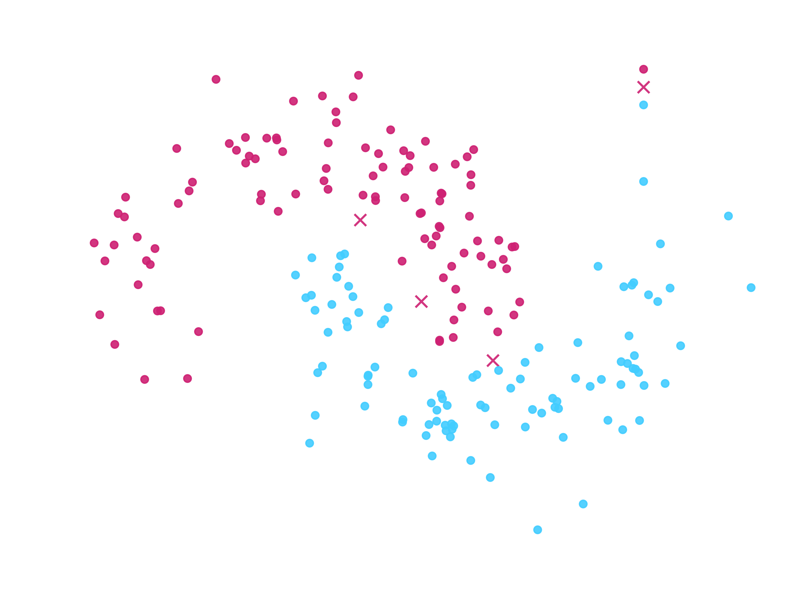

# Hybrid Classical-Quantum Model

This example places an `Ensemble` layer inside a classical `nn.Sequential`
pipeline, and trains the pipeline on the moons dataset.

## Data preparation

```python
import torch
from sklearn.datasets import make_moons
from sklearn.model_selection import train_test_split
from sklearn.preprocessing import StandardScaler

X, y = make_moons(n_samples=1000, noise=0.2, random_state=42)
X_train, X_test, y_train, y_test = train_test_split(
    X,
    y,
    test_size=0.2,
    random_state=42,
)

scaler = StandardScaler()
X_train = scaler.fit_transform(X_train)
X_test = scaler.transform(X_test)

X_train_t = torch.tensor(X_train, dtype=torch.float32)
y_train_t = torch.tensor(y_train, dtype=torch.long)
X_test_t = torch.tensor(X_test, dtype=torch.float32)
y_test_t = torch.tensor(y_test, dtype=torch.long)
```

## Model definition

The quantum layer is `Ensemble`, placed between two classical linear layers.
The first linear layer maps the two features of the moons data to an input with more
dimensions, which the quantum circuit can use.

```python
import torch
from torch import nn
from eigenkit import Ensemble


class HybridModel(nn.Module):
    def __init__(self, hidden_size: int, n_qubits: int, depth: int):
        super().__init__()
        self.layers = nn.Sequential(
            nn.Linear(2, hidden_size),
            nn.ReLU(),
            Ensemble(
                in_features=hidden_size,
                n_qubits=n_qubits,
                depth=depth,
            ),
            nn.ReLU(),
            nn.Linear(hidden_size, 2),
        )

    def forward(self, x: torch.Tensor) -> torch.Tensor:
        return self.layers(x)
```

`hidden_size` must be divisible by `n_qubits`, because `Ensemble` splits its input
into chunks of size `n_qubits` and runs one independent circuit on each chunk. The
outputs of the circuits are concatenated, so the layer returns `hidden_size` values.

## Training loop

```python
from torch import optim
from torch.utils.data import TensorDataset, DataLoader


def train(
    model,
    X_train,
    y_train,
    X_test,
    y_test,
    loss_fn,
    optimizer,
    num_epochs=10,
    batch_size=32,
):
    loader = DataLoader(
        TensorDataset(X_train, y_train),
        batch_size=batch_size,
        shuffle=True,
    )

    for epoch in range(num_epochs):
        model.train()
        running_loss = 0.0
        for xb, yb in loader:
            preds = model(xb)
            loss = loss_fn(preds, yb)
            optimizer.zero_grad()
            loss.backward()
            optimizer.step()
            running_loss += loss.item() * xb.size(0)

        model.eval()
        with torch.no_grad():
            acc = (model(X_test).argmax(1) == y_test).float().mean().item()
        print(
            f"Epoch {epoch + 1}/{num_epochs} | "
            f"loss: {running_loss / len(X_train):.4f} | "
            f"test_acc: {acc:.4f}"
        )
```

## Run training

```python
torch.manual_seed(42)

model = HybridModel(hidden_size=12, n_qubits=4, depth=2)
loss_fn = nn.CrossEntropyLoss()
optimizer = optim.Adam(model.parameters(), lr=0.005)

train(
    model,
    X_train_t,
    y_train_t,
    X_test_t,
    y_test_t,
    loss_fn,
    optimizer,
    num_epochs=15,
    batch_size=32,
)
```

```text
Epoch 1/15 | loss: 0.6283 | test_acc: 0.8200
...
Epoch 15/15 | loss: 0.1134 | test_acc: 0.9850
```

## Visualise predictions

```python
import matplotlib.pyplot as plt
import matplotlib
from matplotlib.colors import ListedColormap
from eigenkit.datasets import STYLE_COLORS, rc_params


def plot_predictions(model, X_test, y_test):
    model.eval()
    with torch.no_grad():
        pred = model(X_test).argmax(1)
    acc = (pred == y_test).float().mean().item()
    correct = pred.eq(y_test)
    class_cmap = ListedColormap([STYLE_COLORS[0], STYLE_COLORS[3], STYLE_COLORS[5]])

    with matplotlib.rc_context(rc_params(theme="light")):
        plt.figure(figsize=(8, 6))
        for cls in torch.unique(pred).tolist():
            color = class_cmap(int(cls) % class_cmap.N)
            mask = pred.eq(cls)
            plt.scatter(
                X_test[mask & correct, 0],
                X_test[mask & correct, 1],
                s=28,
                marker="o",
                alpha=0.9,
                label=f"pred={cls} (correct {int((mask & correct).sum())})",
                color=color,
            )
            if (mask & ~correct).any():
                plt.scatter(
                    X_test[mask & ~correct, 0],
                    X_test[mask & ~correct, 1],
                    s=70,
                    marker="x",
                    alpha=0.9,
                    label=f"pred={cls} (errors {int((mask & ~correct).sum())})",
                    color=color,
                )
        plt.title(f"Test predictions - acc={acc:.3f}")
        plt.legend(fontsize=9)
        plt.tight_layout()
        plt.show()


plot_predictions(model, X_test_t, y_test_t)
```

{ .theme-image-light }
{ .theme-image-dark }

See the [Layers guide](../user-guide/layers.md) for the full application programming
interface (API).
