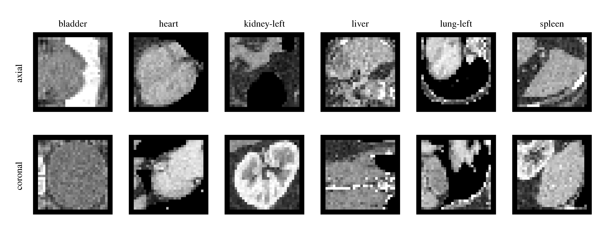
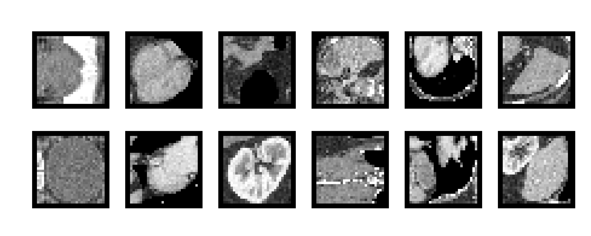
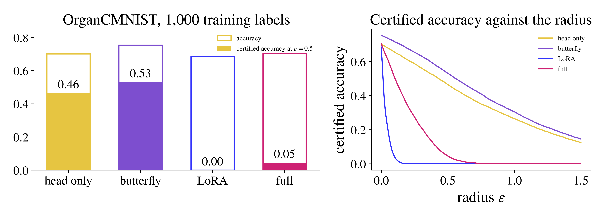
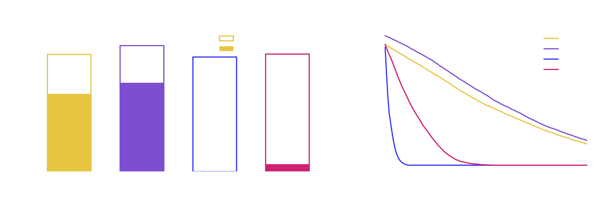

# Certified Fine-Tuning with Butterfly Adapters

## What this example shows

The [previous example](orthogonal-certified-training.md) trained a network whose
Lipschitz bound \(L\) is 1, so every prediction comes with a certified radius: a
distance within which no change of the image can change the prediction. This
example asks what happens to that guarantee when such a network is adapted to a
new task.

The certified radius of an image is

\[
r(x) = \min_{j \ne p} \frac{z_p(x) - z_j(x)}{L \, \lVert w_p - w_j \rVert_2},
\]

where \(z\) are the logits, \(p\) the predicted class, \(w_k\) the rows of the head
and \(L\) the bound of the features in front of the head. Adapting the network
changes its weights, and with them \(L\). Ordinary fine-tuning lets the
singular values of every weight drift, \(L\) grows, and the radii shrink by the
same factor, even when the accuracy is good.

A *butterfly adapter* changes a frozen weight \(W\) by an orthogonal rotation
\(R(\theta)\), built from RBS (Givens) rotations, in front of it:

\[
W' = R(\theta) \, W, \qquad
W'^\top W' = W^\top R^\top R \, W = W^\top W .
\]

\(W'\) has exactly the singular values of \(W\), for any \(W\) and any angles, so
the bound of the adapted network stays \(L_0\), the bound of the pretrained one,
and the certificate keeps its meaning. The angles start at zero, where
\(R = I\), so training starts from the pretrained network.

We compare four ways of adapting the same pretrained network, all with a new
classification head:

- **head only**: every pretrained weight stays frozen;
- **butterfly**: a butterfly adapter in front of every pretrained matrix;
- **LoRA** (Hu et al., ICLR 2022): a low-rank update \(W' = W + BA\) of rank 4,
  with \(B = 0\) at the start, the usual parameter-efficient method;
- **full**: every pretrained weight is trained.

See the [user guide](../user-guide/orthogonal.md#orthogonal-fine-tuning) for
`apply_orthogonal_adapters` and for the adapter on a single layer.

## The data

Two MedMNIST datasets (Yang et al., *Scientific Data* 10, 41, 2023) show the same
eleven abdominal organs in CT scans, cut in two different planes:

- **OrganAMNIST**: axial slices, 34,561 training images. The network is
  pretrained on it;
- **OrganCMNIST**: coronal slices, 12,975 training images and 8,216 test
  images. The network is adapted to it, with only **1,000** labelled training
  images, as when a new view of the data has few labels.

The images are \(28 \times 28\) and grey. As in the previous example, each one is
padded to \(32 \times 32\) and flattened to a vector of 1024 values in \([0, 1]\), which
changes no distances. The files come from the MedMNIST record on Zenodo (CC BY
4.0) and are downloaded once, about 70 MB, into `~/.cache/medmnist`.

```python
import copy
import time
import urllib.request
from pathlib import Path

import matplotlib.pyplot as plt
import numpy as np
import pandas as pd
import torch
import torch.nn as nn
import torch.nn.functional as F

from eigenkit import GenericClassifier
from eigenkit.datasets import STYLE_COLORS, rc_params
from eigenkit.orthogonal.torch import (
    LLNHead,
    MaxMin,
    Orthogonal,
    OrthogonalAdapter,
    apply_orthogonal_adapters,
    certified_accuracy,
    certified_radius,
    lipschitz_bound,
)

URL = "https://zenodo.org/records/10519652/files/{}.npz?download=1"
FOLDER = Path.home() / ".cache" / "medmnist"


def load_medmnist(name):
    """Images padded to 32 x 32 and flattened to 1024 values in [0, 1]."""
    path = FOLDER / f"{name}.npz"
    if not path.exists():
        FOLDER.mkdir(parents=True, exist_ok=True)
        urllib.request.urlretrieve(URL.format(name), path)
    out = {}
    with np.load(path) as data:
        for split in ("train", "val", "test"):
            images = data[f"{split}_images"].astype(np.float32) / 255
            images = np.pad(images, ((0, 0), (2, 2), (2, 2)))
            out[split] = (images.reshape(len(images), -1), data[f"{split}_labels"][:, 0])
    return out


source = load_medmnist("organamnist")
target = load_medmnist("organcmnist")
device = "cuda" if torch.cuda.is_available() else "cpu"

subset = np.random.default_rng(0).permutation(len(target["train"][0]))[:1000]
X_few, y_few = target["train"][0][subset], target["train"][1][subset]
X_test, y_test = target["test"]
print(f"source train {source['train'][0].shape}")
print(f"target train {X_few.shape}, every class present: {len(np.unique(y_few)) == 11}")
print(f"target test  {X_test.shape}")
```

```text
source train (34561, 1024)
target train (1000, 1024), every class present: True
target test  (8216, 1024)
```

The same six organs, once in each dataset, show how different the two views
are. The network has to carry what it learned on the top row over to the bottom
row:

```python
organs = (
    "bladder",
    "femur-left",
    "femur-right",
    "heart",
    "kidney-left",
    "kidney-right",
    "liver",
    "lung-left",
    "lung-right",
    "pancreas",
    "spleen",
)
shown = (0, 3, 4, 6, 7, 10)
with plt.rc_context(rc_params(theme="light")):
    fig, axes = plt.subplots(2, 6, figsize=(9, 3.6))
    for row, (name, data) in zip(axes, (("axial", source), ("coronal", target))):
        X, y = data["train"]
        for ax, organ in zip(row, shown):
            ax.imshow(
                X[np.flatnonzero(y == organ)[0]].reshape(32, 32),
                cmap="gray",
                vmin=0,
                vmax=1,
            )
            ax.set_axis_off()
            if name == "axial":
                ax.set_title(organs[organ], fontsize=10)
        row[0].text(-4, 16, name, rotation=90, ha="right", va="center", fontsize=10)
    fig.tight_layout()
    plt.show()
```

{ .theme-image-light }
{ .theme-image-dark }

## The pretrained certified network

The pretrained network is the butterfly network of the previous example, eight
blocks deep, now with eleven outputs:

\[
x \in \mathbb{R}^{1024}
\;\to\; 8 \times \big[\, \text{butterfly}(1024) \to \mathrm{MaxMin} \,\big]
\;\to\; \text{head}(1024 \to 11).
\]

It is trained on OrganAMNIST by `GenericClassifier`, as before: Adam with a
learning rate of \(10^{-3}\), batches of 128, cross-entropy, 30 epochs.

A pretrained network usually reaches us as plain weight matrices, not as
rotation angles. To start from that situation, we turn every trained butterfly
into an ordinary `nn.Linear` layer that holds its \(1024 \times 1024\) matrix. The
matrices are orthogonal because of how they were trained, but nothing in an
`nn.Linear` keeps them so, and that is exactly the situation of fine-tuning.
The bound of the result, \(L_0\), is the product of their largest singular
values.

```python
def make_network(depth, n_classes):
    blocks = []
    for _ in range(depth):
        blocks += [Orthogonal(1024, "butterfly"), MaxMin()]
    return nn.Sequential(*blocks, LLNHead(1024, n_classes))


start = time.time()
pretrained = GenericClassifier(
    make_network(8, 11).to(device),
    in_features=1024,
    lr=1e-3,
    epochs=30,
    batch_size=128,
    show_progress=False,
    random_state=0,
).fit(*source["train"])
source_accuracy = (pretrained.predict(source["test"][0]) == source["test"][1]).mean()
print(
    f"pretrained on OrganAMNIST in {time.time() - start:.0f} s, "
    f"test accuracy {source_accuracy:.3f}"
)

layers = []
for layer in pretrained.model_[:-1]:  # every block, without the head
    if isinstance(layer, Orthogonal):
        linear = nn.Linear(1024, 1024, bias=False)
        with torch.no_grad():
            linear.weight.copy_(layer.matrix())
        layer = linear
    layers.append(layer)
backbone = nn.Sequential(*layers).to(device)
L0 = lipschitz_bound(backbone)
print(f"bound of the pretrained features: L0 = {L0:.6f}")
```

```text
pretrained on OrganAMNIST in 680 s, test accuracy 0.727
bound of the pretrained features: L0 = 1.000002
```

## Four ways to adapt it

Every strategy gets a copy of the frozen backbone and a new head,
`LLNHead(1024, 11)`, which is always trained.

- **Head only** leaves the backbone as it is.
- **Butterfly** calls `apply_orthogonal_adapters`, which replaces every
  `nn.Linear` it selects by an `OrthogonalAdapter`: the frozen weight times a
  butterfly rotation whose angles start at zero. It freezes everything else.
- **LoRA** has no module in the library, so a few lines define it: the frozen
  weight plus \(BA\), with \(A\) of shape \(4 \times 1024\), and \(B\) of shape
  \(1024 \times 4\) starting at zero.
- **Full** makes every backbone weight trainable.

In all four, the adapted network at step zero computes exactly the pretrained
features.

```python
class LoRA(nn.Module):
    """A frozen linear layer plus a trainable update B @ A of low rank."""

    def __init__(self, base, rank=4):
        super().__init__()
        self.base = base
        self.A = nn.Parameter(torch.randn(rank, base.in_features) * 0.01)
        self.B = nn.Parameter(torch.zeros(base.out_features, rank))

    @property
    def weight(self):
        return self.base.weight + self.B @ self.A

    def forward(self, x):
        return F.linear(x, self.weight)


def adapt(strategy):
    torch.manual_seed(0)  # the LoRA matrices A and the new head are drawn below
    body = copy.deepcopy(backbone)
    for p in body.parameters():
        p.requires_grad_(strategy == "full")
    if strategy == "butterfly":
        apply_orthogonal_adapters(body, lambda name, m: isinstance(m, nn.Linear))
    if strategy == "LoRA":
        body = nn.Sequential(*[LoRA(m) if isinstance(m, nn.Linear) else m for m in body])
    return nn.Sequential(body, LLNHead(1024, 11)).to(device)


strategies = ("head only", "butterfly", "LoRA", "full")
pd.DataFrame(
    {
        "strategy": strategies,
        "trainable parameters": [
            sum(p.numel() for p in adapt(s).parameters() if p.requires_grad)
            for s in strategies
        ],
    }
)
```

| strategy | trainable parameters |
|:---|---:|
| head only | 11,275 |
| butterfly | 52,235 |
| LoRA | 76,811 |
| full | 8,399,883 |

A butterfly adapter on 1024 channels has \(5{,}120\) angles, so the eight of them
train \(40{,}960\) parameters, fewer than the \(65{,}536\) of LoRA and 200 times
fewer than the \(8{,}388{,}608\) of full fine-tuning. The counts in the table add
the \(11{,}275\) parameters of the head to each.

## Training

`GenericClassifier` starts every fit by initialising the network again, which
is right for training from scratch but would throw the pretrained weights away;
an `OrthogonalAdapter` refuses to be re-initialised for this reason. Fine-tuning
therefore uses a short loop of its own. It is the same for every strategy: Adam
on the trainable parameters, batches of 128, cross-entropy, and the model after
the last epoch is the one we evaluate.

The learning rate and the number of epochs differ between the strategies. Both
were chosen on the validation split of OrganCMNIST, by the highest validation
accuracy; the test set was not used. The learning rate came first, from
\(\{10^{-3}, 10^{-2}\}\) for the head, \(\{3 \cdot 10^{-3}, 10^{-2}, 3 \cdot 10^{-2}\}\) for
butterfly, \(\{10^{-4}, 10^{-3}, 10^{-2}\}\) for LoRA and
\(\{3 \cdot 10^{-5}, 10^{-4}, 3 \cdot 10^{-4}, 10^{-3}\}\) for full fine-tuning. The number
of epochs came next, from \(\{30, 60, 120, 200\}\). Full fine-tuning is best after
30 epochs and then starts to overfit the 1,000 images; the other three are best
after 120. The angles of a rotation need a larger step than the entries of a
weight matrix: a change of one angle turns a whole pair of rows.

```python
def fine_tune(model, X, y, lr, epochs, batch_size=128):
    params = [p for p in model.parameters() if p.requires_grad]
    optimizer = torch.optim.Adam(params, lr=lr)
    X = torch.tensor(X, device=device)
    y = torch.tensor(y, device=device, dtype=torch.long)
    generator = torch.Generator().manual_seed(0)
    model.train()
    for _ in range(epochs):
        for batch in torch.randperm(len(X), generator=generator).split(batch_size):
            optimizer.zero_grad()
            F.cross_entropy(model(X[batch]), y[batch]).backward()
            optimizer.step()
    return model.eval()


def bound(body):
    """L of the adapted features; LoRA layers are bounded by their weight."""
    if any(isinstance(m, LoRA) for m in body):
        b = 1.0
        for m in body:
            if isinstance(m, LoRA):
                b *= float(torch.linalg.matrix_norm(m.weight.detach().double(), 2))
        return b
    return lipschitz_bound(body)


def evaluate(model, X, y):
    with torch.no_grad():
        logits = model(torch.tensor(X, device=device))
    L = bound(model[0])
    cert = certified_radius(logits, model[1].get_weight(), L)
    correct = cert.pred == torch.as_tensor(y)
    return L, cert, correct


learning_rates = {"head only": 1e-3, "butterfly": 1e-2, "LoRA": 1e-4, "full": 3e-5}
epochs = {"head only": 120, "butterfly": 120, "LoRA": 120, "full": 30}
radii = (0.25, 0.5, 1.0)
models, results, rows = {}, {}, []
for strategy in strategies:
    start = time.time()
    model = fine_tune(
        adapt(strategy), X_few, y_few, learning_rates[strategy], epochs[strategy]
    )
    L, cert, correct = evaluate(model, X_test, y_test)
    models[strategy] = model
    results[strategy] = {
        "L / L0": L / L0,
        "accuracy": certified_accuracy(correct, cert.radius, 0),
        "certified": [certified_accuracy(correct, cert.radius, e) for e in radii],
        "radius": cert.radius[correct].numpy(),
    }
    rows.append(
        {
            "strategy": strategy,
            "L / L0": f"{L / L0:.3g}",
            "accuracy": results[strategy]["accuracy"],
            **{
                f"certified at {e}": c
                for e, c in zip(radii, results[strategy]["certified"])
            },
            "time, s": round(time.time() - start),
        }
    )

pd.DataFrame(rows)
```

| strategy | L / L0 | accuracy | certified at 0.25 | certified at 0.5 | certified at 1.0 | time, s |
|:---|---:|---:|---:|---:|---:|---:|
| head only | 1 | 0.701 | 0.587 | 0.465 | 0.265 | 2 |
| butterfly | 1 | 0.753 | 0.654 | 0.531 | 0.305 | 50 |
| LoRA | 48.6 | 0.685 | 0.000 | 0.000 | 0.000 | 18 |
| full | 10.4 | 0.703 | 0.274 | 0.045 | 0.000 | 2 |

```python
with plt.rc_context(rc_params(theme="light")):
    fig, axes = plt.subplots(1, 2, figsize=(11, 4), width_ratios=(1.3, 1))
    positions = np.arange(len(strategies))
    colors = [STYLE_COLORS[k] for k in (6, 2, 4, 0)]
    axes[0].bar(
        positions,
        [results[s]["accuracy"] for s in strategies],
        0.6,
        fill=False,
        edgecolor=colors,
        linewidth=1.5,
        label="accuracy",
    )
    axes[0].bar(
        positions,
        [results[s]["certified"][1] for s in strategies],
        0.6,
        color=colors,
        label=r"certified accuracy at $\varepsilon = 0.5$",
    )
    for k, s in enumerate(strategies):
        axes[0].text(
            k,
            results[s]["certified"][1] + 0.01,
            f"{results[s]['certified'][1]:.2f}",
            ha="center",
            va="bottom",
        )
    axes[0].set_xticks(positions, strategies)
    axes[0].set_ylim(0, 0.85)
    axes[0].legend(loc="upper right", fontsize=9)
    axes[0].set_title("OrganCMNIST, 1,000 training labels")
    grid = np.linspace(0, 1.5, 151)
    for s, c in zip(strategies, colors):
        radius = np.sort(results[s]["radius"])
        n_test = len(y_test)
        axes[1].plot(grid, [(radius > e).sum() / n_test for e in grid], color=c, label=s)
    axes[1].set_xlabel(r"radius $\varepsilon$")
    axes[1].set_ylabel("certified accuracy")
    axes[1].set_title("Certified accuracy against the radius")
    axes[1].legend(fontsize=9)
    fig.tight_layout()
    plt.show()
```

{ .theme-image-light }
{ .theme-image-dark }

Butterfly is the most accurate strategy, 0.753 against 0.701 for the head alone,
0.685 for LoRA and 0.703 for full fine-tuning, which train more parameters. It
also certifies the most test images at every radius in the table, 0.531 at
\(\varepsilon = 0.5\) against 0.465 for the head alone. Butterfly and head only
keep \(L / L_0 = 1\), so their certificates mean what they meant before the
adaptation.

LoRA and full fine-tuning raise the bound 49 and 10 times. Their accuracy is
close to that of the head alone, but at 0.5 they certify 0% and 4.5% of the test
images. The right panel shows the whole range of radii. The curve of LoRA falls
to zero before a radius of 0.2, and that of full fine-tuning before 0.8.
Butterfly stays above head only at every radius up to 1.5.

## Where the guarantee goes

The certificate of LoRA and of full fine-tuning is lost through \(L\), and \(L\)
is a product over the eight matrices. The next cell prints the largest
singular value of every adapted matrix: it is 1 for the pretrained network, and
it stays 1, to rounding, in every butterfly-adapted layer.

```python
def adapted_matrices(body):
    for m in body:
        if isinstance(m, (nn.Linear, OrthogonalAdapter, LoRA)):
            yield m.weight.detach().double()


pd.DataFrame(
    {
        strategy: [
            f"{float(torch.linalg.matrix_norm(w, 2)):.4g}"
            for w in adapted_matrices(models[strategy][0])
        ]
        for strategy in ("butterfly", "LoRA", "full")
    },
    index=pd.Index(range(1, 9), name="layer"),
)
```

| layer | butterfly | LoRA | full |
|---:|---:|---:|---:|
| 1 | 1 | 1.24 | 1.165 |
| 2 | 1 | 1.246 | 1.259 |
| 3 | 1 | 1.327 | 1.31 |
| 4 | 1 | 1.497 | 1.372 |
| 5 | 1 | 1.564 | 1.393 |
| 6 | 1 | 1.778 | 1.411 |
| 7 | 1 | 2.396 | 1.412 |
| 8 | 1 | 2.376 | 1.415 |

Every butterfly-adapted layer keeps the largest singular value of its
pretrained matrix, 1, to the four digits printed. LoRA raises it to between 1.24
and 2.40 per layer, and full fine-tuning to between 1.17 and 1.42. Each factor is
modest, but they multiply: their products are the 48.6 and 10.4 of the table,
and every certified radius is divided by them.

## With all the labels

The comparison above uses 1,000 labels, a setting with few labels. The cell below
repeats it with all 12,975 training images of OrganCMNIST and the same learning
rates. The numbers of epochs were chosen on the validation split again, from
\(\{15, 30, 60\}\): 30 for the head and LoRA, 60 for butterfly and full
fine-tuning.

```python
epochs_all_labels = {"head only": 30, "butterfly": 60, "LoRA": 30, "full": 60}
rows = []
for strategy in strategies:
    start = time.time()
    model = fine_tune(
        adapt(strategy),
        *target["train"],
        learning_rates[strategy],
        epochs_all_labels[strategy],
    )
    L, cert, correct = evaluate(model, X_test, y_test)
    rows.append(
        {
            "strategy": strategy,
            "L / L0": f"{L / L0:.3g}",
            "accuracy": certified_accuracy(correct, cert.radius, 0),
            "certified at 0.5": certified_accuracy(correct, cert.radius, 0.5),
            "time, s": round(time.time() - start),
        }
    )

pd.DataFrame(rows)
```

| strategy | L / L0 | accuracy | certified at 0.5 | time, s |
|:---|---:|---:|---:|---:|
| head only | 1 | 0.743 | 0.511 | 5 |
| butterfly | 1 | 0.778 | 0.602 | 318 |
| LoRA | 171 | 0.741 | 0.000 | 29 |
| full | 181 | 0.812 | 0.000 | 42 |

With all the labels, full fine-tuning is the most accurate strategy, 0.812
against 0.778 for butterfly, but its bound grows 181 times and it certifies
nothing at 0.5; LoRA certifies nothing either. Butterfly keeps \(L_0\), is the
most accurate of the strategies that keep the certificate, and certifies 0.602
of the test images, more than the 0.511 of the head alone. With more data an
unconstrained update finds a better accuracy, but only the orthogonal update
keeps a guarantee.

## Takeaway

A certified network adapted with butterfly adapters stays certified. Its bound is
exactly the pretrained one, by construction, so its certificates keep their
meaning. On OrganCMNIST with 1,000 labels, butterfly is both the most accurate
strategy and the one that certifies the most test images, with 52,235 trainable
parameters. LoRA and full fine-tuning train more parameters, reach a lower
accuracy, and lose the certificate through a bound that grows layer by layer.
With all the labels, full fine-tuning becomes more accurate by about 0.03, at
the price of every guarantee.

## Citation

This example follows *Quantum-inspired orthogonal adapters for certifiably robust
medical image classification* ([arXiv:2611.18775](https://arxiv.org/abs/2611.18775)),
which studies butterfly layers and butterfly adapters in certified classifiers of
medical images. The code of the paper is in
[eigenorbit/quantum-inspired-fine-tuning](https://github.com/eigenorbit/quantum-inspired-fine-tuning).
If you use these methods in your research, please cite the paper:

```bibtex
@misc{tsurkan2026quantum,
  title         = {Quantum-inspired orthogonal adapters for certifiably robust medical image classification},
  author        = {Tsurkan, Olga and Domingo, Laia and Orlova, Victoria and Sagingalieva, Asel and Zalaudek, Iris and Caposiena Caro, Raffaele Dante},
  year          = {2026},
  eprint        = {2611.18775},
  archivePrefix = {arXiv},
  primaryClass  = {cs.CV},
  doi           = {10.48550/arXiv.2611.18775},
  url           = {https://arxiv.org/abs/2611.18775}
}
```
