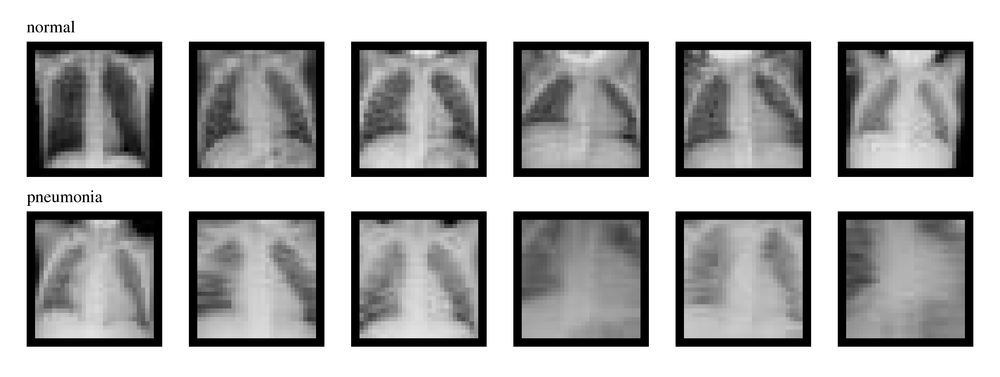
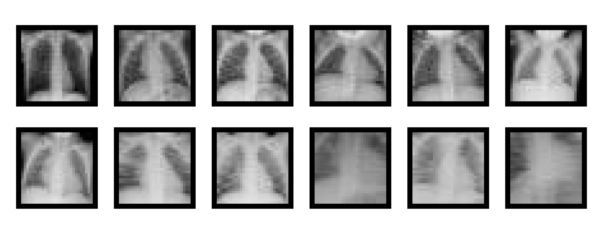
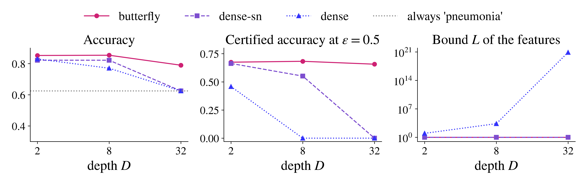

# Certified Classifier from Orthogonal Layers

## Why a prediction needs more than accuracy

A classifier is usually judged by one number: how often it is right on a test
set. For a model that is going to inform a real decision, that is not enough. A
model can be right on almost every test image and still change its answer when
the image changes by an amount nobody would notice — another camera, a
re-encoding, a handful of pixels. Accuracy on a fixed test set cannot see this,
because it only ever asks about the images in the set, never about the images
next to them.

So there is a second question to ask of a prediction, next to whether it is
right: how much can the input change before the prediction changes?

One way to answer it is to attack the model — search for a small change that
flips the prediction, and report the smallest one found. That is useful, but it
only bounds the robustness from above: a better search may find a smaller change
tomorrow, and the answer depends on the attack. The guarantee we want points the
other way. Around each image we want a radius inside which *no* change at all can
flip the prediction: not "no attack we tried succeeded", but "no attack can
succeed". A prediction that comes with such a radius is *certifiably robust*, and
the radius is a proof about the network, not the result of one search.

This example builds classifiers whose predictions carry such a radius, where the
radius follows from the way the network is constructed rather than from anything
done to it after training.

## The certificate

Let \(h\) be the part of the network that maps the image to the features in front
of the last linear layer. The one thing the proof needs about \(h\) is how much it
can stretch a change of its input: a number \(L\) with

\[
\lVert h(x) - h(x') \rVert_2 \le L \, \lVert x - x' \rVert_2 \quad \text{for all } x, x'.
\]

Such an \(L\) is a *Lipschitz bound* of \(h\). It is a worst case over every pair of
inputs and every direction, which is what makes it strong enough to prove
something rather than merely to describe the data at hand.

The rest follows from the last layer. If the logits are
\(z_k = w_k^\top h(x) + b_k\) and \(p\) is the predicted class, class \(j\) can
overtake class \(p\) only by closing the gap \(z_p - z_j\), and a change \(\delta\)
of the image closes it by at most
\(L \lVert w_p - w_j \rVert \, \lVert \delta \rVert\). The prediction therefore
cannot change while \(\lVert \delta \rVert\) stays below the *certified radius*

\[
r(x) = \min_{j \ne p} \frac{z_p(x) - z_j(x)}{L \, \lVert w_p - w_j \rVert_2}.
\]

The radius comes from one forward pass, with no attack and no sampling. Two
things have to hold for it to be worth anything. \(L\) must be small, and \(L\) of
a deep network is the product of the bounds of its layers, so every layer has to
be controlled. The margins \(z_p - z_j\) must also stay large — which, as the rest
of this example shows, is where networks built for a small \(L\) tend to fail.

## What this example shows

This example trains the same small network with three kinds of linear layer and
watches what happens to accuracy and to the certificate as the network gets
deeper:

- **butterfly**: an orthogonal matrix built from RBS (Givens) rotations, the
  classical form of a quantum orthogonal layer. Every singular value is exactly 1,
  for every value of the angles;
- **dense-sn**: an ordinary dense matrix divided by its largest singular value
  (spectral normalisation). Its largest singular value is 1, but the others are
  free to be smaller;
- **dense**: an ordinary dense matrix with no constraint.

All three are trained with the library's
[`GenericClassifier`](../user-guide/estimators.md), with the same loss, optimiser
and number of epochs. See the [user guide](../user-guide/orthogonal.md) for the
orthogonal modules and [Orthogonal networks](../algorithms/orthogonal-networks.md)
for the theory of RBS circuits.

## The data

[PneumoniaMNIST](https://medmnist.com/) (Yang et al., *Scientific Data* 10, 41,
2023) holds paediatric chest X-rays of \(28 \times 28\) pixels, labelled normal or
pneumonia: 4,708 training images and 624 test images. The file comes from the
MedMNIST record on Zenodo (CC BY 4.0) and is downloaded once, about 4 MB, into
`~/.cache/medmnist`.

Every image is padded with zeros to \(32 \times 32\) and flattened into a vector of
1024 pixels in \([0, 1]\). The padding only adds zeros and the flattening only
reorders the pixels, so the distance between two images does not change: a
certificate for the vector is a certificate for the image. The width 1024 is a
power of two, which the butterfly layout needs.

```python
import time
import urllib.request
from pathlib import Path

import matplotlib.pyplot as plt
import numpy as np
import pandas as pd
import torch
import torch.nn as nn
from torch.nn.utils import parametrize

from eigenkit import GenericClassifier
from eigenkit.datasets import STYLE_COLORS, rc_params
from eigenkit.orthogonal.torch import (
    LLNHead,
    MaxMin,
    Orthogonal,
    certified_accuracy,
    certified_radius,
    lipschitz_bound,
    sigma_max,
)

URL = "https://zenodo.org/records/10519652/files/{}.npz?download=1"
FOLDER = Path.home() / ".cache" / "medmnist"


def load_medmnist(name):
    """Images padded to 32 x 32 and flattened to 1024 values in [0, 1]."""
    path = FOLDER / f"{name}.npz"
    if not path.exists():
        FOLDER.mkdir(parents=True, exist_ok=True)
        urllib.request.urlretrieve(URL.format(name), path)
    out = {}
    with np.load(path) as data:
        for split in ("train", "test"):
            images = data[f"{split}_images"].astype(np.float32) / 255
            images = np.pad(images, ((0, 0), (2, 2), (2, 2)))
            out[split] = (images.reshape(len(images), -1), data[f"{split}_labels"][:, 0])
    return out


data = load_medmnist("pneumoniamnist")
X_train, y_train = data["train"]
X_test, y_test = data["test"]
device = "cuda" if torch.cuda.is_available() else "cpu"

print(f"train {X_train.shape}, labels {np.bincount(y_train).tolist()}")
print(f"test  {X_test.shape}, labels {np.bincount(y_test).tolist()}")
print(f"median norm of a test image: {np.median(np.linalg.norm(X_test, axis=1)):.1f}")
print(f"norm of a change of 1/255 in every one of the 784 pixels: {28 / 255:.2f}")
```

```text
train (4708, 1024), labels [1214, 3494]
test  (624, 1024), labels [234, 390]
median norm of a test image: 16.6
norm of a change of 1/255 in every one of the 784 pixels: 0.11
```

The last two lines give a scale for the radii below. A radius of 0.5 is about 3%
of the norm of a typical image, or a change of about four grey levels in every
pixel at once.

Here are six training images of each class, as the network receives them,
padding included:

```python
classes = ("normal", "pneumonia")
with plt.rc_context(rc_params(theme="light")):
    fig, axes = plt.subplots(2, 6, figsize=(9, 3.4))
    for label, row in zip((0, 1), axes):
        for ax, i in zip(row, np.flatnonzero(y_train == label)[:6]):
            ax.imshow(X_train[i].reshape(32, 32), cmap="gray", vmin=0, vmax=1)
            ax.set_axis_off()
        row[0].set_title(classes[label], loc="left", fontsize=11)
    fig.tight_layout()
    plt.show()
```

{ .theme-image-light }
{ .theme-image-dark }

## The network

The network is a stack of \(D\) identical blocks, followed by a linear head:

\[
x \in \mathbb{R}^{1024}
\;\to\; \big[\, W_1 \to \mathrm{MaxMin} \,\big]
\;\to\; \cdots
\;\to\; \big[\, W_D \to \mathrm{MaxMin} \,\big]
\;\to\; \text{head} \;\to\; (z_0, z_1).
\]

The matrices carry no bias and there is no normalisation layer. Only the \(W_i\)
change between the three variants. The other two pieces are the same in all of
them, and both are chosen so that they never stretch a change of their input.

`MaxMin` splits the 1024 features into the 512 disjoint pairs
\((u_{2k}, u_{2k+1})\) and sorts each pair on its own, smaller value first:

\[
\mathrm{MaxMin}(u)_{2k} = \min(u_{2k},\, u_{2k+1}), \qquad
\mathrm{MaxMin}(u)_{2k+1} = \max(u_{2k},\, u_{2k+1}).
\]

It either leaves a pair as it is or swaps its two entries, so on any given input
it is a permutation of the 1024 coordinates: it keeps the norm of its input and
is 1-Lipschitz (Anil, Lucas and Grosse, ICML 2019). *Which* permutation it
applies depends on the input, and that is what makes it non-linear.

`LLNHead` is a linear head whose rows are normalised to unit length at every
call, so the distances \(\lVert w_p - w_j \rVert\) in the radius depend only on
the directions of the rows.

Because `MaxMin` is 1-Lipschitz, each block contributes exactly the bound of its
matrix, and the bound of the features is their product,
\(L = \prod_{i=1}^{D} \sigma_{\max}(W_i)\); `lipschitz_bound` computes it for any
stack of these layers. For the butterfly variant \(L = 1\) by construction. For
dense-sn every factor is 1 too, through a parametrisation that divides the weight
by its largest singular value at every call (`sigma_max` computes it exactly). For
dense nothing holds \(L\) down.

```python
class UnitSpectralNorm(nn.Module):
    """Divide a weight by its largest singular value."""

    def forward(self, weight):
        return weight / sigma_max(weight)


def mixer(kind):
    if kind == "butterfly":
        return Orthogonal(1024, "butterfly")
    layer = nn.Linear(1024, 1024, bias=False)
    if kind == "dense-sn":
        parametrize.register_parametrization(layer, "weight", UnitSpectralNorm())
    return layer


def make_network(kind, depth, n_classes=2):
    blocks = []
    for _ in range(depth):
        blocks += [mixer(kind), MaxMin()]
    return nn.Sequential(*blocks, LLNHead(1024, n_classes))


for kind in ("butterfly", "dense-sn", "dense"):
    n = sum(p.numel() for p in mixer(kind).parameters())
    print(f"{kind:10s} {n:9,d} parameters per block")
```

```text
butterfly      5,120 parameters per block
dense-sn   1,048,576 parameters per block
dense      1,048,576 parameters per block
```

A butterfly on \(n = 1024\) wires has \(\log_2 n = 10\) layers of \(n/2 = 512\)
rotations, so \(5{,}120\) angles instead of the \(1{,}048{,}576\) entries of a dense
matrix. The angles start at zero, so an untrained butterfly block is the
identity.

## Training

Each network is trained by `GenericClassifier`, which wraps any `nn.Module` in the
`fit` / `predict` interface of scikit-learn and runs the standard training loop of
the library: Adam with a learning rate of \(10^{-3}\), batches of 128, the
cross-entropy loss, and 10 epochs, the same for every model. We train every
variant at depths 2, 8 and 32. The fitted network is `clf.model_`. The time
column of the output was measured on a GPU; on a CPU the deepest networks take
longest.

After training we compute, on the 624 test images:

- the accuracy;
- the bound \(L\) of the features, with `lipschitz_bound`;
- the certified radius of every image, with `certified_radius`, from the logits,
  the normalised head weights and \(L\);
- the *certified accuracy* at radius \(\varepsilon\) with `certified_accuracy`: the
  share of test images that are classified correctly *and* have
  \(r(x) > \varepsilon\). It is the accuracy that is guaranteed against every change
  of norm up to \(\varepsilon\), whatever its direction.

```python
def certify(model, X, y):
    """Logits, bound, certificate and correctness on a test set."""
    model.eval()
    with torch.no_grad():
        logits = model(torch.tensor(X, device=device))
    L = lipschitz_bound(model[:-1])  # every block, without the head
    cert = certified_radius(logits, model[-1].get_weight(), L)
    correct = cert.pred == torch.as_tensor(y)
    return L, cert, correct


depths = (2, 8, 32)
kinds = ("butterfly", "dense-sn", "dense")
radii = (0.25, 0.5, 1.0)
models, results, rows = {}, {}, []
for depth in depths:
    for kind in kinds:
        start = time.time()
        torch.manual_seed(0)  # the dense weights are drawn when the network is built
        clf = GenericClassifier(
            make_network(kind, depth).to(device),
            in_features=1024,
            lr=1e-3,
            epochs=10,
            batch_size=128,
            show_progress=False,
            random_state=0,
        )
        clf.fit(X_train, y_train)
        L, cert, correct = certify(clf.model_, X_test, y_test)
        models[kind, depth] = clf.model_
        results[kind, depth] = {
            "L": L,
            "accuracy": certified_accuracy(correct, cert.radius, 0),
            "certified": [certified_accuracy(correct, cert.radius, e) for e in radii],
        }
        rows.append(
            {
                "depth": depth,
                "mixer": kind,
                "L": f"{L:.3g}",
                "accuracy": results[kind, depth]["accuracy"],
                **{
                    f"certified at {e}": c
                    for e, c in zip(radii, results[kind, depth]["certified"])
                },
                "time, s": round(time.time() - start),
            }
        )

pd.DataFrame(rows)
```

| depth | mixer | L | accuracy | certified at 0.25 | certified at 0.5 | certified at 1.0 | time, s |
|---:|:---|---:|---:|---:|---:|---:|---:|
| 2 | butterfly | 1 | 0.853 | 0.772 | 0.675 | 0.426 | 9 |
| 2 | dense-sn | 1 | 0.822 | 0.763 | 0.663 | 0.460 | 12 |
| 2 | dense | 9.44 | 0.830 | 0.673 | 0.458 | 0.043 | 1 |
| 8 | butterfly | 1 | 0.854 | 0.769 | 0.683 | 0.421 | 25 |
| 8 | dense-sn | 1 | 0.822 | 0.590 | 0.551 | 0.417 | 47 |
| 8 | dense | 2.27e+03 | 0.771 | 0.000 | 0.000 | 0.000 | 3 |
| 32 | butterfly | 1 | 0.790 | 0.708 | 0.657 | 0.527 | 82 |
| 32 | dense-sn | 1 | 0.625 | 0.625 | 0.000 | 0.000 | 188 |
| 32 | dense | 8.15e+20 | 0.625 | 0.000 | 0.000 | 0.000 | 12 |

```python
with plt.rc_context(rc_params(theme="light")):
    fig, axes = plt.subplots(1, 3, figsize=(12, 3.8))
    lines = {"butterfly": ("o", "-"), "dense-sn": ("s", "--"), "dense": ("^", ":")}
    for k, kind in enumerate(kinds):
        marker, linestyle = lines[kind]
        style = dict(
            marker=marker, linestyle=linestyle, color=STYLE_COLORS[2 * k], label=kind
        )
        axes[0].plot(depths, [results[kind, d]["accuracy"] for d in depths], **style)
        axes[1].plot(depths, [results[kind, d]["certified"][1] for d in depths], **style)
        axes[2].plot(depths, [results[kind, d]["L"] for d in depths], **style)
    majority = np.bincount(y_test).max() / len(y_test)
    axes[0].axhline(majority, color="grey", linestyle=":", label="always 'pneumonia'")
    axes[0].set_title("Accuracy")
    axes[1].set_title(r"Certified accuracy at $\varepsilon = 0.5$")
    axes[2].set_title("Bound $L$ of the features")
    axes[2].set_yscale("log")
    for ax in axes:
        ax.set_xscale("log", base=2)
        ax.set_xticks(depths, [str(d) for d in depths])
        ax.set_xlabel("depth $D$")
    axes[0].set_ylim(0.3, 0.9)
    axes[1].set_ylim(-0.03, 0.8)
    handles, labels = axes[0].get_legend_handles_labels()
    fig.legend(handles, labels, loc="upper center", ncol=4)
    fig.tight_layout(rect=(0, 0, 1, 0.88))
    plt.show()
```

{ .theme-image-light }
{ .theme-image-dark }

At depth 2 the three variants are close. Their accuracy is 0.82 to 0.85, and the
two constrained ones certify about two thirds of the test images at
\(\varepsilon = 0.5\). The unconstrained network already has \(L \approx 9\), which
divides every radius by 9, and it certifies less, 0.458.

With depth they part ways. The bound of the dense network grows with every
layer, to \(2.3 \cdot 10^{3}\) at depth 8 and \(8 \cdot 10^{20}\) at depth 32. At depth
8 its predictions are still often right, 0.771, but not one of them is certified
at any radius in the table. Spectral normalisation keeps \(L = 1\), but at depth 32
the network answers "pneumonia" for every image: its accuracy, 0.625, is the share
of that class in the test set, and it certifies nothing at 0.5. The butterfly
network keeps \(L = 1\) at every depth and still certifies 0.657 of the test images
at depth 32, almost as many as at depth 2. Its accuracy goes down from 0.853 to
0.790 with the same 10 epochs, but it never collapses to one class.

## Why spectral normalisation fails at depth

Both constrained variants have \(L = 1\), so the difference between them is not in
the bound. It is in what the layers do to the signal. A layer with
\(\sigma_{\max} = 1\) cannot enlarge any input, but if its other singular values
are smaller than one it shrinks the inputs along those directions, and a stack of
such layers shrinks them again and again. The logits are then small, and so are
the margins \(z_p - z_j\) that the radius is made of. An orthogonal layer keeps
the norm of every input, \(\lVert Wx \rVert = \lVert x \rVert\), and `MaxMin` keeps it
too, so the features of the butterfly network have exactly the norm of the image,
at any depth.

The next cell measures this: the median of \(\lVert h(x) \rVert / \lVert x \rVert\) over
the test images, and the smallest singular value of the matrices of each
network.

```python
def norm_kept(model, X):
    with torch.no_grad():
        x = torch.tensor(X, device=device)
        h = model[:-1](x)
    return float((h.norm(dim=1) / x.norm(dim=1)).median())


def smallest_singular_value(model):
    """The smallest singular value over the matrices of a network."""
    values = []
    for layer in model[:-1]:
        if isinstance(layer, nn.Linear):
            weight = layer.weight
        elif isinstance(layer, Orthogonal):
            weight = layer.matrix()  # a butterfly builds its matrix from the angles
        else:
            continue  # MaxMin has no matrix
        values.append(torch.linalg.svdvals(weight.detach().double()).min())
    return float(min(values))


pd.DataFrame(
    [
        {
            "depth": depth,
            "mixer": kind,
            "‖h(x)‖ / ‖x‖": f"{norm_kept(models[kind, depth], X_test):.4f}",
            "smallest singular value": f"{smallest_singular_value(models[kind, depth]):.2e}",
        }
        for depth in depths
        for kind in ("butterfly", "dense-sn")
    ]
)
```

| depth | mixer | ‖h(x)‖ / ‖x‖ | smallest singular value |
|---:|:---|---:|---:|
| 2 | butterfly | 1.0000 | 1.00e+00 |
| 2 | dense-sn | 0.0988 | 3.51e-05 |
| 8 | butterfly | 1.0000 | 1.00e+00 |
| 8 | dense-sn | 0.0644 | 1.99e-05 |
| 32 | butterfly | 1.0000 | 1.00e+00 |
| 32 | dense-sn | 0.0000 | 1.04e-06 |

The butterfly networks keep the norm of every image exactly, and the smallest
singular value of their matrices is 1; since \(L = 1\) bounds the largest, every
singular value is 1. The dense-sn networks have singular values down to
\(10^{-5}\) even at depth 2, and their features keep about 10% of the norm of the
image at depth 2, 6% at depth 8, and nothing measurable at depth 32. With unit
rows in the head, the gap between two logits is at most
\(\lVert w_p - w_j \rVert \, \lVert h(x) \rVert\) plus the difference of the biases.
When \(h(x)\) is almost zero, only the biases are left: they pick one class for
every image, and the margin no longer depends on the image at all. That is the
collapse in the plot. A bound \(L = 1\) is therefore not enough. The layers must
also not lose the signal, and orthogonal layers are the linear layers that lose
none.

## Takeaway

On PneumoniaMNIST, a network built from butterfly layers keeps its Lipschitz
bound at exactly 1 and keeps the norm of the signal through 32 layers. It
certifies about two thirds of the test images at a radius of 0.5 at every depth
we tried. A dense network of the same shape loses its certificate as its bound
grows. A spectrally normalised one keeps the bound but loses the signal, and at
depth 32 it predicts one class. Each butterfly layer has 5,120 parameters instead
of more than a million, and the whole network is trained with
`GenericClassifier` like any other model of the library.

The next example, [Certified Fine-Tuning with Butterfly
Adapters](orthogonal-certified-fine-tuning.md), starts from such a network and
adapts it to a new task without losing the certificate.

## Citation

This example follows *Quantum-inspired orthogonal adapters for certifiably robust
medical image classification* ([arXiv:2611.18775](https://arxiv.org/abs/2611.18775)),
which studies butterfly layers and butterfly adapters in certified classifiers of
medical images. The code of the paper is in
[eigenorbit/quantum-inspired-fine-tuning](https://github.com/eigenorbit/quantum-inspired-fine-tuning).
If you use these methods in your research, please cite the paper:

```bibtex
@misc{tsurkan2026quantum,
  title         = {Quantum-inspired orthogonal adapters for certifiably robust medical image classification},
  author        = {Tsurkan, Olga and Domingo, Laia and Orlova, Victoria and Sagingalieva, Asel and Zalaudek, Iris and Caposiena Caro, Raffaele Dante},
  year          = {2026},
  eprint        = {2611.18775},
  archivePrefix = {arXiv},
  primaryClass  = {cs.CV},
  doi           = {10.48550/arXiv.2611.18775},
  url           = {https://arxiv.org/abs/2611.18775}
}
```
