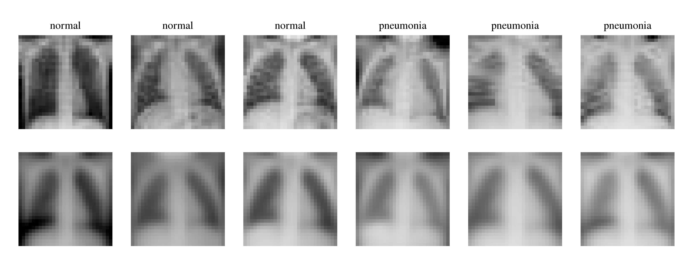
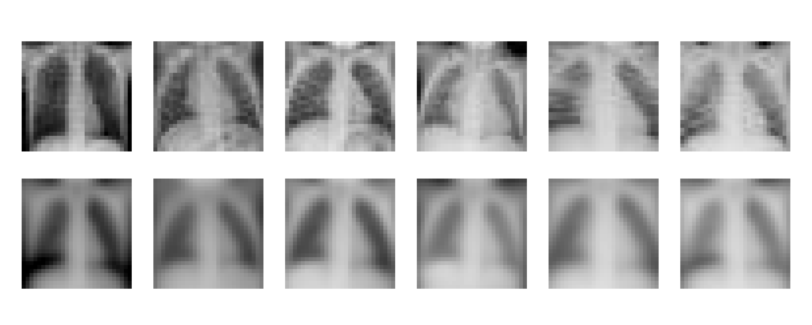
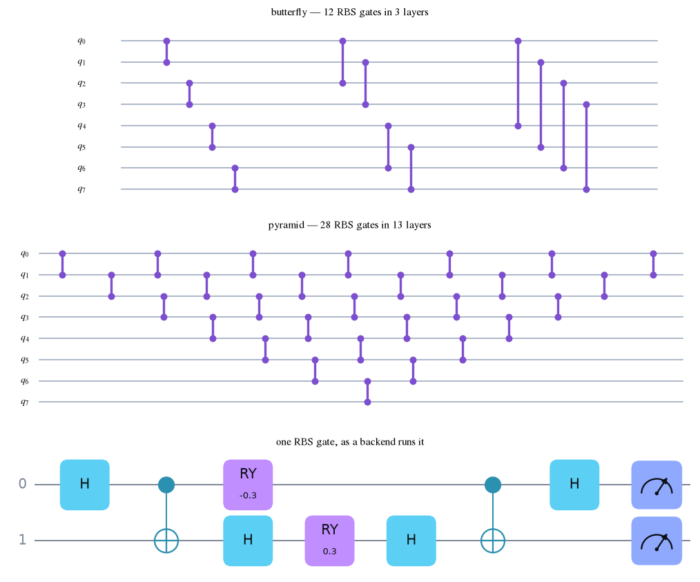
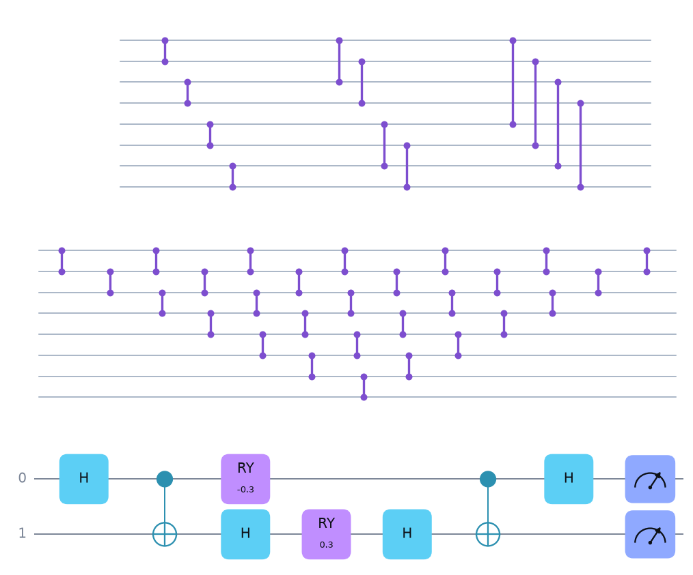
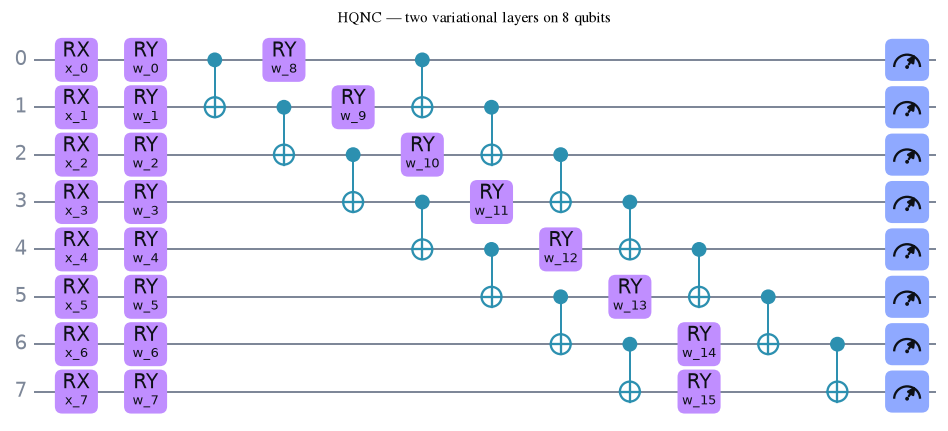
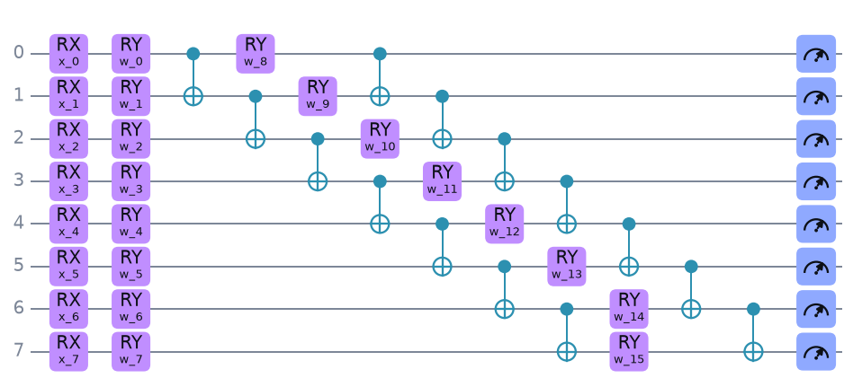
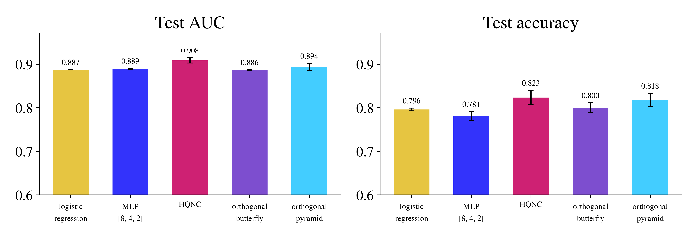
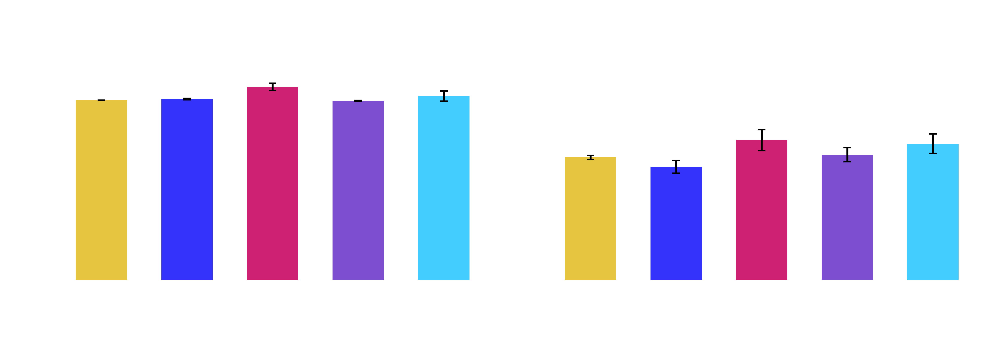
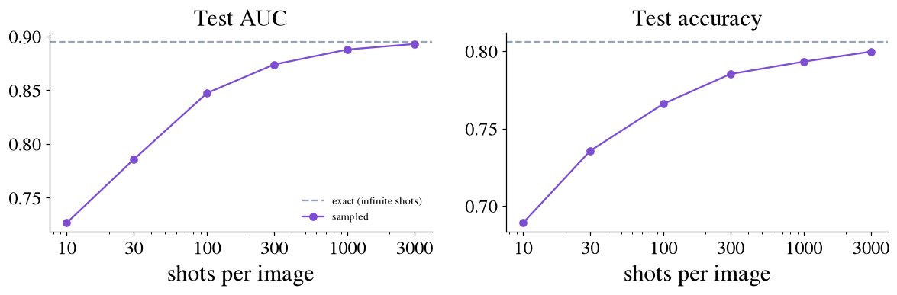

# Orthogonal QNN as a Compact Classifier

## What this example shows

A quantum orthogonal neural network (Landman et al., *Quantum* 6, 881, 2022)
classifies data with three parts:

1. a **unary loader** puts the input \(x \in \mathbb{R}^n\) into the amplitudes of
   \(n\) qubits, one amplitude per qubit:
   \(\lvert x \rangle = \sum_i \frac{x_i}{\lVert x \rVert} \lvert e_i \rangle\), where
   \(\lvert e_i \rangle\) has a single 1 on qubit \(i\);
2. a network of **RBS gates** rotates the state. RBS gates keep the number of 1s
   fixed, so the state stays a combination of the \(n\) unary states, and the
   network acts on its amplitudes as an \(n \times n\) orthogonal matrix \(W\);
3. a **measurement** finds the single 1 on qubit \(i\) with probability
   \(p_i = (Wx)_i^2 / \lVert x \rVert^2\). The \(p_i\) are a probability distribution
   over the qubits by construction.

This example uses such a network as a binary classifier on medical images, and
compares it with three other models that see the same inputs: logistic
regression, a small classical network (MLP) and the variational quantum
classifier of the library, `HQNC`. Every model is trained by an estimator of the
library: `GenericClassifier` for the classical models and the orthogonal network,
`HQNC` for the variational one. See [Orthogonal
networks](../algorithms/orthogonal-networks.md) for the theory of RBS circuits and
the [user guide](../user-guide/orthogonal.md#from-trained-angles-to-a-circuit) for
exporting trained angles to a circuit.

## The data

[PneumoniaMNIST](https://medmnist.com/) (Yang et al., *Scientific Data* 10, 41,
2023) holds paediatric chest X-rays of \(28 \times 28\) pixels, labelled normal or
pneumonia: 4,708 training images and 624 test images. The file comes from the
MedMNIST record on Zenodo (CC BY 4.0) and is downloaded once, about 4 MB, into
`~/.cache/medmnist`.

A circuit of 8 qubits loads 8 numbers, so every image is reduced to 8 features
by a principal component analysis (PCA) fitted on the training images. Every
feature is then scaled to \([0, 1]\) over the training set, and test values are
clipped to stay non-negative.

The scaling matters for the orthogonal network. The loader keeps only the
direction \(x / \lVert x \rVert\), and the measurement returns squares
\((Wx)_i^2\), so the network cannot tell \(x\) from \(-x\). Centred PCA features
carry much of the class in their signs, which would be lost. On \([0, 1]\) every
feature is non-negative, and the direction keeps what the classes need. `HQNC`
scales its inputs to \([0, 1]\) by itself, so all models see the same values.

```python
import time
import urllib.request
from pathlib import Path

import matplotlib.pyplot as plt
import numpy as np
import torch
import torch.nn as nn
from sklearn.decomposition import PCA
from sklearn.metrics import roc_auc_score
from sklearn.preprocessing import MinMaxScaler

from eigenkit import HQNC, Circuit, GenericClassifier, OrthogonalQNN, PennyLaneConfig
from eigenkit.datasets import STYLE_COLORS, rc_params
from eigenkit.orthogonal import Topology, to_block, topology
from eigenkit.orthogonal.torch import Orthogonal

URL = "https://zenodo.org/records/10519652/files/{}.npz?download=1"
FOLDER = Path.home() / ".cache" / "medmnist"


def load_medmnist(name):
    path = FOLDER / f"{name}.npz"
    if not path.exists():
        FOLDER.mkdir(parents=True, exist_ok=True)
        urllib.request.urlretrieve(URL.format(name), path)
    with np.load(path) as data:
        return {
            split: (
                data[f"{split}_images"].reshape(len(data[f"{split}_images"]), -1) / 255,
                data[f"{split}_labels"][:, 0],
            )
            for split in ("train", "test")
        }


data = load_medmnist("pneumoniamnist")
images_train, y_train = data["train"]
images_test, y_test = data["test"]

n = 8
pca = PCA(n_components=n, random_state=0).fit(images_train)
scaler = MinMaxScaler().fit(pca.transform(images_train))
X_train = scaler.transform(pca.transform(images_train)).astype(np.float32)
X_test = np.clip(scaler.transform(pca.transform(images_test)), 0, None).astype(np.float32)

print(f"train {X_train.shape}, labels {np.bincount(y_train).tolist()}")
print(f"test  {X_test.shape}, labels {np.bincount(y_test).tolist()}")
```

```text
train (4708, 8), labels [1214, 3494]
test  (624, 8), labels [234, 390]
```

The images below are six training X-rays of each class (top), and the same
images rebuilt from their 8 principal components alone (bottom). The 8 numbers
keep the overall shape and brightness of the chest, not its details; this is all
that every model of the example sees.

```python
classes = ("normal", "pneumonia")
shown = np.concatenate([np.flatnonzero(y_train == c)[:3] for c in (0, 1)])
rebuilt = pca.inverse_transform(pca.transform(images_train[shown]))
with plt.rc_context(rc_params(theme="light")):
    fig, axes = plt.subplots(2, 6, figsize=(9, 3.6))
    for k, i in enumerate(shown):
        axes[0, k].imshow(images_train[i].reshape(28, 28), cmap="gray", vmin=0, vmax=1)
        axes[1, k].imshow(rebuilt[k].reshape(28, 28), cmap="gray", vmin=0, vmax=1)
        axes[0, k].set_title(classes[y_train[i]], fontsize=10)
    for ax in axes.flat:
        ax.set_axis_off()
    fig.tight_layout()
    plt.show()
```

{ .theme-image-light }
{ .theme-image-dark }

## The orthogonal classifier

With \(n = 8\) qubits and two classes, the class is read from the two halves of
the qubits:

\[
P(\text{pneumonia} \mid x) = \sum_{i=4}^{7} p_i = \sum_{i=4}^{7} \frac{(Wx)_i^2}{\lVert x \rVert^2},
\]

so every measurement of the circuit is one vote for a class.

The circuit computes exactly \((Wx)_i^2 / \lVert x \rVert^2\), so the network can be
trained in this *matrix form*: the module `Orthogonal` holds the angles of the RBS
gates and builds \(W\) from them. Training then works with an \(8 \times 8\) matrix
instead of simulating the \(2^8 = 256\) amplitudes of the circuit, and the trained
angles are copied into the circuit afterwards.

The probability has no bias, and the classes are not balanced: 74% of the
training images show pneumonia. Two classical numbers, a scale \(a\) and an offset
\(b\), turn the probability into the logit that the cross-entropy needs,
\(z = a \, (P - \tfrac{1}{2}) + b\). They only move and sharpen the decision
threshold on \(P\); the ranking of the images, and so the AUC, comes from the
circuit alone.

We use two layouts of the RBS gates on 8 qubits: the **butterfly**, 12 gates in
3 layers, and the **pyramid**, 28 gates, which connects every pair of qubits and
is the layout of Landman et al.

Both are drawn below. Each link joins the two qubits that one RBS gate acts on,
and the gates in a column act at the same time, so the number of columns is the
depth of the circuit. The butterfly pairs qubits at distance 1, then 2, then 4,
which is why 3 layers reach every qubit from every other. The pyramid walks a
single pair across the register and back. The bottom panel is what one of those
links becomes on hardware.

```python
def draw_layout(ax, name, title):
    """The RBS gates of a topology: one line per qubit, one link per gate.

    Gates of the same layer act at the same time; they are drawn a little apart
    so that links which span the same wires stay readable.
    """
    layers = topology(name, n).layers
    width = len(layers) - 0.4
    for q in range(n):
        ax.plot([-0.45, width], [q, q], color=STYLE_COLORS[7], lw=1, zorder=0)
        ax.text(-0.65, q, f"$q_{q}$", ha="right", va="center", fontsize=9)
    for depth, layer in enumerate(layers):
        spread = 0.13 * (len(layer) - 1)
        for k, (a, b) in enumerate(sorted(layer)):
            x = depth - spread / 2 + 0.13 * k if len(layer) > 1 else depth
            ax.plot([x, x], [a, b], color=STYLE_COLORS[2], lw=2.2, zorder=1)
            ax.plot([x, x], [a, b], "o", color=STYLE_COLORS[2], ms=5.5, zorder=2)
    gates = sum(len(layer) for layer in layers)
    ax.set_title(f"{title} — {gates} RBS gates in {len(layers)} layers", fontsize=10)
    ax.set_xlim(-1.1, width + 0.2)
    ax.set_ylim(n - 0.4, -0.9)
    ax.set_axis_off()


with plt.rc_context(rc_params(theme="light")):
    fig, axes = plt.subplots(3, 1, figsize=(9.5, 8.0), height_ratios=(1.1, 1.1, 0.8))
    draw_layout(axes[0], "butterfly", "butterfly")
    draw_layout(axes[1], "pyramid", "pyramid")
    one_gate = Circuit([to_block(Topology(2, (((0, 1),),)), [0.3])])
    one_gate.draw_mpl(style="eigen-universal", ax=axes[2])
    axes[2].set_title("one RBS gate, as a backend runs it", fontsize=10)
    fig.tight_layout()
    plt.show()
```

{ .theme-image-light }
{ .theme-image-dark }

```python
class OrthogonalClassifier(nn.Module):
    """P(class 1) from the second half of the qubits, then a scale and an offset."""

    def __init__(self, n, topology):
        super().__init__()
        self.n = n
        self.rotation = Orthogonal(n, topology, init="random", std=1.0)
        self.scale = nn.Parameter(torch.tensor(4.0))
        self.offset = nn.Parameter(torch.tensor(0.0))

    def probability(self, x):
        p = self.rotation(x) ** 2 / (x**2).sum(dim=1, keepdim=True).clamp_min(1e-12)
        return p[:, self.n // 2 :].sum(dim=1)

    def forward(self, x):
        z = self.scale * (self.probability(x) - 0.5) + self.offset
        return torch.stack([-z / 2, z / 2], dim=1)


def make(name, seed):
    common = dict(
        epochs=30, batch_size=64, lr=0.02, show_progress=False, random_state=seed
    )
    if name == "logistic regression":
        return GenericClassifier(nn.Linear(n, 2), in_features=n, **common)
    if name == "MLP [8, 4, 2]":
        mlp = nn.Sequential(nn.Linear(n, 4), nn.Sigmoid(), nn.Linear(4, 2))
        return GenericClassifier(mlp, in_features=n, **common)
    if name == "HQNC":
        return HQNC(in_features=n, n_qubits=n, depth=2, n_classes=2, **common)
    topology = name.split()[1]
    return GenericClassifier(OrthogonalClassifier(n, topology), in_features=n, **common)


names = (
    "logistic regression",
    "MLP [8, 4, 2]",
    "HQNC",
    "orthogonal butterfly",
    "orthogonal pyramid",
)
```

## Size of every model

The next cell counts the trainable parameters of every model and, for the quantum
ones, the gates of the circuit. Each RBS gate is compiled to two CNOTs, and the
loader adds \(n - 1 = 7\) more RBS gates. The butterfly uses the parallel loader,
which needs a power of two and is 3 layers deep; the pyramid uses the diagonal
loader, which works for any \(n\).

```python
def count(model):
    return sum(p.numel() for p in model.parameters() if p.requires_grad)


probe = HQNC(
    in_features=n, n_qubits=n, depth=2, n_classes=2, epochs=1, show_progress=False
)
probe.fit(X_train[:8], np.arange(8) % 2)
circuits = {
    "HQNC": probe.model_[1].circuit.spec,
    "orthogonal butterfly": OrthogonalQNN(n, "butterfly", loader="parallel").circuit.spec,
    "orthogonal pyramid": OrthogonalQNN(n, "pyramid", loader="diagonal").circuit.spec,
}
print("model                   parameters   gates  CNOTs")
for name in names:
    if name == "HQNC":
        size = count(probe.model_)
    else:
        size = count(make(name, 0).model)
    spec = circuits.get(name)
    gates = (
        f"{len(spec.gates):6d} {sum(g.name == 'CNOT' for g in spec.gates):6d}"
        if spec
        else "     -      -"
    )
    print(f"{name:22s} {size:10d}  {gates}")
```

```text
model                   parameters   gates  CNOTs
logistic regression            18       -      -
MLP [8, 4, 2]                  46       -      -
HQNC                           34      38     14
orthogonal butterfly           14     153     38
orthogonal pyramid             30     281     70
```

The orthogonal butterfly is the smallest model: 12 angles, plus the scale and
the offset. The pyramid has 28 angles, the variational classifier `HQNC` has 16
circuit weights and a linear layer of 18 after the circuit, and the MLP has 46
weights. In gates the order is reversed. Every RBS gate is compiled into two
CNOTs and single-qubit rotations, and the loader adds its own RBS gates, so the
orthogonal circuits are deeper than the circuit of `HQNC`. The butterfly needs
about half the CNOTs of the pyramid.

`HQNC` builds a circuit of a different kind. It writes each of the 8 features
into the angle of an `RX` rotation, follows them with trainable `RY` rotations
and a ladder of CNOTs, and measures every qubit; a linear layer then turns those
expectations into the two logits.

```python
with plt.rc_context(rc_params(theme="light")):
    fig, ax = plt.subplots(figsize=(11, 4.2))
    probe.model_[1].circuit.draw_mpl(style="eigen-universal", ax=ax)
    ax.set_title("HQNC — two variational layers on 8 qubits", fontsize=10)
    fig.tight_layout()
    plt.show()
```

{ .theme-image-light }
{ .theme-image-dark }

The encoded features (`x_0` to `x_7`) and the 16 trainable weights (`w_0` to
`w_15`) are visible in the boxes. Nothing here keeps the number of 1s fixed, so
the state leaves the unary subspace and the circuit has to be simulated over all
\(2^8\) amplitudes, which is why it is the slowest model to train.

## Training and results

Every model is trained with the same settings: Adam with a learning rate of
0.02, batches of 64, 30 epochs, cross-entropy, and three seeds. We report the
area under the ROC curve (AUC), which measures how well the model ranks the
images, and the accuracy, on the test set, after the last epoch.

```python
results, fitted = {}, {}
for name in names:
    start = time.time()
    scores = []
    for seed in range(3):
        clf = make(name, seed).fit(X_train, y_train)
        probability = clf.predict_proba(X_test)[:, 1]
        scores.append(
            (roc_auc_score(y_test, probability), (clf.predict(X_test) == y_test).mean())
        )
        fitted[name, seed] = clf
    results[name] = np.array(scores)
    seconds = (time.time() - start) / 3
    auc, acc = results[name].mean(axis=0)
    auc_sd, acc_sd = results[name].std(axis=0)
    print(
        f"{name:22s} AUC {auc:.3f} ± {auc_sd:.3f}   accuracy {acc:.3f} ± {acc_sd:.3f}"
        f"   {seconds:5.0f} s per fit"
    )
```

```text
logistic regression    AUC 0.887 ± 0.000   accuracy 0.796 ± 0.003       2 s per fit
MLP [8, 4, 2]          AUC 0.889 ± 0.001   accuracy 0.781 ± 0.010       3 s per fit
HQNC                   AUC 0.908 ± 0.006   accuracy 0.823 ± 0.017     180 s per fit
orthogonal butterfly   AUC 0.886 ± 0.001   accuracy 0.800 ± 0.011       5 s per fit
orthogonal pyramid     AUC 0.894 ± 0.008   accuracy 0.818 ± 0.016      11 s per fit
```

```python
with plt.rc_context(rc_params(theme="light")):
    fig, axes = plt.subplots(1, 2, figsize=(11, 3.8))
    positions = np.arange(len(names))
    colors = [STYLE_COLORS[k] for k in (6, 4, 0, 2, 3)]
    for ax, column, title in zip(axes, (0, 1), ("Test AUC", "Test accuracy")):
        means = [results[name][:, column].mean() for name in names]
        errors = [results[name][:, column].std() for name in names]
        ax.bar(positions, means, 0.6, yerr=errors, capsize=3, color=colors)
        for k, (m, e) in enumerate(zip(means, errors)):
            ax.text(k, m + e + 0.006, f"{m:.3f}", ha="center", va="bottom", fontsize=9)
        ax.set_xticks(
            positions, [name.replace(" ", "\n", 1) for name in names], fontsize=9
        )
        ax.set_ylim(0.6, 0.97)
        ax.set_title(title)
    fig.tight_layout()
    plt.show()
```

{ .theme-image-light }
{ .theme-image-dark }

The orthogonal pyramid ranks the images better than the two classical models,
with an AUC of 0.894 against 0.887 and 0.889. It is also more accurate, 0.818
against 0.796 and 0.781. The butterfly matches logistic regression, AUC 0.886
and accuracy 0.800 against 0.887 and 0.796, with 14 parameters, fewer than any
other model.

`HQNC` is the best model here, with an AUC of 0.908 and an accuracy of 0.823. Its
accuracy is that of the pyramid within the spread over the seeds (±0.017 and
±0.016). It is also the most expensive to train: minutes per fit, against seconds for
the orthogonal networks (the last column; the times depend on the machine).
`HQNC` is trained by simulating its circuit, while the orthogonal network is
trained in its matrix form, which gives the output of the circuit exactly
without simulating the quantum state.

## From infinite shots to a real device

The orthogonal networks were trained in their matrix form, which returns
\((Wx)_i^2 / \lVert x \rVert^2\) exactly. Those are the probabilities a circuit
would give if every image were measured infinitely many times. A real device
returns samples instead. Each shot of the orthogonal circuit finds the single 1
on one qubit, and the share of shots that land on the second half of the qubits
estimates \(P(\text{pneumonia})\).

The cell below copies the trained angles of the pyramid of seed 0 into
`OrthogonalQNN`, runs it on PennyLane's simulator with a finite number of shots,
which samples as a noiseless device would, and applies the same scale and offset.
The dashed line is the exact probability, the infinite-shot limit that the matrix
form computes.

```python
def with_shots(model, shots):
    """AUC and accuracy when P is estimated from a finite number of shots."""
    config = PennyLaneConfig(device_name="default.qubit", shots=shots)
    sampled = OrthogonalQNN(n, "pyramid", loader="diagonal", provider=config)
    with torch.no_grad():
        sampled.circuit.weights.copy_(model.rotation.theta.double())
        p = sampled(torch.tensor(X_test, dtype=torch.float64))[:, n // 2 :].sum(dim=1)
        z = model.scale * (p.float() - 0.5) + model.offset
    predictions = (z > 0).numpy().astype(int)
    return roc_auc_score(y_test, p.numpy()), (predictions == y_test).mean()


model = fitted["orthogonal pyramid", 0].model_
exact = results["orthogonal pyramid"][0]
np.random.seed(0)  # PennyLane's default.qubit samples from NumPy's global generator
shot_counts = (10, 30, 100, 300, 1000, 3000)
measured = np.array([with_shots(model, s) for s in shot_counts])

with plt.rc_context(rc_params(theme="light")):
    fig, axes = plt.subplots(1, 2, figsize=(11, 3.8))
    for ax, column, title, value in zip(
        axes, (0, 1), ("Test AUC", "Test accuracy"), exact
    ):
        ax.axhline(
            value, color=STYLE_COLORS[7], linestyle="--", label="exact (infinite shots)"
        )
        ax.plot(
            shot_counts,
            measured[:, column],
            marker="o",
            color=STYLE_COLORS[2],
            label="sampled",
        )
        ax.set_xscale("log")
        ax.set_xticks(shot_counts, [str(s) for s in shot_counts])
        ax.set_xlabel("shots per image")
        ax.set_title(title)
    axes[0].legend(fontsize=9, loc="lower right")
    fig.tight_layout()
    plt.show()
```

{ .theme-image-light }
{ .theme-image-dark }

Both curves climb towards the dashed line and are close to it by a thousand
shots: an AUC of 0.888 and an accuracy of 0.793, against 0.895 and 0.806 exactly,
and 0.893 and 0.800 with three thousand. Below a hundred shots the estimate of
\(P\) is too noisy for the images near the threshold, and both fall away quickly
— at ten shots the AUC is 0.727.

That the curves converge to the dashed line is also the check that the circuit
computes what was trained: the matrix form and the sampled circuit agree once
enough shots are taken, so training on the matrix and running on a device are the
same model. The shots are random, and `np.random.seed(0)` fixes them because
PennyLane's `default.qubit` draws its samples from NumPy's global generator;
another seed moves the points slightly. Each shot is a vote for one class, so how
many are needed depends on how close \(P\) is to the threshold, not on the number
of qubits.

## Takeaway

On PneumoniaMNIST reduced to 8 features, an orthogonal network of RBS gates,
trained with `GenericClassifier` like any other model, is as good as or better
than logistic regression and an MLP with the same inputs. It needs only 14 to 30
parameters. The pyramid reaches the accuracy of the variational classifier
`HQNC` within the spread over the seeds, in a fraction of its training time,
because its matrix form gives the output of the circuit exactly, without
simulating the quantum state. Its output is a probability distribution over the
qubits by construction, so each shot is a vote for a class: measured on a
simulator, 1,000 shots per image come within about 0.01 of the exact AUC and
accuracy, and 3,000 within 0.006. The price is the depth of the circuit: 38 to
70 CNOTs against 14 for `HQNC`.
