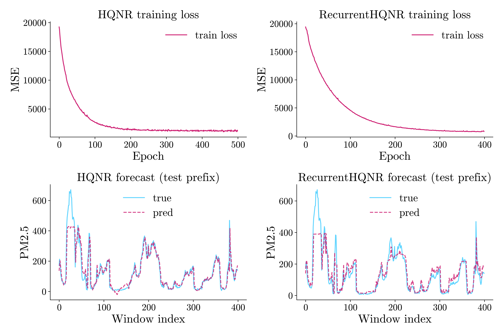

# Time series regression with eigenkit: HQNR and RecurrentHQNR compared


## Why this problem matters

Forecasts of air quality support public health alerts, decisions on traffic and industry, and early warnings when the level of a pollutant rises sharply. An hourly series with several variables combines the weather, the seasons and human activity. The target at the next step (for example, the concentration of fine particulate matter, PM2.5) is **ordered in time**, so the split into training and test data must keep the order of time instead of shuffling the rows at random.

## Dataset

This example uses the **Beijing PM2.5** series: hourly measurements of fine particulate matter in Beijing, with several weather variables. We load the cleaned comma-separated values (CSV) file of eigenkit. Its last column, the PM2.5 concentration, is the regression target. The rows with a missing target were already removed from the file, and the wind direction was already encoded as one-hot columns.

- The source of the dataset is the UC Irvine Machine Learning Repository: [Beijing PM2.5](https://archive.ics.uci.edu/dataset/381/beijing+pm2+5+data), by Song Xi Chen.
- Its digital object identifier (DOI) is [10.24432/C5JS49](https://doi.org/10.24432/C5JS49).
- `load_dataset("beijing_pm25")` downloads the hosted CSV file [kit.eigenorbit.com/datasets/beijing_pm25.csv](https://kit.eigenorbit.com/datasets/beijing_pm25.csv).
- The licence is [CC BY 4.0](https://creativecommons.org/licenses/by/4.0/) (Creative Commons Attribution 4.0).

## Our approach

We compare two hybrid quantum and classical regressors of **`eigenkit`**. Each one is wrapped in **`QuantumTimeSeriesRegressor`**:

1. **`HQNR`** (the hybrid quantum neural network regressor): each sliding window is **flattened** to a single vector per sample. With `autoregressive=True`, each window also holds the past values of the target, as an extra channel (see `QuantumTimeSeriesRegressor` in the library documentation).
2. **`RecurrentHQNR`**: a gated recurrent unit (**GRU**) reads each window as a sequence, and then the quantum block predicts the target at the next step.

Both models use the same length of window, the same shift of the horizon and the same held-out test segment, which comes **after** the training data in time. We use only the first rows of each split, so that the example finishes in a reasonable time. For runs on the full data, increase `MAX_TRAIN_ROWS`, `MAX_TEST_ROWS` and `epochs`.

## Import libraries


```python
import matplotlib
import matplotlib.pyplot as plt
import numpy as np
import pandas as pd

from sklearn.metrics import mean_absolute_error, mean_squared_error, r2_score
from sklearn.preprocessing import StandardScaler

from eigenkit import (
    HQNR,
    QuantumTimeSeriesRegressor,
    RecurrentHQNR,
)
from eigenkit.datasets import STYLE_COLORS, load_dataset, rc_params
```

## Loading the selected dataset


```python
data = load_dataset("beijing_pm25")
X_train_full, y_train_full = data["X_train"], data["y_train"]
X_test_full, y_test_full = data["X_test"], data["y_test"]

# Subsample for notebook runtime (remove or raise limits for full data)
MAX_TRAIN_ROWS = 8000
MAX_TEST_ROWS = 2500

X_train = X_train_full[:MAX_TRAIN_ROWS]
y_train = y_train_full[:MAX_TRAIN_ROWS]
X_test = X_test_full[:MAX_TEST_ROWS]
y_test = y_test_full[:MAX_TEST_ROWS]

scaler = StandardScaler()
X_train = scaler.fit_transform(X_train).astype(np.float32)
X_test = scaler.transform(X_test).astype(np.float32)

print("Train shape:", X_train.shape, y_train.shape)
print("Test shape:", X_test.shape, y_test.shape)
```

```text
Train shape: (8000, 13) (8000,)
Test shape: (2500, 13) (2500,)
```


## Windowing parameters

`in_size` is the number of past hours in each window, and `shift=1` means that we predict the step just after the window. With `autoregressive=True`, the wrapper adds the past values of the **target** inside each window, so the number of channels is `n_features + 1`.


```python
in_size = 24
shift = 1
n_chan = X_train.shape[1] + 1  # exogenous features + autoregressive target channel
flat_dim = in_size * n_chan

N_QUBITS = 4
RANDOM_STATE = 42

# Targets aligned with windowed predictions (same for both models)
y_test_aligned = y_test[in_size + shift - 1 :]

print("Channels per time step (with AR):", n_chan)
print("Flattened HQNR input dim:", flat_dim)
print("Aligned test targets:", len(y_test_aligned))
```

```text
Channels per time step (with AR): 14
Flattened HQNR input dim: 336
Aligned test targets: 2476
```

## Model 1: HQNR inside `QuantumTimeSeriesRegressor`


```python
hqnr_base = HQNR(
    in_features=flat_dim,
    in_quantum=N_QUBITS,
    n_qubits=N_QUBITS,
    depth=2,
    layer_type="Basic",
    variational_type="strong",
    basis="Y",
    lr=0.01,
    optimizer="adam",
    epochs=500,
    batch_size=128,
    loss_func="mse",
    show_progress=True,
    random_state=RANDOM_STATE,
)

hqnr_ts = QuantumTimeSeriesRegressor(
    estimator=hqnr_base,
    in_size=in_size,
    shift=shift,
    autoregressive=True,
)

hqnr_ts.fit(X_train, y_train)
print(
    "Training complete (HQNR). Last epoch loss:",
    round(float(hqnr_base.train_losses_[-1]), 6),
)
```

```text
HQNR training | Epoch 1/500 | loss=19248.546565 | elapsed=3.3s | eta=1647.4s
HQNR training | Epoch 2/500 | loss=18833.893043 | elapsed=6.5s | eta=1626.9s
HQNR training | Epoch 3/500 | loss=17989.033854 | elapsed=9.8s | eta=1626.7s
...
HQNR training | Epoch 498/500 | loss=1050.977663 | elapsed=1497.2s | eta=6.0s
HQNR training | Epoch 499/500 | loss=1314.121002 | elapsed=1500.4s | eta=3.0s
HQNR training | Epoch 500/500 | loss=1180.751416 | elapsed=1503.5s | eta=0.0s
Training complete (HQNR). Last epoch loss: 1180.751416
```

## Model 2: RecurrentHQNR inside `QuantumTimeSeriesRegressor`


```python
seq_base = RecurrentHQNR(
    seq_feature_dim=n_chan,
    rnn_type="gru",
    rnn_hidden_dim=16,
    rnn_num_layers=1,
    in_quantum=N_QUBITS,
    n_qubits=N_QUBITS,
    depth=2,
    layer_type="Basic",
    variational_type="strong",
    basis="Y",
    lr=0.005,
    optimizer="adam",
    epochs=400,
    batch_size=128,
    loss_func="mse",
    show_progress=True,
    random_state=RANDOM_STATE,
)

seq_ts = QuantumTimeSeriesRegressor(
    estimator=seq_base,
    in_size=in_size,
    shift=shift,
    autoregressive=True,
)

seq_ts.fit(X_train, y_train)
print(
    "Training complete (RecurrentHQNR). Last epoch loss:",
    round(float(seq_base.train_losses_[-1]), 6),
)
```

```text
RecurrentHQNR training | Epoch 1/400 | loss=19419.129154 | elapsed=4.1s | eta=1643.2s
RecurrentHQNR training | Epoch 2/400 | loss=19135.513052 | elapsed=8.6s | eta=1707.3s
RecurrentHQNR training | Epoch 3/400 | loss=18939.542535 | elapsed=12.9s | eta=1712.4s
...
RecurrentHQNR training | Epoch 398/400 | loss=844.827900 | elapsed=618.8s | eta=3.1s
RecurrentHQNR training | Epoch 399/400 | loss=915.601318 | elapsed=620.3s | eta=1.6s
RecurrentHQNR training | Epoch 400/400 | loss=793.070036 | elapsed=621.8s | eta=0.0s
Training complete (RecurrentHQNR). Last epoch loss: 793.070036
```

## Evaluation


```python
y_pred_hqnr = hqnr_ts.predict(X_test, y_history=y_test)
y_pred_seq = seq_ts.predict(X_test, y_history=y_test)

assert len(y_pred_hqnr) == len(y_test_aligned)
assert len(y_pred_seq) == len(y_test_aligned)


def _report(name: str, y_true: np.ndarray, y_pred: np.ndarray) -> dict:
    mae = float(mean_absolute_error(y_true, y_pred))
    rmse = float(np.sqrt(mean_squared_error(y_true, y_pred)))
    r2 = float(r2_score(y_true, y_pred))
    print(f"{name}")
    print(f"  R2:   {r2:.4f}")
    print(f"  MAE:  {mae:.4f}")
    print(f"  RMSE: {rmse:.4f}")
    return {"model": name, "r2": r2, "mae": mae, "rmse": rmse}


rows = [
    _report("HQNR + QuantumTimeSeriesRegressor", y_test_aligned, y_pred_hqnr),
    _report("RecurrentHQNR + QuantumTimeSeriesRegressor", y_test_aligned, y_pred_seq),
]
```


```text
HQNR + QuantumTimeSeriesRegressor
  R2:   0.9184
  MAE:  18.3597
  RMSE: 33.0781
RecurrentHQNR + QuantumTimeSeriesRegressor
  R2:   0.8679
  MAE:  28.6717
  RMSE: 42.0891
```

## Plotting results


```python
for theme in ("light", "dark"):
    with matplotlib.rc_context(rc_params(theme=theme)):
        fig, axes = plt.subplots(2, 2, figsize=(12, 8))

        axes[0, 0].plot(
            hqnr_base.train_losses_, color=STYLE_COLORS[0], label="train loss"
        )
        axes[0, 0].set_title("HQNR training loss")
        axes[0, 0].set_xlabel("Epoch")
        axes[0, 0].set_ylabel("MSE")
        axes[0, 0].legend()

        axes[0, 1].plot(seq_base.train_losses_, color=STYLE_COLORS[0], label="train loss")
        axes[0, 1].set_title("RecurrentHQNR training loss")
        axes[0, 1].set_xlabel("Epoch")
        axes[0, 1].set_ylabel("MSE")
        axes[0, 1].legend()

        n_plot = min(400, len(y_test_aligned))
        idx = np.arange(n_plot)
        axes[1, 0].plot(
            idx, y_test_aligned[:n_plot], color=STYLE_COLORS[3], label="true", alpha=0.85
        )
        axes[1, 0].plot(
            idx,
            y_pred_hqnr[:n_plot],
            color=STYLE_COLORS[0],
            linestyle="--",
            label="pred",
            alpha=0.85,
        )
        axes[1, 0].set_title("HQNR forecast (test prefix)")
        axes[1, 0].set_xlabel("Window index")
        axes[1, 0].set_ylabel("PM2.5")
        axes[1, 0].legend()

        axes[1, 1].plot(
            idx, y_test_aligned[:n_plot], color=STYLE_COLORS[3], label="true", alpha=0.85
        )
        axes[1, 1].plot(
            idx,
            y_pred_seq[:n_plot],
            color=STYLE_COLORS[0],
            linestyle="--",
            label="pred",
            alpha=0.85,
        )
        axes[1, 1].set_title("RecurrentHQNR forecast (test prefix)")
        axes[1, 1].set_xlabel("Window index")
        axes[1, 1].set_ylabel("PM2.5")
        axes[1, 1].legend()

        plt.tight_layout()
        fig.savefig(f"pollution_hqnr_{theme}.png")
        if theme == "light":
            plt.show()
        else:
            plt.close(fig)
```

{ .theme-image-light }
{ .theme-image-dark }

## Conclusion

In this run, both models follow the PM2.5 curve. `HQNR` is a little better: its coefficient of determination (`R²`) is `0.918`, and its root mean squared error (RMSE) is `33.08`. `RecurrentHQNR` reaches `R² = 0.868` and an RMSE of `42.09`.

This is not a strict comparison of the two architectures. Both models use the same window and the same training data, but the two architectures behave differently during optimisation. Treat the plot as a worked example, and not as proof that one estimator is always better.

The practical lesson is simple: look at the fit of the time series on a plot, and tune the inner estimator. A fair comparison would tune the learning rate of each model separately, use several random seeds, and give both models the same training budget.
