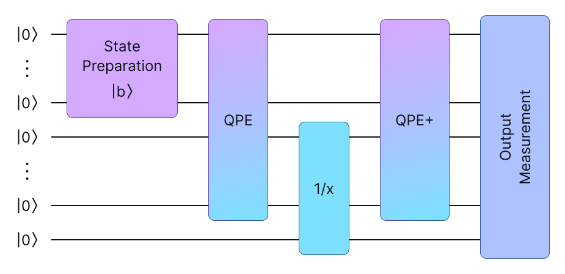
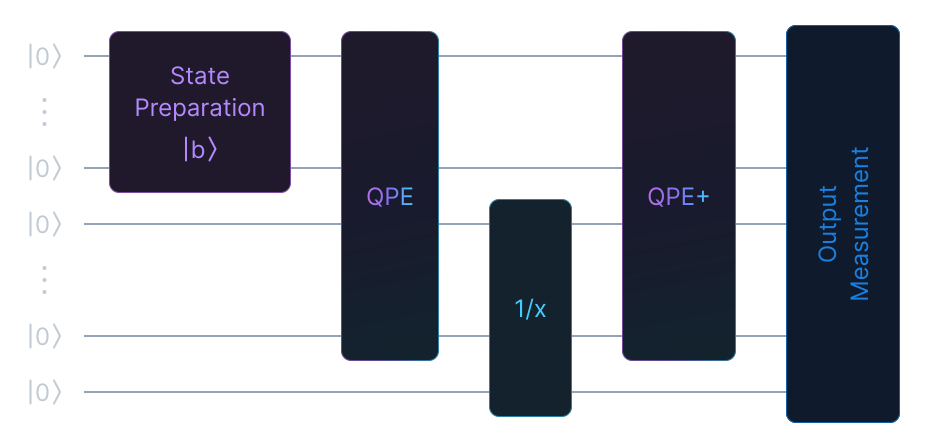
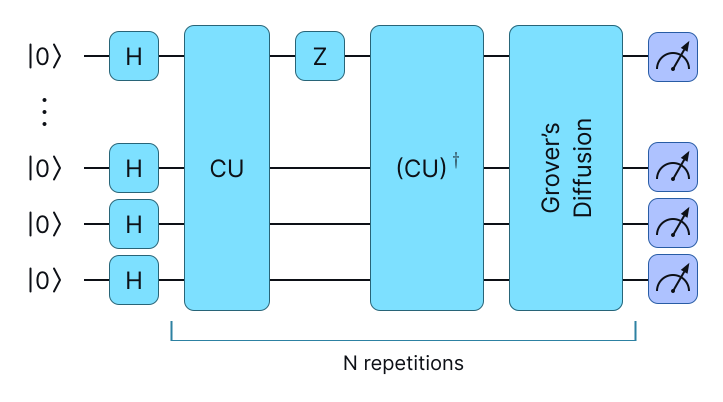
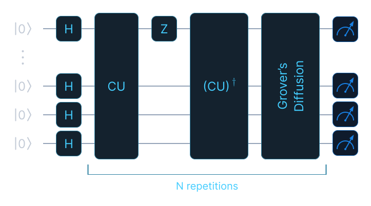

# Algorithms

`eigenkit.algorithms` contains three standalone quantum algorithms. `HHL` solves
linear systems with the algorithm of Harrow, Hassidim and Lloyd (HHL). `IQAE`
runs Iterative Quantum Amplitude Estimation (IQAE). `PortfolioRiskEstimator`
estimates portfolio risk and is built on IQAE. The first two are single-call
solvers. You configure a
solver in its constructor, call one method, and get back a frozen result
dataclass. There is no `fit`/`predict` cycle and no fitted state to keep.
`PortfolioRiskEstimator` works differently, because it is first fitted to a
price history (see [below](#portfolioriskestimator-var-and-cvar)).

All three default to `provider="numpy"`, the built-in simulator that every
installation includes. Two of the modes of `IQAE`, a callable oracle and
`shot_mode="provider"`, need `provider="pennylane"` and the `pennylane` extra. The
[API reference](#api-reference) at the end of this page lists the full signatures
and defaults, with notes on every argument.

| Solver | Answers | Result carries |
|---|---|---|
| [`HHL`](#hhl-linear-systems) | the solution `x` of `Ax = b` | `solution`, `euclidean_norm`, `residual`, `success_probability`, `readout_probability`, `raw_solution` |
| [`IQAE`](#iqae-amplitude-estimation) | an unknown amplitude, with an interval | `estimation`, `confidence_interval`, `n_rounds`, `n_oracle_calls` |
| [`PortfolioRiskEstimator`](#portfolioriskestimator-var-and-cvar) | the Value at Risk (VaR) and the Conditional Value at Risk (CVaR) | `var`, `cvar`, `tail_probability`, `confidence_interval`, `iqae_result` |

Each result is a frozen dataclass, so its fields can be read but not changed.

The theory behind these two algorithms is explained in the
[HHL](../algorithms/hhl.md) and [IQAE](../algorithms/iqae.md) chapters of the
Algorithms Explained section.

### What counts as a solver

A solver inherits from
[`BaseQuantumSolver`][eigenkit.core.solver.BaseQuantumSolver]. It has a
`solve()` method that takes a problem and returns a result, with no training
phase and no fitted state. Four classes are solvers: `HHL` and `IQAE` on this
page, the Quantum Approximate Optimization Algorithm
([`QAOA`](optimization.md)) in `optimization`, and the Variational Quantum
Eigensolver ([`VQE`](chemistry.md)) in `chemistry`. The base class is defined in `core` and not in `algorithms`,
because `QAOA` and `VQE` depend only on `core`.

```python
from eigenkit.core import BaseQuantumSolver
from eigenkit import HHL

isinstance(HHL(), BaseQuantumSolver)  # True
```

`solve()` is an abstract method, so a solver class that does not implement it
cannot be instantiated. The base class also stores the `provider` attribute for
all four solvers. Each subclass sets its own default in its signature and
passes it to the base class, and the default is `"numpy"` for all four.

`PortfolioRiskEstimator` does not inherit from `BaseQuantumSolver`, by design.
It follows the scikit-learn estimator pattern, with `fit()`, `estimate()` and
`var_at()` and no `solve()` method, so `isinstance` returns `False` for it. This
is the expected result when you check whether an object can be given a problem
directly.

## HHL: Linear systems

`HHL` solves `Ax = b`. If `A` is Hermitian, it is used directly, even when it is
not positive semidefinite. Any other invertible square matrix is converted to the normal
equations `A†Ax = A†b`, which have the same solution and a Hermitian system
matrix.

```python
import numpy as np
from eigenkit import HHL

A = np.array([[1.0, 0.5], [0.5, 1.5]])
b = np.array([1.0, 0.0])

result = HHL(n_eigenvalue_qubits=3, provider="numpy").solve(A, b)

print(result.solution.real)  # [ 1.1888 -0.3789]
print(np.linalg.solve(A, b))  # [ 1.2    -0.4   ]  the classical answer
print(result.residual)  # 0.026
print(result.success_probability)  # 0.7282
```

The solution is returned as a complex array because it is read from a
statevector. Use `.real` when the system is real.

{ .theme-image-light }
{ .theme-image-dark }

The circuit that `solve()` builds has the same stages in both modes. `|b⟩` is
prepared on the input register. Phase estimation writes the eigenvalues of `A`
into the clock register, whose size is set by `n_eigenvalue_qubits`. The `1/x`
rotation turns each eigenvalue into its reciprocal on the ancilla, and `QPE+`,
the adjoint of quantum phase estimation (QPE), resets the clock register. The `mode` argument
changes how the phase-estimation step is built, but not these stages. The
answer is read from the branch where the ancilla is in the useful state and the
clock register has returned to zero. This is why the backend must provide a
statevector, and `readout_probability` measures the weight of that branch.
`success_probability` counts only the ancilla, over every clock state.
{: .figure-caption }

Two arguments control the accuracy. `n_eigenvalue_qubits` sets the size of the
clock register, which determines how finely the spectrum is resolved. A finer
resolution needs a larger circuit. The example above uses `3` qubits and gets
within about `1 %` of the classical answer. `epsilon` is an eigenvalue
cutoff. Eigenvalues below it are treated as noise and dropped, which prevents a
nearly singular system from producing very large values. The evolution time `t`
is chosen automatically from the spectrum, and we recommend keeping the
automatic value. If `t` is too large, phase estimation aliases. The solver
detects this and reports it, instead of returning a wrong answer.

A third argument, `mode`, chooses which circuit is built. The default,
`mode="reference"`, computes the eigenvalues classically and applies `e^{iAt}`
as one dense unitary. It is exact and fast, but its cost does not reflect how
HHL scales. `mode="honest"` builds the same algorithm from elementary gates
instead. The evolution is Trotterised from the Pauli decomposition of `A`, and
the evolution time comes from a Gershgorin bound, so no circuit parameter
depends on an eigendecomposition. This mode needs at least two clock qubits, and
`trotter_steps` (`"auto"` by default), `trotter_order` and `trotter_tolerance`
control the Trotter grid. The [HHL page](../algorithms/hhl.md) compares the two
modes, and the [worked example](../examples/hhl-honest.md) measures the cost of
each one.

The result has six fields. `residual` is the best measure of the quality of a
run. It is the relative error `‖Ax − b‖ / ‖b‖`, computed against the original
system, so it measures the answer itself and not the algorithm's own estimate of
it. `success_probability` matters for anything beyond a simulator. It is the
probability that the ancilla lands in the useful branch, so its reciprocal is
roughly the number of times a real device would have to repeat the state
preparation. `readout_probability` is the narrower physical rate: the
probability that both the ancilla and the clock register land where the
solution is read, which is what an estimate from shots needs. `raw_solution`
holds the post-selected amplitudes produced by the circuit, before the classical
rescaling. It is the only part of the output that comes directly from the
quantum computation.

The circuit reads the full statevector and post-selects, so the backend must
provide a statevector. The numpy simulator, PennyLane `default.qubit` and
`lightning.qubit`, and Qiskit Aer all do. Shot-based backends and quantum
processing units (QPUs) raise `NotImplementedError`.

## IQAE: Amplitude estimation

`IQAE` estimates `a = |⟨ψ₁|A|0⟩|²`, the probability that a state-preparation
circuit ends in the marked state. The estimate comes with a confidence interval,
so you do not have to infer one from repeated runs.

The oracle is the state preparation `A` itself. It can be given as a
`CircuitSpec` built with `CircuitBuilder`, or as a PennyLane callable
`oracle(wires)`, which needs `provider="pennylane"`. **The last qubit is the
ancilla.** The oracle must have no trainable weights and no inputs, and its number
of qubits must equal `n_qubits`.

```python
import numpy as np
from eigenkit import CircuitBuilder
from eigenkit import IQAE

# RY(pi/3) on the ancilla prepares an amplitude of sin^2(pi/6) = 0.25 exactly.
qc = CircuitBuilder(n_qubits=2)
qc.ry(np.pi / 3, qubit=1)
oracle = qc.build()

result = IQAE(epsilon=0.02, alpha=0.05, n_qubits=2, random_state=0).solve(oracle)

print(result.estimation)  # 0.246
print(result.confidence_interval)  # (0.2407, 0.2513)  contains the true 0.25
print(result.n_rounds)  # 4
print(result.n_oracle_calls)  # 2600
```

{ .theme-image-light }
{ .theme-image-dark }

This is the operator that IQAE repeats. One repetition applies the state
preparation `A` (the oracle you pass, drawn as `CU` in the figure), then a phase flip on the
marked state, then `A†`, then the diffusion operator. Each repetition rotates
more amplitude onto the marked state. The adaptive rule of Grinko et al. decides how
the number of repetitions grows from one round to the next, and `n_oracle_calls` counts the
applications of `A` and `A†` over the whole run. The Hadamard layer at the start
comes from Grover search, where `A` prepares the uniform superposition. In IQAE,
the initial state is whatever your oracle prepares.
{: .figure-caption }

`epsilon`, `alpha` and `n_qubits` are required and have no default values.
`epsilon` is the half-width of the interval that you are willing to accept,
`alpha` is the probability that the interval is allowed to miss the true value,
and `n_qubits` is the number of qubits of the oracle, including the ancilla.

Set `random_state` whenever a run must be repeatable, because the shot noise is
seeded from it.

The result contains the estimate, its interval, and two cost counters. Use
`n_oracle_calls` when comparing against classical sampling, because the
advantage of the algorithm is its convergence rate: as `epsilon` gets smaller,
the error decreases roughly as `1/n_oracle_calls`, compared with `1/√n` when
drawing `n` classical samples.

## PortfolioRiskEstimator: VaR and CVaR

`PortfolioRiskEstimator` takes a price history, fits a loss distribution to it,
and reports the Value at Risk (VaR) and the Conditional Value at Risk (CVaR).
The tail probability behind these numbers is estimated with `IQAE`, which is
the quantum part of the method. By default, VaR and CVaR are computed
classically from the fitted bins. A quantum bisection, described below, is
optional.

!!! warning "Not financial advice"

    The estimates come from a model fitted to the price history you pass in,
    and they carry no guarantee. They are not investment advice, and they are
    not meant to be the only basis of a decision about risk.

`fit` takes `X` of shape `(n_timesteps, n_assets)`, containing closing prices
and not returns. Portfolio weights are optional, and all assets are weighted
equally by default.

```python
import numpy as np
from eigenkit import PortfolioRiskEstimator

rng = np.random.default_rng(0)
returns = rng.normal(0.0005, 0.02, size=(250, 3))
prices = 100 * np.exp(np.cumsum(returns, axis=0))

estimator = PortfolioRiskEstimator(n_qubits=5, provider="numpy", random_state=0)
estimator.fit(prices, weights=np.array([0.5, 0.3, 0.2]))

risk = estimator.estimate(confidence_level=0.95)

print(risk.var)  # 0.0237   loses at most 2.37% on 95% of days
print(risk.cvar)  # 0.0262   average loss on the worst 5%
print(risk.tail_probability)  # 0.0659   IQAE estimate of the tail mass
```

`n_qubits` sets the resolution. One qubit is the ancilla and the others
discretise the loss distribution, so `5` qubits give `16` bins. With coarse
bins, the VaR changes in visible steps. If the result looks like a round number,
increase `n_qubits` first.

Two arguments decide how much of the computation is quantum. With the default
`n_bisection_steps=0`, VaR and CVaR are the classical values from the bins, and
only the tail probability is estimated on the circuit. A positive value runs a
binary search that calls IQAE at every step to find the VaR threshold.
`measure_tail_probability` controls the final IQAE call. Turn it off when you
only need the classical values and do not want to run the circuit at all.

The result reports `var` and `cvar` as fractions of the portfolio value, with
the estimated `tail_probability` and a confidence interval for it. The interval
applies to the tail probability, not to the VaR. The nested `iqae_result`
contains the underlying IQAE estimate, and is `None` when the final IQAE call
was skipped.

`var_at()` is the array version of `estimate()`. It takes a list of confidence
levels and returns the VaR at each one. For the fit above,
`var_at([0.90, 0.95, 0.99])` returns `[0.0144, 0.0237, 0.0330]`, and the middle
value matches `estimate(0.95).var`.

The method is not called `predict()`, on purpose. In scikit-learn, `predict`
takes samples from the same feature space that `fit` received, and this method
takes confidence levels instead. Calling `predict()` raises an error that points
to `var_at()`.

A confidence level below `0.5` is valid (the VaR at `0.5` is the median loss), but
such values also look like a series of returns or normalised features, so
`var_at()` issues a warning in that case. Passing such an array is the only
mistake that this method does not reject with an error. A price series is rejected
because prices are not in `(0, 1)`, and a price matrix is rejected because it is
not 1-D.

## API reference

::: eigenkit.algorithms
