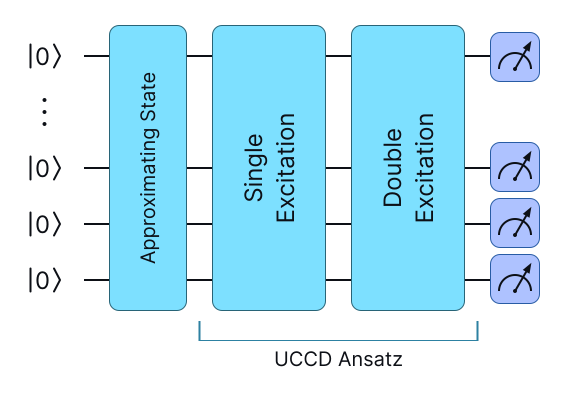
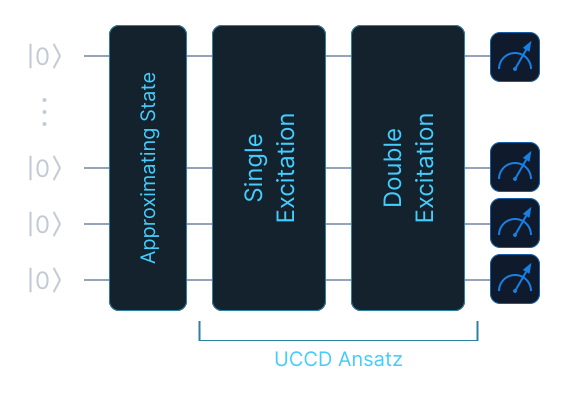

# Quantum Chemistry

`eigenkit.chemistry` computes ground-state energies. The process always has the
same four steps: build a fermionic Hamiltonian, map it onto qubits, choose an
ansatz, and minimise the energy with the Variational Quantum Eigensolver (VQE).
Each step is a separate function, so you can stop after any of them and inspect
the result.

Like `optimization` and `reservoir`, this package belongs to the core of the
library. It uses only NumPy and SciPy, and needs neither PyTorch nor a backend
package, so most of it runs on a bare installation. The exceptions are the
functions that call external chemistry software: `molecular_hamiltonian`,
`hydrogen_molecule` and `bravyi_kitaev`. They need the `chemistry` extra
(`pip install eigenkit[chemistry]`), which installs PySCF, OpenFermion and
openfermionpyscf.

## The whole process in one example

The two-site Fermi-Hubbard model, also called the Fermi-Hubbard dimer, is the
smallest model worth solving, and it needs no external software. This example
solves it from start to finish and compares the result with the exact answer:

```python
from eigenkit.chemistry import (
    VQE,
    exact_ground_state_energy,
    fermi_hubbard_dimer,
    jordan_wigner,
)

hamiltonian = fermi_hubbard_dimer(t=1.0, u=2.0)  # 6 fermionic terms
observable, offset = jordan_wigner(hamiltonian)  # 10 Pauli terms, offset 1.0

result = VQE(layers=3, restarts=5).solve(observable, 4, offset=offset)
exact = exact_ground_state_energy(observable, 4, offset=offset)

print(result.energy)  # -1.236068
print(exact)  # -1.236068
print(result.success)  # True
```

The model uses `4` qubits, two spin-orbitals per site. `VQE` uses
`provider="numpy"` by default, so this example runs with no optional
dependencies.

The rest of this page goes through the four steps one at a time.

## Building a Hamiltonian

A `FermionOperator` is a dictionary of fermionic terms and their coefficients.
Each term is a tuple of `(mode, kind)` pairs, where `kind` is `1` for a creation
operator and `0` for an annihilation operator. For example, `((0, 1), (2, 0))`
is `c†₀c₂`:

```python
from eigenkit.chemistry import FermionOperator, fermi_hubbard_dimer

hamiltonian = fermi_hubbard_dimer(t=1.0, u=2.0)

for term, coeff in hamiltonian.terms.items():
    print(term, coeff)
# ((0, 1), (2, 0))                  (-1+0j)   hopping between the two sites
# ((2, 1), (0, 0))                  (-1+0j)
# ((1, 1), (3, 0))                  (-1+0j)
# ((3, 1), (1, 0))                  (-1+0j)
# ((0, 1), (0, 0), (1, 1), (1, 0))   (2+0j)   on-site repulsion, u
# ((2, 1), (2, 0), (3, 1), (3, 0))   (2+0j)

# The same notation builds one by hand: c†₀c₁ + c†₁c₀
hopping = FermionOperator({((0, 1), (1, 0)): 1.0, ((1, 1), (0, 0)): 1.0})
print(len(hopping.terms))  # 2
```

`fermi_hubbard_dimer(t, u)` uses only NumPy. `t` is the hopping amplitude
between the two sites, and `u` is the on-site repulsion. Because it needs
nothing else, it is the right model to develop against.

For real molecules, `molecular_hamiltonian(geometry, basis=...)` runs PySCF and
OpenFermion, and `hydrogen_molecule(bond_length)` is a shortcut for `H₂`. Both
return a `Molecule`. A `Molecule` holds the fermionic operator, the number of
electrons and the nuclear repulsion energy, which are the values needed to turn
a converged VQE energy into a physical one:

```python
# Requires the `chemistry` extra: PySCF and OpenFermion.
from eigenkit.chemistry import hydrogen_molecule

molecule = hydrogen_molecule(bond_length=0.7414)
print(molecule.n_qubits, molecule.n_electrons)
```

## Mapping onto qubits

A fermionic operator cannot be measured directly, so it has to be rewritten
with Pauli operators. Both mappings return the same pair: an `Observable` and a
scalar `offset`:

```python
from eigenkit.chemistry import exact_ground_state_energy, jordan_wigner

observable, offset = jordan_wigner(hamiltonian)

print(len(observable.terms))  # 10
print(offset)  # 1.0
print(observable.terms[0])  # PauliTerm(coeff=-0.5, paulis=(('Y', 0), ('Z', 1), ('Y', 2)))
```

**The offset must always be passed.** It is the identity part of the
Hamiltonian. It contains no Pauli operator, so it is left out of the
observable. Pass it back in every time, otherwise every energy is wrong by a
constant:

```python
print(exact_ground_state_energy(observable, 4, offset=offset))  # -1.236068
print(exact_ground_state_energy(observable, 4))  # -2.236068
```

The two results differ by exactly `1.0`, and nothing in the wrong one looks
suspicious.

The two mappings have different dependencies, which is useful to know before
you choose one. `jordan_wigner` is implemented in eigenkit and needs nothing
else. `bravyi_kitaev` uses OpenFermion, and it raises `ModuleNotFoundError`
without the `chemistry` extra. Jordan-Wigner is the natural default.
Bravyi-Kitaev gives shorter Pauli strings for larger systems, at the cost of
that dependency:

```python
# Requires the `chemistry` extra: OpenFermion.
from eigenkit.chemistry import bravyi_kitaev

observable_bk, offset_bk = bravyi_kitaev(hamiltonian, n_qubits=4)
print(len(observable_bk.terms), offset_bk)
```

If you already work with OpenFermion, three functions convert between the two
libraries. `fermion_operator_from_openfermion` and
`to_openfermion_fermion_operator` convert fermionic operators in either
direction, and `observable_from_openfermion` turns an `openfermion.QubitOperator`
into the same `(Observable, offset)` pair that the mappings return. All three
need OpenFermion.

## Choosing an ansatz

The table compares the two ansätze that `VQE` supports: the hardware-efficient
ansatz, and the unitary coupled-cluster ansatz with single and double
excitations (UCCSD).

| | Hardware-efficient | UCCSD |
|---|---|---|
| When it is used | By default | When you pass it with `ansatz=` |
| How it is built | A layer of `RY` rotations, then `layers` repetitions of a chain of `CNOT` gates and a pair of rotations | Single and double excitations, with a Trotter approximation, on a Hartree-Fock reference |
| Why you would choose it | A device can run it | The chemistry of the problem suggests it |
| Weights on `4` qubits with `2` electrons | `20` with `layers=2` | `10` with `reps=2` |
| Depth | Shallow | Much deeper for the same number of parameters |
| Reference state | None: it starts from `|0…0⟩` | It adds `hartree_fock_state` at the start itself |

By default, `VQE` builds a hardware-efficient ansatz: a layer of `RY`
rotations, then `layers` repetitions of a chain of `CNOT` gates and a pair of
rotations. `hardware_efficient_ansatz` builds the same circuit on its own, and
`hartree_fock_state` builds the Hartree-Fock reference state that UCCSD starts
from. Both are useful to count the parameters before you start a run:

```python
from eigenkit.chemistry import hardware_efficient_ansatz, hartree_fock_state

print(hardware_efficient_ansatz(n_qubits=4, layers=2).n_weights)  # 20
print(hartree_fock_state(n_qubits=4, n_electrons=2).n_weights)  # 0, it is a fixed state
```

The ansatz designed for chemistry is `uccsd_ansatz`: a unitary coupled-cluster
ansatz, with a Trotter approximation, built on the Hartree-Fock reference. Pass
it explicitly:

```python
from eigenkit.chemistry import uccsd_ansatz

ansatz = uccsd_ansatz(n_qubits=4, n_electrons=2, reps=2)
result = VQE(restarts=3).solve(observable, 4, offset=offset, ansatz=ansatz)

print(ansatz.n_weights)  # 10
print(result.energy)  # -1.236068
```

{ .theme-image-light }
{ .theme-image-dark }

This figure draws the UCCSD column of the table above. The Hartree-Fock
reference state is on the left. Then come the single and double excitations
that `uccsd_ansatz` produces, with a Trotter approximation, and then the Pauli
measurements whose weighted sum is the energy that VQE minimises. `reps` is the
number of times the block of excitations is repeated. With one Trotter step, the
ansatz converges to the first excited level, and with two it reaches the ground
state.
{: .figure-caption }

The value of `reps` has a large effect. With `reps=1`, the ansatz has `5`
parameters and converges to `-1.0`. This is not a near miss: it is the *first
excited level* of this Hamiltonian, `0.236` above the ground state, and the
result reports `success=True`. The optimiser did converge, but one Trotter step
cannot reach the ground state. `reps=2` doubles the number of parameters and
reaches the exact energy.

For finer control, `apply_hartree_fock(circuit, n_electrons)` prepares the
reference state on a `CircuitBuilder` that you are already building, and
`uccsd_excitation_generators(n_qubits, n_electrons)` returns the generators
`T - T†` themselves (`5` of them for this system) if you want to build the
ansatz in a different way.

## Checking the answer

VQE gives an upper bound on the ground-state energy. For a system this small,
you can compute the true value and see how close the bound is.
`dense_hamiltonian` builds the matrix of the Hamiltonian, so the whole spectrum
is available, and not only the lowest level:

```python
import numpy as np
from eigenkit.chemistry import (
    dense_hamiltonian,
    fermi_hubbard_dimer_ground_energy,
)

matrix = dense_hamiltonian(observable, 4, offset=offset)

print(matrix.shape)  # (16, 16)
print(np.linalg.eigvalsh(matrix)[:3])  # [-1.236068 -1.  -1.]
print(fermi_hubbard_dimer_ground_energy(t=1.0, u=2.0))  # -1.236068
```

The second eigenvalue is where the UCCSD run with `reps=1` above stopped.
`exact_ground_state_energy` is the shortcut when only the lowest level is
needed. For this model, the analytic formula at half filling agrees with the
diagonalisation to the last digit, so three different methods give the same
number.

Add this check to any workflow, because **`success=True` only means that the
optimiser converged; it does not mean that the energy is correct**. Dense
diagonalisation becomes impractical at around `14` qubits, where the matrix
already needs about `4` gigabytes of memory. By then, you will have calibrated the
ansatz on smaller cases where the check was possible.

## API reference

::: eigenkit.chemistry
