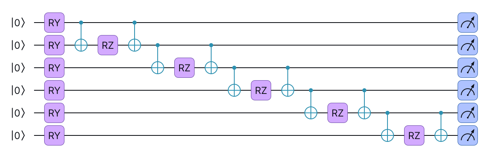
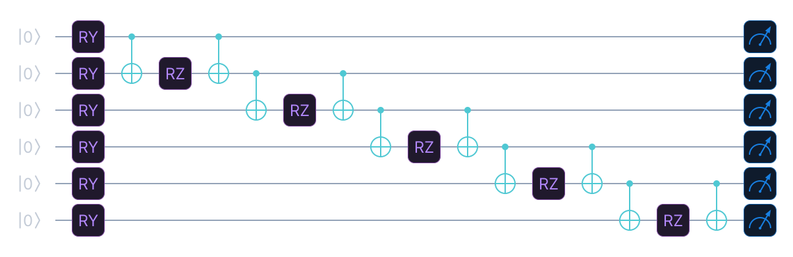
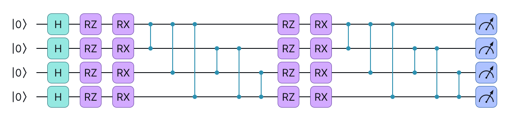
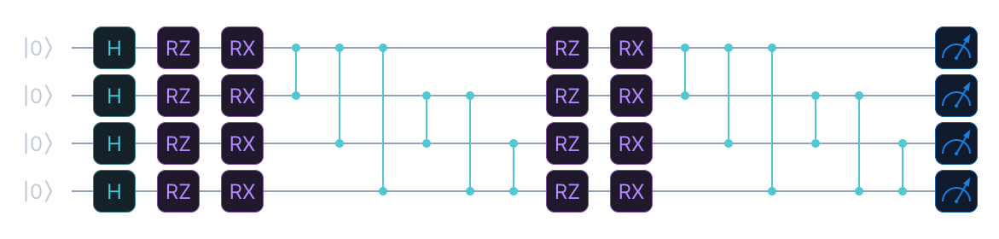

# Quantum Kernels

`QuantumKernel` computes a quantum kernel matrix based on fidelity, for use with
kernel methods such as support vector machines (SVMs), Gaussian processes and kernel
ridge regression. It works with any provider. The feature map is any circuit that you
write, or one of two built-in maps. The inverse half of the circuit is derived with
`adjoint()`. The Gram matrix comes from a contraction of statevectors on simulators,
or from the `zero_state_probability` primitive on shot-based and hardware backends.

It is defined in the **qml package** (`eigenkit.qml`), which does not use PyTorch,
and it is re-exported at the top level, which is where the examples below import it
from. It runs the inversion circuit on the NumPy interface, so it needs scikit-learn,
which the `qml` extra installs, and not PyTorch. It needs no provider extra either:
`provider` defaults to the built-in NumPy simulator, which every install has.

```python
import numpy as np
from eigenkit import QuantumKernel

qk = QuantumKernel(n_features=4, feature_map="AngleCNOT", reps=2)

X_train = np.random.randn(50, 4)
X_test = np.random.randn(20, 4)
y_train = (X_train[:, 0] > 0).astype(int)  # toy labels for the sklearn hand-off below

K_train = qk.compute_kernel_matrix(X_train)  # (50, 50)
K_test = qk.compute_kernel_matrix(X_test, X_train)  # (20, 50)
```

| Parameter | Type | Default | Description |
|---|---|---|---|
| `n_features` | `int` | Required | The number of features. For the built-in maps, it is also the number of qubits. |
| `feature_map` | `str`, `CircuitSpec`, `CircuitBuilder`, a block or blocks, or a callable | `"AngleCNOT"` | `"Angle"`, `"AngleCNOT"`, or a custom forward map `U(x; w)`. See [Custom feature maps](#custom-feature-maps). |
| `reps` | `int` | `2` | The number of repetitions of a built-in map. It is ignored for a custom map. |
| `provider` | `ProviderSpec` | `"numpy"` | The backend, with the same options as `Circuit(provider=...)`. |
| `weights` | array | `None` | The trainable weights of the feature map. `None` means zeros. |
| `scale` | `float` | `1.0` | The bandwidth: the inputs are multiplied by it before they are encoded. |
| `n_weights` | `int` | `None` | The number of weights that a callable map reserves. |
| `n_qubits` | `int` | `None` | The number of qubits of a callable map. It defaults to `n_features`. |
| `psd_projection` | `bool` | `False` | Whether to clip the negative eigenvalues of a Gram matrix with shot noise. |

## Feature maps

| `feature_map` | Description |
|---|---|
| `"Angle"` | Angle encoding only, without entanglement, which gives a product state. It uses `RX` on the first repetition and `RZ` on the next ones. |
| `"AngleCNOT"` | The same as `"Angle"`, plus a ladder of controlled-NOT (CNOT) gates before each repetition after the first. |

`reps` sets the depth of the feature map. `reps=1` uses only the `RX` embedding, and
`reps>=2` adds repetitions of the `RZ` embedding, with CNOT gates in between when
`feature_map="AngleCNOT"`.

`"Angle"` prepares a product state, so its kernel factorises into
`prod_q cos^2((x_q - x'_q) / 2)`, which is a classical kernel. Use an entangling map
when you want a kernel that a classical computer cannot write down in one line.

### Custom feature maps

Pass the forward map `U(x; w)` itself. The inversion circuit is derived with
`adjoint()`, and the two halves share the weights:

```python
from eigenkit import QuantumKernel


def zz_map(qc, x, w):
    """H, a data phase per qubit, and a ZZ interaction on each pair."""
    for q in range(len(x)):
        qc.h(q)
        qc.phase_shift(x[q], qubit=q)
    for a in range(len(x)):
        for b in range(a + 1, len(x)):
            qc.pauli_exponential([("Z", a), ("Z", b)], x[a])


qk = QuantumKernel(n_features=3, feature_map=zz_map)
qk.draw()  # the forward map; draw(inversion=True) for U(x1) U(x2)^dagger
qk.draw_mpl(style="eigen")
```

`feature_map` accepts a callable `emit(builder, x, w)` as above, a `CircuitSpec`, a
`CircuitBuilder`, a block such as `Encoding(3, rotation="RX")`, or a list of blocks.
The map must read exactly `n_features` inputs.

The circuits are public. `qk.feature_map_circuit` is the forward map `U(x; w)`,
`qk.circuit` is the inversion circuit that shot-based backends run, and
`qk.kernel_spec` is the `CircuitSpec` of the inversion circuit.
`qk.draw_mpl(inversion=True)` draws the circuit that a quantum processing unit (QPU)
runs for one entry of the kernel.

### Trainable kernels and kernel alignment

Give the map weights, and train them with `align_kernel`. It minimises the dual
objective of the SVM (`loss="svc"`, which is quantum kernel alignment), or minus the
kernel-target alignment (`loss="kta"`). By default, it uses simultaneous perturbation
stochastic approximation (SPSA):

```python
from eigenkit import QSVC, align_kernel


def trainable_map(qc, x, w):
    for q in range(len(x)):
        qc.ry(w[0], qubit=q)
    zz_map(qc, x, w)


kernel = QuantumKernel(n_features=4, feature_map=trainable_map, n_weights=1)
result = align_kernel(kernel, X_train, y_train, loss="svc", maxiter=20)
model = QSVC(kernel=result.kernel).fit(X_train, y_train)
result.loss_history  # plot it
```

`align_kernel` returns a `KernelAlignmentResult`. It holds the trained `weights`, a
`kernel` that carries them, the final `loss` and the `initial_loss`, the
`loss_history`, the number of kernel matrices computed (`n_evaluations`), and
`success`, which says whether the loss improved. Every evaluation of the loss computes
one Gram matrix. SPSA computes three per iteration, whatever the number of weights:
two for the estimate of the gradient, and one to record the loss. It computes one more
at the start. When `learning_rate=None`, the default, it also calibrates its first
step, which costs `10` more evaluations. It returns the best point that it visited.
`optimizer` also accepts the name of a `scipy.optimize.minimize` method, such as
`"COBYLA"`, or a callable `optimizer(fun, x0) -> x`, and `loss` accepts a callable
`loss(K, y) -> float`. The `"svc"` loss needs binary labels.

Both built-in losses also work on their own, to score a kernel without training it:

```python
from eigenkit.qml import kernel_target_alignment, svc_dual_loss

K_train = kernel.compute_kernel_matrix(X_train)
kernel_target_alignment(K_train, y_train)  # in [-1, 1]; higher is better
svc_dual_loss(K_train, y_train, C=1.0)  # the "svc" loss; lower is better
```

To evaluate a kernel with other weights, pass them at each call, or take a copy.
`kernel.compute_kernel_matrix(X, weights=w)` leaves the kernel unchanged, and
`kernel.with_weights(w)` returns a new kernel that carries `w`.

### Bandwidth

`scale` multiplies every input before it is encoded. Small values keep the states
close together, and they avoid the exponential concentration of kernel values that
wide and expressive maps suffer from. `QSVC(scale=...)` exposes the same setting to
`GridSearchCV`. Set it in one place only: when both `QSVC(scale=...)` and the
`scale` of the kernel are set, the two are multiplied.

## How the kernel value is computed

For two inputs `x_i` and `x_j`, the kernel value is the fidelity of the two state
preparations:

```text
K[i, j] = |<0...0| U^dag(x_j) U(x_i) |0...0>|^2
```

How this value is obtained depends on the backend, and the two ways differ in cost:

- **Backends that expose a statevector** (NumPy, PennyLane in analytic mode, Qiskit,
  Qiskit Aer, Qulacs, qsim). The whole Gram matrix comes from one batched state
  evolution and a single matrix product. This takes `O(N)` state evolutions, and no
  inversion circuit is involved. The kernel tries this way on first use, and keeps
  it when it works.
- **Shot-based and QPU backends** (Qiskit Runtime, IQM, Braket, PennyLane with
  shots). The kernel uses the inversion circuit: it applies `U(x_i)`, then the adjoint
  of `U(x_j)`, and reads the probability of the all-zeros state. On Qiskit Runtime
  and IQM, all the pairs go into one batched call, which is a single job. The other
  backends evaluate the pairs in smaller calls. A Gram matrix measures only the
  `N(N-1)/2` pairs above its diagonal.

A Gram matrix with shot noise can have small negative eigenvalues.
`QuantumKernel(psd_projection=True)` clips them, and `project_psd(K)` from
`eigenkit.qml` does the same to any matrix.

The circuits are compiled the first time they are used, so building or cloning a
kernel never transpiles or submits anything.

## On hardware

```python
from eigenkit import QiskitRuntimeConfig

X_small = X_train[:8, :2]  # a few points, two features for the 2-qubit map
qk = QuantumKernel(
    n_features=2,
    feature_map="AngleCNOT",
    provider=QiskitRuntimeConfig(
        backend_name="ibm_fez", primitive="sampler", shots=1000, seed_transpiler=0
    ),
)
qk.estimate_cost(X_small)  # circuits, jobs, shots, transpiled 2q gates
qk.circuit.resources()  # depth, 2q count, routing, est. success
job = qk.submit_kernel_matrix(X_small)
job.save("kernel_job.json")  # job id + pair layout
K = job.result()  # or, later: qk.retrieve_kernel_matrix("kernel_job.json").result()
```

`submit_kernel_matrix()` returns a `KernelJob` without waiting for the device. The
job has `job_id()`, `status()`, `result()`, which waits and then assembles the matrix,
and `save(path)`, which writes the job identifier and the layout of the pairs.
`qk.retrieve_kernel_matrix(path)` attaches to the job again from another session, and
returns a `KernelJob` again. With a bare job identifier in place of the saved file,
also pass the size of the matrix: `n_x` for a Gram matrix, and also `n_y` for a test
matrix. Attaching again needs a device looked up through the service, because fake
backends and Aer keep no history of jobs.

The same code runs on IQM with `IQMConfig(...)`. It also runs locally on fake devices
(`backend_instance=FakeFez()`, `IQMFakeGarnet()`), or on a noiseless `AerSimulator()`
to see the shot noise alone.

## Choosing a backend

The same `provider=` argument as in `Circuit` works here, and it defaults to
`"numpy"`, the built-in reference simulator, which every install has. A kernel entry
is a fidelity, so every backend returns the same number. What changes is how fast it
arrives, and what has to be installed. Name any other registered provider to switch:

```python
# The default: no extra dependencies.
qk = QuantumKernel(n_features=4, feature_map="Angle", reps=1)

# Any other registered provider works the same way, once its extra is
# installed:
qk = QuantumKernel(n_features=4, feature_map="Angle", reps=1, provider="pennylane")
```

The results agree to machine precision across the NumPy simulator, PennyLane, Qiskit
and Braket. CUDA Quantum also works, as long as the feature map does not need
parameter expressions that it does not support.

## Use with scikit-learn estimators

`QuantumKernel` is the kernel behind `QSVC` and `QSVR`, which pass it to
scikit-learn's `SVC(kernel="precomputed")` and `SVR(kernel="precomputed")`. Pass any
kernel, whether custom, trained or on hardware, with `QSVC(kernel=qk)`. It survives
`clone`, `GridSearchCV`, `Pipeline`, and saving and loading as `.eigenkit`. You can
also give `K_train` and `K_test` to any scikit-learn estimator that supports
precomputed kernels:

```python
from sklearn.svm import SVC

clf = SVC(kernel="precomputed", C=1.0)
clf.fit(K_train, y_train)
predictions = clf.predict(K_test)
```

## Direct use of `zero_state_probability`

For kernels, pass a hand-built map to `QuantumKernel(feature_map=...)`, as shown
above. This section shows the primitive underneath, for quantities based on fidelity
other than kernels.

{ .theme-image-light }
{ .theme-image-dark }

One such map: `RY(x_q)` embeds one feature per qubit, then a `CNOT-RZ-CNOT` block acts
on each pair of neighbouring qubits, which is the usual way to write a two-qubit
interaction into a feature map. It has six qubits, six features and one repetition.
{: .figure-caption }

{ .theme-image-light }
{ .theme-image-dark }

Another map, with two repetitions: a layer of Hadamard gates, `RZ` and `RX` rotations
that carry the data, and `CZ` gates across every pair of qubits instead of along a
ladder, then the rotations and the entangling gates once more. Neither of these two
maps is `"Angle"` or `"AngleCNOT"`. Both are the kind of map that you build with
`CircuitBuilder` and pass to `QuantumKernel(feature_map=...)`.
{: .figure-caption }

For custom observables based on fidelity (swap tests, the Bures distance and so on),
call `circuit.zero_state_probability(weights, inputs)` directly. It returns the
probability of the all-zeros state without going through the Pauli machinery:

```python
from eigenkit import Circuit, CircuitBuilder
from eigenkit.core.ir import Negate

qc = CircuitBuilder(n_qubits=2)
x = qc.add_inputs(2)
for q in range(2):
    qc.rx(x[q], qubit=q)
for q in reversed(range(2)):
    qc.rx(Negate(x[q]), qubit=q)
spec = qc.build()

circuit = Circuit(blocks=spec)
# The inversion circuit has no trainable weights, so pass an empty weight vector.
print(circuit.zero_state_probability([], [0.4, -0.2]))  # ~1.0 (U U^dag)
```

## API reference

::: eigenkit.qml._kernels.QuantumKernel

::: eigenkit.qml._kernels.KernelJob

::: eigenkit.qml._alignment.align_kernel

::: eigenkit.qml._alignment.KernelAlignmentResult

::: eigenkit.qml._alignment.kernel_target_alignment

::: eigenkit.qml._alignment.svc_dual_loss

::: eigenkit.qml._kernels.project_psd
