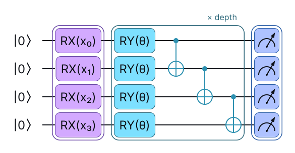
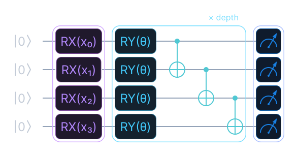
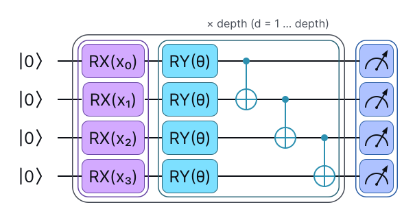
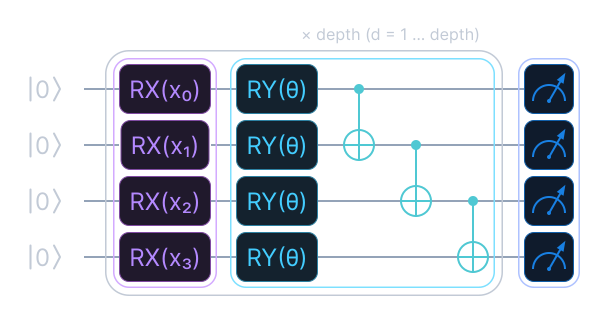
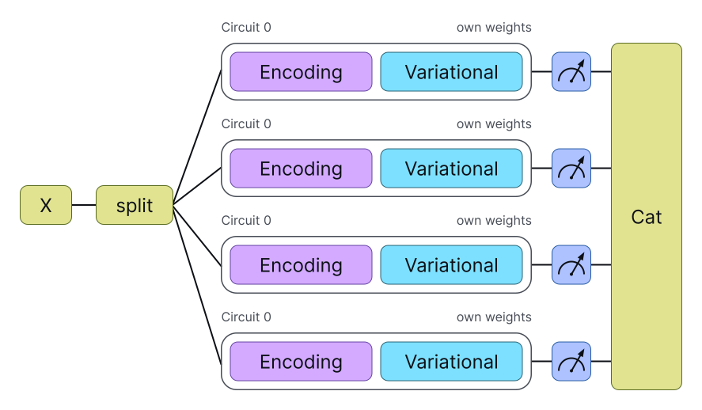
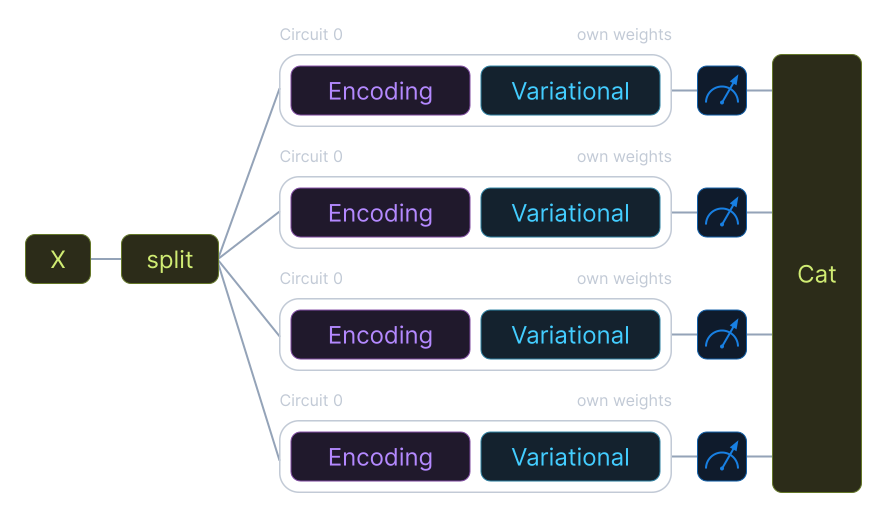

# Layers

Four `nn.Module` layers cover the usual patterns, and they can all be used inside
`nn.Sequential`. Most of these layers expose `in_features` and `out_features`.
`MinMaxNorm` uses `feature_dim`.

The three layers that build a circuit, `Basic`, `Reupload` and
`Ensemble`, take the same `provider=` argument as `Circuit`, and they pass it to the
circuit unchanged.
`MinMaxNorm` is classical arithmetic and has no circuit to run, so it does not take
the argument, and passing it raises a `TypeError`.

The same three layers return the provider on `.provider`, as the resolved backend,
whichever form was passed in. `.provider.name` is its registered name:

```python
from eigenkit import Basic, PennyLaneConfig

layer = Basic(n_qubits=4, depth=2, provider=PennyLaneConfig())
layer.provider.name  # "pennylane"
```

| Layer | Pattern |
|---|---|
| `Basic` | One encoding, one variational block, and a measurement of each qubit. |
| `Reupload` | Standard data reuploading, optionally with a trainable scale. |
| `Ensemble` | `N` independent circuits, one for each chunk of the input. |
| `MinMaxNorm` | Min/max normalisation of each feature, in the style of batch normalisation. |

## `Basic`

`Basic` is the thinnest wrapper around `Circuit`: one encoding, one variational
block, and a measurement of each qubit. Use it for textbook variational classifiers
and regressors, where `n_features == n_qubits`.

```python
import torch
from eigenkit import Basic

# Defaults: RX encoding, RY variational, Z basis, which are three different axes.
layer = Basic(n_qubits=4, depth=2)
out = layer(torch.randn(8, 4))  # shape (8, 4)
```

{ .theme-image-light }
{ .theme-image-dark }

The circuit that this call builds. `RX(x_i)` encodes one feature per qubit. Then the
`basic` variational block, which is one `RY(θ)` per qubit followed by the ladder of
controlled-NOT (CNOT) gates, repeats `depth` times, and every qubit is measured in
`Z`. These three axes are the defaults. With `variational_type="strong"`, each
`RY(θ)` box becomes the three rotations `RZ`, `RY` and `RZ`.
{: .figure-caption }

!!! warning "Some combinations of axes make the circuit inert"

    Some choices of `enc_rotation`, `var_rotation` and `basis` build a circuit whose
    weights, or whose input, provably cannot reach the output. All three layers check
    for this and issue a `UserWarning` that names the reason. The layer is still
    built, because you may want to build a degenerate circuit on purpose, as a
    baseline.

    There are three ways to get one:

    - **The weights commute with the observable.** With `variational_type="basic"`
      and `var_rotation` on the measurement axis (`RZ` with `basis="Z"`, or `RX` with
      `basis="X"`), the rotations and the CNOT ladder both preserve that group of
      Pauli operators. The weights then cancel out of the expectation value, and
      every gradient is exactly `0`. Rotate away from the measurement axis, or use
      `variational_type="strong"`, whose three rotations `RZ`, `RY` and `RZ` always
      include one away from the axis.
    - **`RZ` encoding.** The circuit starts in `|0...0⟩`, which every `RZ` leaves
      unchanged up to a phase, so the input never enters. `Reupload` escapes this
      once it encodes again, because the second encoding acts on a state that has
      already moved. `Basic` and `Ensemble` encode only once, so they do not escape
      it.
    - **A real circuit measured in `Y`.** `RY` and CNOT are real matrices, so an `RY`
      encoding with `RY` rotations keeps the statevector real, and `⟨Y⟩` is always
      `0` on a real state.

    Sharing an axis is not a problem in itself. `RY` rotations with `basis="Y"` train
    well on two qubits or more, because the CNOT ladder does not preserve strings of
    `Y` operators.

## `Reupload`

`Reupload` is standard data reuploading in a single circuit. The input is encoded
again `depth` times, with new variational weights between the encodings. Set
`trainable_scale=True` to add a trainable scale for each pair of layer and feature
(Schuld et al. 2021).

Here, `in_features == n_qubits`.

```python
from eigenkit import Reupload

# Encoding on RX, variational on RY: same rule as Basic.
layer = Reupload(n_qubits=4, depth=3, enc_rotation="RX", trainable_scale=True)
out = layer(torch.randn(8, 4))  # shape (8, 4)
```

{ .theme-image-light }
{ .theme-image-dark }

What distinguishes this layer from `Basic` is where the outer bracket starts. It
covers the encoding as well as the variational block, so the input is encoded again
at each repetition, with new weights. The circuit is drawn with `enc_rotation="RX"`,
as in the call above, and without the trainable scale. With `trainable_scale=True`,
each `RX(x_i)` becomes `RX(λ·x_i)`, with one trainable `λ` for each pair of layer and
feature.
{: .figure-caption }

Keep `enc_rotation` and `var_rotation` on different axes here too. When they share
one, each `R(x)` and the `R(θ)` that follows it combine into a single `R(x + θ)`, and
the variational weights of that layer become a plain offset of the data angle. The
defaults of `Reupload` put both rotations on `RY`, so pass `enc_rotation`
explicitly, as in the call above.

## `Ensemble`

`Ensemble` runs `N` independent circuits, one for each chunk of the input, each with
its own weights. The outputs are concatenated along the feature dimension.

```python
from eigenkit import Ensemble

layer = Ensemble(in_features=20, n_qubits=4, depth=5)
out = layer(torch.randn(128, 20))  # shape (128, 20): 5 circuits * 4 qubits
```

{ .theme-image-light }
{ .theme-image-dark }

The input is split into chunks of `n_qubits` features, and each chunk gets its own
circuit, with its own weights and its own measurement. The outputs of the circuits
are concatenated back into one feature vector. Nothing is shared between the
branches: no statevector and no parameters. Four branches are drawn, while the call
above has five. Note also that on this layer, the variational block defaults to
`variational_type="strong"`, not `"basic"`.
{: .figure-caption }

## `MinMaxNorm`

`MinMaxNorm` normalises each feature with its minimum and maximum, and keeps running
statistics. It is useful before encoding rotations, which expect bounded angles.

```python
import torch
from eigenkit import MinMaxNorm

norm = MinMaxNorm(feature_dim=16, min_val=0.0, max_val=torch.pi)
```

In training mode, it uses the minimum and maximum of each batch, and it updates an
exponential moving average of them (`momentum=0.1` by default). In evaluation mode, it
uses the running statistics. The output is clamped to `[min_val, max_val]`, to guard
against outliers that were not seen in training.

## API reference

::: eigenkit.torch.layers
