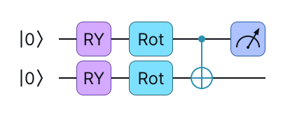
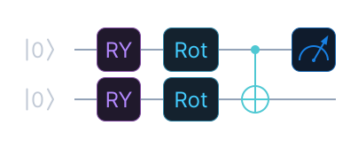

# Variational

These blocks are trainable, parametrised layers. There are two kinds:

- `Variational` applies rotations about one axis and a ladder of controlled-NOT
  (CNOT) gates, repeated `depth` times.
- `StrongVariational` applies the rotations `RZ`, `RY` and `RZ` and a ladder of CNOT
  gates, repeated `depth` times.

```python
from eigenkit import Variational, StrongVariational

basic = Variational(depth=2, rotation="RY")
strong = StrongVariational(depth=2)
```

## `Variational`

| Parameter | Type | Default | Description |
|---|---|---|---|
| `depth` | `int` | Required | The number of repetitions. |
| `rotation` | `"RX"` \| `"RY"` \| `"RZ"` | `"RY"` | The rotation gate applied to each qubit in each repetition. |

Each repetition applies one rotation to each qubit, followed by a ladder of CNOT
gates (`CNOT(0, 1), CNOT(1, 2), ...`). The total number of trainable weights is
`depth * n_qubits`.

{ .theme-image-light }
{ .theme-image-dark }

The block is the middle box: one `RY(θ)` on every qubit, then
`CNOT(0, 1), CNOT(1, 2), ...`, and the bracket shows how many times this repeats. The
encoding on the left and the measurement of each qubit on the right are not part of
the block. A layer such as [`Basic`](layers.md#basic) adds them around it.
{: .figure-caption }

## `StrongVariational`

| Parameter | Type | Default | Description |
|---|---|---|---|
| `depth` | `int` | Required | The number of repetitions. |

Each repetition applies `RZ`, `RY` and `RZ` to every qubit, followed by a ladder of
CNOT gates. The total number of trainable weights is `3 * depth * n_qubits`.

{ .theme-image-light }
{ .theme-image-dark }

The same picture with `strong` in place of `basic`, on two qubits. Each `Rot` box is
the three rotations `RZ`, `RY` and `RZ`, so it has three weights where `Variational`
has one, and the CNOT ladder after it is unchanged. It is drawn after an `RY`
encoding, with a single expectation value measured on the first qubit.
{: .figure-caption }

`StrongVariational` is more expressive than `Variational` at the same depth, but it
has three times as many parameters. The block adds all the `RZ` gates, then all the
`RY` gates, then all the `RZ` gates, in place of three rotations per qubit in turn.
This lets the backends that work layer by layer apply each layer of rotations in one
fast call.

## Choosing the depth

Each repetition uses a new set of trainable weights. A larger depth gives more
expressivity, but it adds parameters and makes training slower.

```python
# Minimal expressivity, fast training.
Variational(depth=1, rotation="RY")

# More expressive; useful for harder classification tasks.
Variational(depth=3, rotation="RY")
```

!!! note "`depth` must be positive"

    Both blocks check it when they are created: `Variational(depth=0)` and
    `StrongVariational(depth=0)` raise
    `ValueError: depth must be positive, got 0`, and so does any negative value.
    `Variational` also checks `rotation` at that point. `Reuploading` makes the same
    checks on `depth`, `in_features` and both of its rotation arguments.

## API reference

::: eigenkit.configs.Variational
::: eigenkit.configs.StrongVariational
